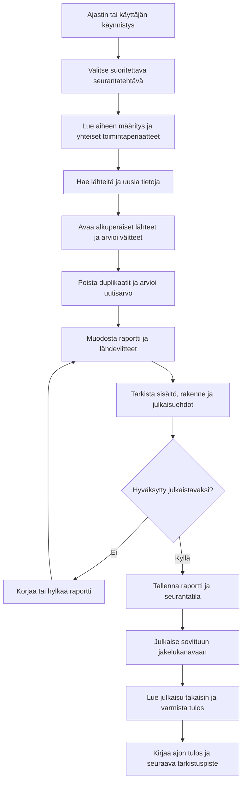
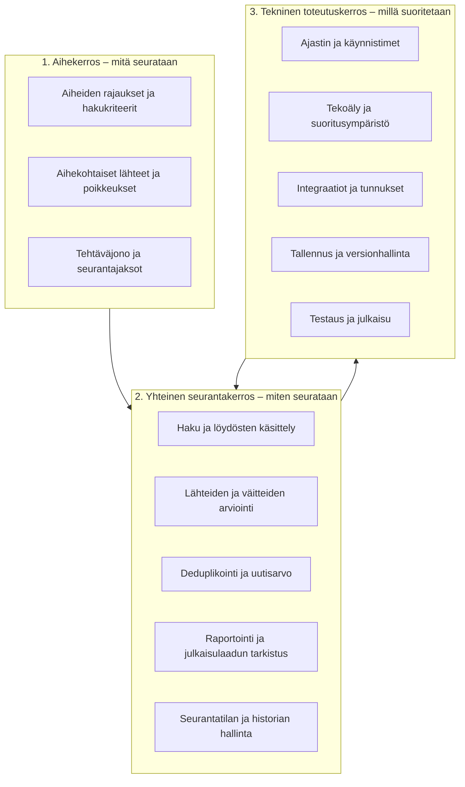
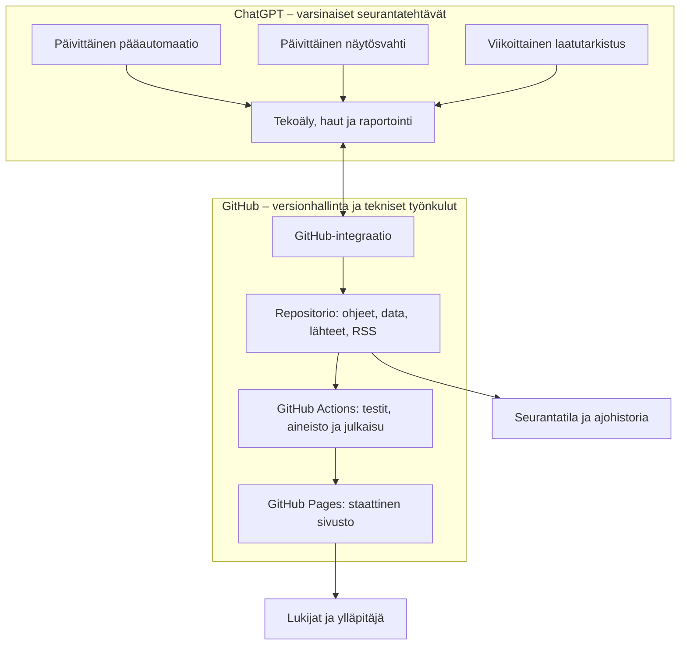
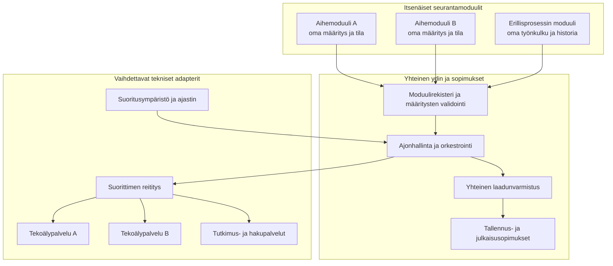
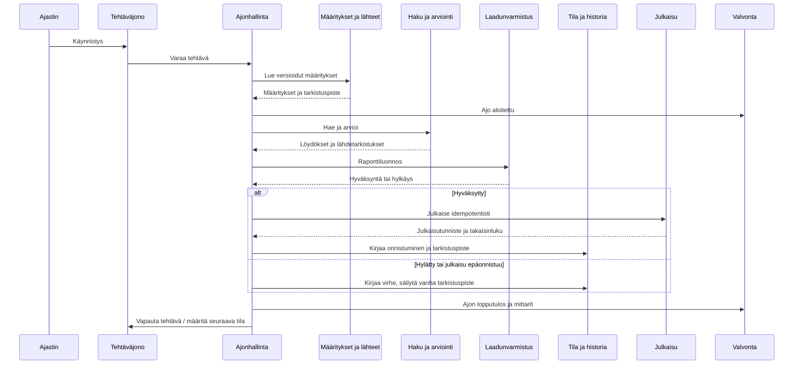

# Aiheseuraimen järjestelmäarkkitehtuuri

**Tarkoitus:** kuvata ensin Aiheseuraimen toimintamalli ilman sidosta yksittäiseen palveluun ja sen jälkeen nykyinen ChatGPT- ja GitHub-toteutus.  
**Nykytilan tarkistus:** 19.11.2026  
**Versio:** 1.18.1  
**Liittyvät kehitystehtävät:** [#75 – Dokumentoi Aiheseuraimen järjestelmäarkkitehtuuri ja teknologioiden vaihdettavuus](https://github.com/mikknikk/aiheseurain/issues/75), [#100 – Täsmennä tavoitearkkitehtuurin aihemoduulien itsenäisyys ja vaihdettavuus](https://github.com/mikknikk/aiheseurain/issues/100), [#102 – Määrittele seurantamoduulien tietosopimus ja määritysskeemat](https://github.com/mikknikk/aiheseurain/issues/102), [#103 – Toteuta seurantamoduulien rekisteri ja määritysten lataus](https://github.com/mikknikk/aiheseurain/issues/103), [#104 – Suunnittele nykyisten aiheiden ja prosessien hallittu moduulisiirtymä](https://github.com/mikknikk/aiheseurain/issues/104), [#105 – Siirrä nykyiset aiheet ja näytösvahti itsenäisiin moduulimäärittelyihin](https://github.com/mikknikk/aiheseurain/issues/105), [#106 – Eriytä seurantamoduulien tila, tarkistuspisteet ja tapahtumahistoria](https://github.com/mikknikk/aiheseurain/issues/106), [#107 – Määrittele tekoäly- ja tutkimuspalvelujen adapterisopimukset](https://github.com/mikknikk/aiheseurain/issues/107), [#108 – Rakenna yhteinen moduulien suoritusorkestrointi](https://github.com/mikknikk/aiheseurain/issues/108), [#109 – Yleistä nykyinen näytösvahti uudelleenkäytettäväksi tapahtumavahdiksi](https://github.com/mikknikk/aiheseurain/issues/109), [#142 – Rajaa julkaisureititys yhteen RSS-syötteeseen seurantakohdetta kohti](https://github.com/mikknikk/aiheseurain/issues/142), [#144 – Erota käyttöliittymätestit seurantajulkaisujen pakollisista tarkistuksista](https://github.com/mikknikk/aiheseurain/issues/144), [#169 – Määrittele Aiheseurannan yleinen ja versioitu julkaisupakettisopimus](https://github.com/mikknikk/aiheseurain/issues/169), [#167 – Rakenna Aiheseurannan yleisen vastaanottorajapinnan eristetty prototyyppi](https://github.com/mikknikk/aiheseurain/issues/167), [#170 – Perusta Aiheseuranta-julkaisurepositorio ja rajatut käyttöoikeudet](https://github.com/mikknikk/aiheseurain/issues/170)

## 1. Järjestelmän tarkoitus ja rajat

Aiheseurain on aiheohjattu tiedonkeruu-, arviointi-, raportointi- ja julkaisujärjestelmä. Se seuraa useita toisistaan erotettuja aiheita, etsii niihin liittyviä uusia tapahtumia, arvioi lähteitä ja väitteitä, muodostaa suomenkielisiä raportteja sekä säilyttää seurannan tilaa ja julkaistua historiaa.

Järjestelmän suunnitteluperiaate on erottaa toisistaan:

1. **Mitä seurataan:** aiheet, rajaukset, hakukriteerit, lähteet ja aihekohtaiset erityissäännöt.
2. **Miten seuranta tehdään:** yhteinen haku-, arviointi-, varmennus-, raportointi- ja jatkotoimintamalli.
3. **Millä tekniikalla se tehdään:** ajastin, tekoälypalvelu, suoritusympäristö, integraatiot, tallennus, testaus ja julkaisu.

Erottelu mahdollistaa aiheiden kehittämisen ilman, että jokainen muutos vaatii teknisen järjestelmän uudelleenohjelmointia. Se myös rajaa aihekohtaisen poikkeuslogiikan vaikutukset kyseiseen aiheeseen. Tavoitearkkitehtuurissa tämä viedään moduulitasolle: jokainen aihe tai erillinen seurantaprosessi on itsenäinen kokonaisuus, jonka voi liittää yhteiseen ytimeen sovitulla sopimuksella.

## 2. Järjestelmäriippumaton toimintamalli

Seuraava prosessi kuvaa toiminnalliset vaiheet riippumatta siitä, mikä ajastin, tekoälypalvelu tai ohjelmisto ne suorittaa.

### 2.1 Vaiheiden vastuut

- **Käynnistys ja tehtävän valinta:** ajastin tai käyttäjä käynnistää oikean tehtävän. Tehtävän valinta perustuu määriteltyyn jonoon tai erillisen prosessin omaan aikatauluun.
- **Määritysten lukeminen:** suorittaja lukee tehtävän rajauksen, aiheen lähteet, yhteiset toimintaperiaatteet ja edellisen onnistuneen tarkistuspisteen.
- **Tiedonhaku:** lähteitä haetaan useilla aiheeseen sopivilla kielillä ja alueilla. Rekisteröity lähdelista on hakujen lähtökohta, ei suljettu luettelo.
- **Arviointi ja varmennus:** alkuperäiset julkaisut avataan, väitteet erotetaan lähteiden tulkinnoista ja epävarmuudet kirjataan. Lähteen yleinen luotettavuus ja yksittäisen väitteen varmennus ovat eri asioita.
- **Raportointi:** vain olennaiset uudet tai muuttuneet tapahtumat raportoidaan. Raporttiin liitetään lähteet ja tarkasteltu ajanjakso.
- **Laadunvarmistus:** tarkistetaan toimitukselliset ehdot sekä koneellisesti tarkistettavat rakenteet. Automaattinen skeema- tai XML-testi ei todista väitteen totuutta.
- **Tallennus ja julkaisu:** raportti, ajokohtainen tila ja julkaisu tallennetaan sovittuihin tietolähteisiin. Julkaisun jälkeen sisältö luetaan takaisin.
- **Jäljitettävyys:** onnistunut tarkistus kirjataan vasta, kun vaaditut haut, kirjoitukset ja takaisinlukutarkistukset on tehty.

Prosessi ei edellytä RSS:ää jakelumuotona. RSS on nykyinen julkaisutapa; toinen järjestelmä voisi tuottaa saman sisällön esimerkiksi verkkosivulle tai rajapintaan, kunhan lähteet, ajanjakso ja raporttihistoria säilyvät.

## 3. Kolme arkkitehtuurikerrosta

### 3.1 Aihekerros

Aihekerros määrittelee seurannan kohteen, ei sitä, millä ohjelmistolla seuranta tehdään. Aihekohtaisia määrityksiä ovat esimerkiksi:

- aiheen sisältörajaukset, nimivariantit ja hakusanat;
- kieli- ja aluepainotukset;
- aihekohtaiset lähdevalinnat ja lähteiden käyttörajoitteet;
- uutisarvon ja mukaan ottamisen erityissäännöt;
- erillistä prosessia edellyttävät tehtävät.

Nykyisessä repositoriossa aihekohtaiset ohjeet ovat `docs/`-hakemiston dokumenteissa. Yhteiset lähdetiedot ovat `data/source-catalog.json`-tiedostossa ja tehtäväkohtaiset lähdekäyttövalinnat `data/sources/{task_id}.json`-tiedostoissa. Yhdeksän aihekierroksen järjestys on `docs/tehtavajono.md`-tiedostossa ja sen koneellisesti ylläpidetty rinnakkaistieto on `data/seurantatila.json`-tiedostossa.

Tavoitetilassa aiheiden rajaukset, hakusanat, kieli- ja aluevalinnat sekä lähdeviittaukset voidaan pitää rakenteisina määrityksinä. Kaikkea ei kuitenkaan pidä pakottaa yhteen skeemaan: esimerkiksi intialaisten elokuvien näytösvahti on erillinen prosessi, koska sillä on oma päivittäinen näytöslogiikka, tapahtumahistoria ja jakelusyöte. Tavoitetilassa kumpikin mallinnetaan omana moduulinaan. Nykyiset erilliset dokumentit ja JSON-rekisterit ovat tähän siirtymisen lähtöaineistoa, eivät vielä todiste valmiista moduulirajapinnoista.

### 3.2 Yhteinen seurantakerros

Yhteinen seurantakerros vastaa siitä, että eri aiheet käsitellään yhdenmukaisilla laadun ja jäljitettävyyden periaatteilla. Se ei saa sisältää yksittäiseen aiheeseen sidottuja oletuksia.

Yhteisiä sääntöjä ovat muun muassa:

- seurantajakson määrittely edellisen kyseisen aiheen onnistumisen perusteella;
- alkuperäisten lähteiden avaaminen ja lähteiden riippumattomuuden arviointi;
- lähteen luotettavuusluokan erottaminen väitekohtaisesta varmennuksesta;
- duplikaattien poistaminen ja uutisarvon arviointi;
- suomenkielisen raportin ja kuvaavien lähdeviitteiden muodostaminen;
- julkaisua edeltävä tarkistus ja julkaistun sisällön takaisinluku;
- onnistuneen tarkistuspisteen sekä virheiden ja epävarmuuksien kirjaaminen.

Nykyiset ensisijaiset ohjeet ovat `docs/seuranta.md`, `docs/luotettavuusluokitus.md`, `docs/julkaisuportti.md` ja saavutettavuuden osalta `docs/saavutettavuus.md`. Näitä ei pidä kopioida aihekohtaisiin ohjeisiin kokonaisuudessaan, vaan aiheohjeiden tulee viitata yhteisiin sääntöihin.

### 3.3 Tekninen toteutuskerros

Tekninen kerros käynnistää ja suorittaa prosessin, välittää haut ja kirjoitukset, säilyttää tiedot, validoi rakenteet ja julkaisee tulokset. Se ei määrittele, mitä uutisia yksittäisestä aiheesta etsitään.

Nykyisessä toteutuksessa tekninen kerros jakautuu useaan palveluun ja komponenttiin:

- ChatGPT:n ajastetut tehtävät käynnistävät varsinaiset seurantavuorot.
- ChatGPT:n tekoäly ja käytettävissä olevat työkalut suorittavat tiedonhaun, lähteiden arvioinnin ja raportoinnin.
- GitHub-integraatio välittää repositorion luku- ja kirjoitustoiminnot.
- GitHub-repositorio säilyttää ohjeet, lähderekisterit, seurantatilan, raportit ja RSS-syötteet.
- GitHub Actions suorittaa repositorion testit, erilliset tekniset työnkulut ja Pages-julkaisun.
- GitHub Pages julkaisee staattisen verkkosivuston, RSS-syötteet ja julkiset JSON-tietolähteet.

## 4. Nykyinen tekninen toteutus

### 4.1 Varsinaiset seurantatehtävät

Nykyisessä toteutuksessa on kolme erillistä ChatGPT:n ajastettua tehtävää:

1. **Pääautomaatio:** käsittelee päivittäisellä ajollaan yhden yhdeksästä aihekierron tehtävästä.
2. **Intialaisten elokuvien näytösvahti:** erillinen päivittäinen prosessi, joka etsii Suomessa järjestettäviä näytöksiä ja ylläpitää näytöshistoriaa sekä omaa RSS-syötettä.
3. **Viikoittainen järjestelmän laatutarkistus:** auditointiprosessi, joka tarkistaa dokumentaation, tietomallit, RSS-syötteet, testit ja automaatioiden hallinnan. Se ei ole uutishaku eikä korjaava ylläpitoprosessi.

Jokaisella on oma GitHubissa ylläpidetty käsikirjansa ja kanoninen käynnistyskehotteensa:

| Tehtävä | Ensisijainen käsikirja | Käynnistyskehote |
|---|---|---|
| Pääautomaatio | `docs/paaautomaation-ohje.md` | `prompts/paauutisseuranta.txt` |
| Näytösvahti | `docs/intialaisten-elokuvien-naytosseuranta.md` | `prompts/naytosvahti.txt` |
| Laatutarkistus | `docs/laatutarkistuksen-ohje.md` | `prompts/laatutarkistus.txt` |

Käynnistyskehote on lyhyt aloitusohje, ei automaation täydellinen toimintamäärittely. Ohjeiden versionumerot ja käynnistyskehotteiden tunnisteet tarkistetaan `data/seurantatila.json`-tiedoston avulla. GitHubiin tallennettu käynnistyskehote ei kuitenkaan päivity automaation asetuksiin itsestään; tekstin kopiointi ja asetusten täsmäytys ovat erillisiä toimenpiteitä.

### 4.2 Ajastus ja käynnistysvastuut

Varsinaiset kolme seurantatehtävää käynnistää ChatGPT:n ajoitettujen tehtävien palvelu. Niiden tehtäväasetukset – aktiivisuus, tarkka aikataulu, aikavyöhyke, käynnistysohje ja kohdekeskustelu – sijaitsevat ChatGPT:n automaatioasetuksissa, eivät GitHub-repositorion tiedostoissa.

GitHubissa olevat käsikirjat kuvaavat odotettua rytmiä seuraavasti: pääautomaatio päivittäin noin klo 12.00 Europe/Helsinki, näytösvahti päivittäin noin klo 05.00 Europe/Helsinki ja laatutarkistus kerran viikossa. Nämä ovat käsikirjoihin kirjattuja odotuksia. **Tässä dokumentointikatselmuksessa ei luettu ChatGPT:n tallennettuja tehtäväasetuksia, joten tarkkoja asetettuja kellonaikoja, aikavyöhykkeitä, aktiivisuutta tai kohdekeskusteluja ei väitetä erikseen varmennetuiksi.**

GitHub-tiedostoista ei voi päätellä ChatGPT:n ajastuksen todellista asetusta. Jos ajastus halutaan myöhemmin tarkistaa tai muuttaa, se tehdään erikseen ChatGPT:n tehtäväasetuksissa ja vain käyttäjän nimenomaisella valtuutuksella. GitHubiin tehty dokumentaatiomuutos ei muuta tehtävän asetuksia.

### 4.3 GitHub-integraatio

ChatGPT:n GitHub-integraatio tarjoaa suorittajalle repositorion luku- ja kirjoitustoiminnot. Nykyisessä työnkulussa sitä käytetään muun muassa tiedostojen lukemiseen, dokumenttien ja seurantatietojen päivittämiseen, issueiden käsittelyyn sekä muutosten viemiseen haaroihin ja pull requesteihin.

Integraation tarkka käyttöoikeusjoukko ja käyttäjän valitsemat käytettävissä olevat repositoriot ovat GitHub-sovelluksen ja ChatGPT-yhteyden asetuksia. Ne eivät ole tämän repositorion tiedostoista kokonaan todennettavissa. Siksi tässä ei väitetä, että integraatiolla olisi kaikki GitHub-sovelluksen teknisesti mahdolliset oikeudet. Käyttöoikeudet tulee rajata vain tarvittaviin repositorioihin ja toimintoihin.

GitHub-integraatio ja GitHub Actionsin `GITHUB_TOKEN` ovat eri tunnistusmekanismeja. Integraation kautta tehtävä käyttäjän puolesta tehtävä repositoriotyö ei ole sama asia kuin Actions-työnkulun oma rajattu token.

### 4.4 GitHub-repositorio ja tallennus

Repositorio `mikknikk/aiheseurain` on nykyisen toteutuksen versionhallittu tietovarasto ja julkaisun lähde. Sen keskeiset vastuut ovat:

| Sijainti | Sisältö ja vastuu |
|---|---|
| `docs/` | Ihmiselle ja automaatioille tarkoitetut ensisijaiset ohjeet, seurannan historia ja tietomallien kuvaukset |
| `prompts/` | ChatGPT:n tehtäväasetuksiin kopioitavat kanoniset käynnistyskehotteet |
| `data/source-catalog.json` | Lähteiden yhteiset perustiedot |
| `data/sources/*.json` | Aihe- tai tehtäväkohtaiset lähdekäyttörekisterit |
| `data/seurantatila.json` | Aihekierron, viimeisimpien onnistumisten ja ohjeversioiden koneellisesti luettava tila |
| `data/lahdetarkistukset.json` | Ajokohtaiset lähteiden tarkistustulokset ja kattavuushuomiot |
| `data/naytosten-muutoshistoria.json` | Näytösseurannan nykytila ja tapahtumahistoria |
| `run-history/*/history.json` | Kolmen ChatGPT-automaation erillisiin haaroihin tallentama vaihekohtainen ajohistoria |
| `feeds/*.xml` | Hyväksyttyjen RSS-sisältöjen lähdeversiot; nykyisen Pages-julkaisun yhteensopivuuspeili säilyy siirtymävaiheessa |
| `schemas/` | JSON-tietomallien ja julkaisuraporttien rakennesopimukset |
| `scripts/` ja `.github/` | Validointi, aineiston muodostus ja GitHub Actions -työnkulut |

GitHub Issues on kehitystehtävien kanoninen tietolähde. Kehitysjono ei ylläpidä tiketeistä erillistä käsin päivitettävää tietokantaa, vaan GitHub Actions muodostaa GitHub Issues -tiedoista ja natiiveista riippuvuuksista täydellisen JSON-tilannekuvan.

### 4.5 GitHub Actions: testaus, aineiston muodostus ja julkaisu

GitHub Actions ei suorita varsinaisia uutis- tai näytöshakuja. Se hoitaa repositorion teknisiä tehtäviä:

| Työnkulku | Käynnistin | Vastuu |
|---|---|---|
| `RSS- ja dokumentaatiotestit` (`validate-feeds.yml`) | Push `main`-haaraan, pull request `main`-haaraan tai manuaalinen käynnistys | RSS/XML- ja HTML-rakenteet, dokumentaatio, seurantatila, seurantamoduulien sopimukset ja Python-yksikkötestit; seurantajulkaisun pakollinen hyväksyntäportti |
| `Käyttöliittymien testit` (`test-ui.yml`) | Push `main`-haaraan, pull request `main`-haaraan tai manuaalinen käynnistys | Valvomon, RSS-lukijan ja Kehitysjonon JavaScript-syntaksi ja Node.js-logiikkatestit; ei ole seurantajulkaisun pakollinen hyväksyntäportti |
| `Kehitysjonon aineisto ja Pages-julkaisu` (`publish-pages.yml`) | Push, pull request, issue-tapahtumat, issue-kommentit, päivittäinen ajastus tai manuaalinen käynnistys | GitHub Issues -aineiston muodostus ja validointi sekä Jekyll/Pages-julkaisu |
| `Synkronoi tikettien riippuvuudet` (`sync-issue-dependencies.yml`) | Issue muokattu | Käsittelee yksiselitteisen natiivin riippuvuuspyynnön ja käynnistää tarvittaessa Pages-aineiston päivityksen |
| `Lähde- ja RSS-linkkien viikoittainen tarkistus` (`check-links.yml`) | Viikoittainen ajastus tai manuaalinen käynnistys | Tarkistaa lähde- ja RSS-linkkien saavutettavuuden ja tallentaa raportin artefaktiksi |

`publish-pages.yml` sisältää päivittäisen varmistusajastuksen `17 3 * * *` UTC, eli Suomen talviaikana klo 05.17 ja kesäaikana klo 06.17. Tämä on GitHub Actionsin Pages-aineiston päivitys- ja julkaisuaika, ei pääautomaation uutishaku. GitHub Actionsin ajastus voi viivästyä ruuhkatilanteessa.

Työnkulkujen vastuuraja on tarkoituksellinen. `validate-feeds.yml` sisältää vain seuranta-aineiston, RSS:n, dokumentaation, moduulien ja niiden julkaisulaadun tarkistukset. Valvomon, RSS-lukijan ja Kehitysjonon JavaScriptin syntaksi- ja logiikkatestit suoritetaan itsenäisessä `test-ui.yml`-työnkulussa. Käyttöliittymätestien epäonnistuminen näkyy omana CI-virheenään, mutta se ei muuta seurantavalidoinnin tulosta eikä estä näytösvahtiin tai uutisraportointiin liittyvän muutoksen hyväksymistä.

Main-haaran aktiivisen rulesetin vaadittu status check on edelleen seurantavalidoinnin työpaikan nimi `Tarkista RSS, HTML, dokumentaatio ja seurantatila`. Käyttöliittymätyönkulun tarkistusta ei lisätä vaadittuihin hyväksyntätarkistuksiin. Näin erottelu säilyy myös PR-yhdistämisen portissa, ei vain YAML-työnkulkujen sisäisessä rakenteessa. Testi `tests/test_workflow_isolation.py` varmistaa, että käyttöliittymätestit pysyvät omassa työnkulussaan ja seurantatyönkulun vaadittu tarkistusnimi säilyy.

`check-links.yml` sisältää viikoittaisen maanantain ajastuksen `17 6 * * 1` UTC. Sekään ei käynnistä uutisseurantaa. `validate-feeds.yml` käynnistyy koodimuutoksista tai manuaalisesti, eikä sillä ole omaa ajastusta.

### 4.6 Käyttöoikeudet ja salaisuudet

Työnkulut määrittelevät oikeutensa erikseen vähimmän tarpeen periaatteella:

- Pages-julkaisu: `contents: read`, `issues: read`, `pages: write` ja `id-token: write`.
- RSS-/dokumentaatiotestit ja linkkitarkistus: `contents: read`.
- Natiivien issue-riippuvuuksien synkronointi: `contents: read`, `issues: write` ja `actions: write`, koska työnkulku muuttaa riippuvuuksia ja käynnistää Pages-työnkulun.

Actions käyttää työnkululle rajattua `GITHUB_TOKEN`-tunnusta. Tokenia ei kirjoiteta lähdekoodiin eikä julkaista selaimelle. GitHub Actionsin työnkulkuoikeudet eivät määrittele ChatGPT:n GitHub-integraation oikeuksia.

### 4.7 GitHub Pages ja verkkosivusto

GitHub Pages julkaisee staattisen Jekyll-sivuston osoitteessa https://mikknikk.github.io/aiheseurain/. Sivuston osia ovat etusivu, Valvomo, RSS-lukija ja Kehitysjono. Selaimen käyttöliittymät lukevat julkisia RSS- ja JSON-tiedostoja; niillä ei ole GitHub-kirjoitusoikeuksia.

Pages-julkaisu muodostaa Kehitysjonon JSON-aineiston Actions-ajossa ennen Jekyll-rakennusta. Aineisto validoidaan, ja vasta onnistunut build voidaan julkaista. Epäonnistunut build ei julkaise osittaista Kehitysjono-aineistoa.

Aiheseurannan itsenäinen, useita lähettäjiä palveleva tavoitearkkitehtuuri on määritelty dokumentissa [Aiheseuranta-julkaisualustan tavoitearkkitehtuuri](rss-julkaisurepositorio.md) (#169). Aiheseurain on ensimmäinen mahdollinen lähettäjä; se validoi sisällön ja lähettää täydellisen julkaisupaketin. Aiheseuranta vastaanottaa paketin ilman riippuvuutta lähettäjän repositorion saatavuudesta, tarkistaa yleisen eheyden ja valtuutuksen, tallentaa erän atomisesti sekä julkaisee ja lukee sen takaisin. Julkaisurepon toteutus pidetään minimaalisena. GUID-käytäntö on `urn:aiheseurain:<aihe>:<alkuperäinen-päivämäärä>:<uuid>`; jo julkaistut GUIDit säilyvät muuttumattomina. Tämä on tavoitetila, ei nykyinen tuotantototeutus: nykyinen Pages-julkaisu ja URL-osoitteet pysyvät ennallaan, kunnes rinnakkaisjulkaisu on varmennettu ja erillinen siirtymä hyväksytty.

## 5. Tietovirrat nykyisessä toteutuksessa

Kaavio on käsitteellinen: integraation kautta tapahtuva luku- tai kirjoitustoiminto voi olla yksittäinen vaihe ajon aikana. Se ei tarkoita, että kaikki seurantatyön vaiheet suoritettaisiin GitHub Actionsissa.

## 6. Virhetilanteet ja palautuminen

- **Lähtötiedot puuttuvat tai ovat ristiriidassa:** automaatio keskeyttää ennen hakuja tai julkaisuja. Vanhentunutta ohjetta tai arvattua seurantatilaa ei käytetä.
- **Lähde ei ole käytettävissä:** merkitään lähde tarkistamatta jääneeksi syineen. Hakutuloskatkelmaa ei tulkita alkuperäisen sisällön tarkistamiseksi.
- **Raportti ei täytä julkaisuehtoja:** raporttia korjataan tai se hylätään. RSS-muutosta ei julkaista ilman julkaisulaadun portin hyväksyntää ja vaadittuja testejä.
- **GitHub-kirjoitus epäonnistuu:** julkaisua ei väitetä onnistuneeksi. Kirjoitettu sisältö luetaan takaisin ennen onnistumisen kirjaamista.
- **GitHub Actions -aineiston muodostus epäonnistuu:** Pages-build pysähtyy ennen julkaisua. Viimeisin onnistunut sivustojulkaisu jää käyttöön.
- **Osittainen riippuvuusaineisto:** sitä ei julkaista täydellisenä. Kehitysjono näyttää välimuistin tai virheen rajauksen mukaisesti.
- **Ajastukseen tai automaatioasetukseen liittyvä ongelma:** ongelma raportoidaan; tehtävän ajastusta tai kohdekeskustelua ei muuteta ilman käyttäjän nimenomaista lupaa.

Virheiden käsittelyn yksityiskohtaiset menettelyt ovat kunkin automaation omassa käsikirjassa ja teknisten työnkulkujen dokumentaatiossa.

## 7. Teknologioiden vaihdettavuus ja siirrettävyys

Teknologian vaihtaminen on mahdollista, mutta se ei ole pelkkä palvelun nimen tai asetuksen muuttaminen. Siirto edellyttää, että uusi toteutus pystyy täyttämään nykyiset tietosopimukset, käsittelemään tehtäväkohtaisen tilan oikein ja suorittamaan samat laadunvarmistukset.

| Osa | Siirrettävä sisältö | Vaihdon edellyttämä työ |
|---|---|---|
| Ajastin | Tehtävien rytmi, jonon säännöt ja erillisten prosessien periaatteet | Uusi ajastin, aikavyöhykkeet, päällekkäisten ajojen esto, uusintayritykset ja tehtävien omistajuus |
| Tekoälypalvelu | Aiheohjeet, lähderekisterit, yhteiset toimitukselliset säännöt ja raporttien rakenteet | Promptien ja työkalukutsujen sovitus, haku- ja selainominaisuudet, kontekstin hallinta sekä tulosten laadun vertailu |
| Suoritusympäristö | Prosessin vaiheet ja hyväksymiskriteerit | Käyttöympäristö, riippuvuudet, salaisuuksien hallinta, ajonaikainen valvonta ja virheistä palautuminen |
| GitHub-integraatio | Tietomallit, tiedostopolut ja versionhallinnan työnkulkuperiaatteet | Uusi API-/connector-adapteri, tunnistautuminen, oikeuksien rajaus, konfliktien ja uudelleenyritysten käsittely |
| Tallennus | JSON-skeemat, RSS-rakenne, tunnisteet ja tapahtumahistorian periaatteet | Tallennusadapteri, migraatiot, varmistukset, palautus ja tietojen eheyden tarkistus |
| Julkaisu | Raporttisisältö, lähdeviitteet, hyväksymisehdot ja julkaisuadapterin sopimus | Erillinen julkaisurepo, rajattu tunnistus, atominen eräkirjoitus, Pages-takaisinluku, vanhojen URL:ien yhteensopivuuspeili ja vaiheittainen siirtymä |
| Testaus ja valvonta | Hyväksymiskriteerit, testitapaukset ja raportointiperiaatteet | Uudet integraatio- ja päästä päähän -testit sekä hälytykset ja käyttötilan seuranta |

### 7.1 Mitä voidaan siirtää sellaisenaan?

Todennäköisimmin siirrettäviä ovat aiheiden kuvaukset, hakukriteerit, lähderekisterit, yhteiset toimitukselliset säännöt, JSON-skeemat, RSS-sisältöjen rakenne, seurantahistorian tietomallit ja dokumentoidut hyväksymiskriteerit. Ne eivät lähtökohtaisesti riipu ChatGPT:n tai GitHub Actionsin käyttöliittymästä.

### 7.2 Mitä täytyy sovittaa uudelleen?

ChatGPT:n tehtäväasetukset, käynnistyskehotteet, mallikohtaiset työkalukutsut ja integraation toimintatavat ovat alustakohtaisia. Niitä ei voi olettaa siirrettäviksi sellaisenaan toiseen tekoälypalveluun. Samoin GitHub Actions -YAML, GitHub API -kutsut, käyttöoikeusmallit ja Pages-julkaisun toteutus ovat GitHubiin sidottuja.

Uuden toteutuksen tulee tarjota vastaavat adapterit ainakin seuraaville rajapinnoille:

- `Scheduler`: käynnistää oikean tehtävän ja estää saman tehtävän päällekkäiset ajot;
- `ResearchProvider`: hakee lähteitä ja avaa alkuperäisiä sisältöjä;
- `AIProcessor`: arvioi lähteitä, muodostaa löydökset ja raportit;
- `RepositoryAdapter`: lukee määritykset ja kirjoittaa hyväksytyt muutokset;
- `StateStore`: säilyttää tarkistuspisteet, historian ja yksilölliset tunnisteet;
- `Publisher`: julkaisee raportit ja varmistaa takaisinluvun;
- `QualityGate`: suorittaa sisällölliset ja rakenteelliset hyväksymistarkistukset.

Nämä ovat arkkitehtuurin rajapintasuosituksia, eivät nykyisessä repositoriossa jo toteutettuja ohjelmistoluokkia tai API-rajapintoja.

### 7.3 Siirron vähimmäisvaatimukset

Ennen tuotantokäyttöä vaihtoehtoisen toteutuksen tulee osoittaa vähintään:

1. Kaikki nykyiset aiheet ja niiden erilliset rajaukset säilyvät.
2. Tehtäväjono ja seurantajaksot jatkuvat oikeista tarkistuspisteistä.
3. Uudet ja aiemmin käsitellyt tapahtumat erotetaan ilman duplikaatteja.
4. Alkuperäiset lähteet, väitteiden varmennustasot ja lähderiippuvuudet säilyvät jäljitettävinä.
5. Kirjoitukset ovat idempotentteja tai niiden uudelleenyritykset eivät tuota päällekkäisiä julkaisuja.
6. Virhe ei siirrä onnistumisen tarkistuspistettä eikä julkaise osittaista aineistoa täydellisenä.
7. Tunnukset ja salaisuudet säilytetään uudessa ympäristössä turvallisesti ja vähimmillä oikeuksilla.
8. Tietomallit voidaan migroida ja palauttaa, ja vanha julkaistu historia säilyy.
9. Uuden toteutuksen integraatio-, regressio- ja päästä päähän -testit kattavat samat kriittiset tapaukset.
10. Vanha ja uusi toteutus voidaan ajaa rajatusti rinnakkain vertailua varten ennen kuin uusi toteutus ottaa tuotantovastuun.

## 8. Tavoitearkkitehtuuri

Tässä luvussa kuvataan järjestelmän tavoiteltu kokonaisuus. Se on suunnittelun tavoitetila, ei kuvaus jo käytössä olevasta toteutuksesta. Tavoitteena on tehdä aiheiden lisäämisestä, suoritusympäristön vaihtamisesta, ajon valvonnasta ja tietojen säilyttämisestä hallittua sitomatta toimituksellisia periaatteita yhteen palveluun.

Tavoitetilassa järjestelmä muodostuu kolmesta erotetusta kokonaisuudesta:

1. **Aihekohtaiset määritykset** kertovat, mitä seurataan, millä rajauksilla ja millä lähteillä.
2. **Yhteinen seurantaprosessi** toteuttaa tehtävien valinnan, haun, arvioinnin, raportoinnin, laadunvarmistuksen ja onnistumisen kirjaamisen.
3. **Tekninen suoritus- ja integraatiokerros** tarjoaa ajastuksen, jonotuksen, suoritusympäristön, ulkoiset yhteydet, tallennuksen, testauksen, valvonnan ja julkaisun.

Kerrokset kommunikoivat määriteltyjen tietosopimusten ja rajapintojen kautta. Aihekohtainen määritys ei sisällä palveluntarjoajan tunnuksia tai ajastimen asetuksia. Tekninen adapteri ei päätä uutisen uutisarvosta eikä muuta aiheen rajausta.

### 8.1 Aihemoduulit ja niiden itsenäisyys

Tavoitetilan perusyksikkö on **seurantamoduuli**. Moduuli kuvaa yhden seurattavan aiheen tai yhden erillisen seurantaprosessin. Moduulilla on pysyvä tunniste, oma määritysversio ja määritelty sopimus yhteisen järjestelmän kanssa. Moduulin nimi tai kuvaus voi muuttua ilman, että sen pysyvä tunniste tai siihen liittyvä historia vaihtuu.

Aihemoduuli omistaa sen, **mitä seurataan ja millä aihekohtaisilla ehdoilla**. Sen määritykseen kuuluvat tarpeen mukaan:

- pysyvä moduulitunniste, moduulityyppi ja määrityksen versio;
- seurannan kohde, sisällyttävät rajaukset ja poissulkusäännöt;
- nimivariantit, hakusanat, kielet, alueet ja hakuprofiilit;
- aihekohtaiset lähdeviittaukset, lähteiden käyttörajoitteet ja täydentävät hakulähteet;
- aihekohtaiset toimitukselliset säännöt, uutisarvon painotukset ja raportointiprofiili;
- moduulin tarvitsemat syöte- ja tulostietojen rakenteet sekä niiden sopimusversiot;
- moduulin omistaman seurannan jatkuvuustiedot, kuten aiheen tarkistuspisteet ja tapahtumahistorian tunnisteet.

Moduuli **ei omista eikä määrittele** ajastinta, jonotuspalvelua, tekoälymallia tai -tarjoajaa, tutkimuspalvelun teknistä toteutusta, suoritusympäristöä, tunnuksia, tallennustekniikkaa eikä julkaisualustaa. Ne valitaan yhteisen järjestelmän asetuksissa ja adaptereissa. Moduulin määritys voi ilmoittaa tarvitsemansa kyvykkyydet ja sopimusversiot, mutta ei sisällä palveluntarjoajan salaisuuksia tai palvelukohtaisia käyttöliittymäasetuksia.

Yhteinen ydin vastaa yleisestä ajon elinkaaresta, tietosopimusten validoinnista, haun ja käsittelyn orkestroinnista, laadunvarmistuksesta, tallennuksen rajapinnoista, julkaisusta ja valvonnasta. Se ei sisällä esimerkiksi Tolkieniin, Euroviisuihin tai näytösvahtiin liittyviä kovakoodattuja hakusanoja, lähteitä tai toimituksellisia poikkeuksia. Aihekohtainen toiminta tulee moduulin määrityksestä tai moduulityypin versionhallituista laajennuksista.

Moduuli liittyy yhteiseen ytimeen seuraavan sopimuksen kautta:

1. **Suorituspyyntö:** yhteinen ajonhallinta välittää moduulitunnisteen, määritys- ja sopimusversiot, ajotunnisteen, seurantajakson sekä moduulille kuuluvan tarkistuspisteen viitteen.
2. **Määrityksen ratkaisu:** määrityspalvelu palauttaa validoidun moduulimäärityksen ja siihen kuuluvat lähde- ja raportointiprofiilit. Määritys ei paljasta teknisiä salaisuuksia.
3. **Kyvykkyyksien valinta:** yhteisen järjestelmän reititin valitsee yhteensopivan haku-, tekoäly- ja suoritusadapterin moduulin vaatimusten, käyttöoikeuksien, kustannusrajojen ja operatiivisen konfiguraation perusteella. Valinta ei muuta moduulin sisältöä.
4. **Tuloksen palautus:** suorittaja palauttaa sovitun rakenteiset löydökset, lähdehavainnot, raporttiluonnoksen ja käsittelyn metatiedot. Laadunvarmistus käsittelee tuloksen samalla yhteisellä hyväksymisportilla.
5. **Tilapäivitys:** moduulin oma tarkistuspiste ja aihekohtainen tapahtumahistoria päivitetään vasta yhteisten onnistumisehtojen täytyttyä. Ajon tekninen loki ja yleinen ajotila kuuluvat yhteiselle ajonhallinnalle.

Tietojen omistajuus erotetaan seuraavasti:

| Tietokokonaisuus | Omistaja | Rajaus |
|---|---|---|
| Aiheen rajaukset, hakuprofiilit ja erityissäännöt | Aihemoduuli | Sisältö säilyy teknologian ja suorittajan vaihtuessa |
| Moduulin pysyvä tunniste ja määritysversiot | Moduulirekisteri | Tunniste ei riipu nimestä, polusta tai palveluntarjoajasta |
| Moduulin tarkistuspiste ja aihekohtainen tapahtumahistoria | Moduulin tilarekisteri | Moduulin historia ei sekoitu muiden moduulien historiaan |
| Ajon tunniste, vaihetilat, tekniset lokit ja suoritusmittarit | Yhteinen ajonhallinta ja valvonta | Ajon tiedot viittaavat moduuliin ja sen määritysversioon |
| Palveluntarjoajan valinta, tunnukset ja tekniset asetukset | Tekninen konfiguraatio ja adapterit | Ei tallenneta aihemoduulin sisältömääritykseen |
| Hyväksytty raportti ja jakelukanavan tunniste | Julkaisu- ja sisältöarkisto | Julkaisu viittaa moduuliin, ajotunnisteeseen ja lähdehavaintoihin |

Moduulin lisääminen tarkoittaa uuden moduulimäärittelyn rekisteröintiä ja sen sopimusten validointia. Poistaminen tarkoittaa moduulin poistamista uusien ajojen valinnasta; aiempia raportteja, tapahtumia tai tarkistuspisteitä ei hävitetä. Korvaaminen tai siirtäminen säilyttää pysyvän tunnisteen ja historian, jos kyse on saman seurannan jatkumisesta. Uusi, sisällöllisesti eri seuranta saa uuden tunnisteen. Yhteisen sopimuksen rikkova muutos versioidaan ja yhteensopivuus käsitellään hallitusti.

Moduulien ja teknisten palvelujen riippumattomuus on tavoitetilan hyväksymisperiaate:

- uuden aiheen lisääminen tai aiheen poistaminen ei edellytä yhteisen ytimen ohjelmakoodin muuttamista;
- yhden aiheen määritysten muuttaminen ei muuta muiden moduulien määrityksiä tai tilaa;
- tekoäly- tai tutkimuspalvelun vaihtaminen ei muuta aihemoduulien sisältömäärityksiä;
- yhden moduulin voi reitittää eri yhteensopivalle suorittajalle kuin muut moduulit;
- moduulin voi siirtää toiseen suoritusympäristöön säilyttäen tunnisteet, sopimukset, historian ja hyväksymisehdot;
- moduulin virhe, poistaminen tai version päivitys ei saa vahingoittaa muiden moduulien ajoja tai tarkistuspisteitä.

Esimerkiksi intialaisten elokuvien näytösvahti on oma prosessimoduulinsa. Se voi määritellä oman päivittäisen rytminsä, näytöstapahtumien tietomallinsa ja RSS-julkaisunsa, mutta käyttää yhteisiä lähde-, tallennus-, laadunvarmistus-, julkaisu- ja valvontapalveluja. Sen erityinen näytöslogiikka ei kuulu yhteiseen ytimeen eikä uutisaiheiden moduuleihin.

Seuraava kaavio havainnollistaa riippumattomuuden tavoitetta:

Kaavio kuvaa tavoitetta, ei nykyistä toteutusta. Moduulien määrä, teknisten palvelujen valinta ja moduulikohtainen reititys ovat konfiguroitavia. Yhteinen ydin ei saa edellyttää, että kaikki moduulit käyttävät samaa tekoälypalvelua tai samaa erillisprosessin työnkulkua.

### 8.2 Tavoiteltu kokonaisrakenne ja vastuut

~~~mermaid
flowchart TB
    subgraph CONFIG["Aihekohtaiset määritykset"]
      TOPICS["Aiheiden rajaukset ja hakuprofiilit"]
      SOURCES["Lähdekatalogi ja tehtäväkohtaiset lähdekäytöt"]
      POLICIES["Aihekohtaiset poikkeukset ja raportointiprofiilit"]
    end
    subgraph ORCH["Yhteinen seurantaprosessi"]
      QUEUE["Tehtäväjono ja tehtävän valinta"]
      RUN["Ajon elinkaari ja tarkistuspiste"]
      RESEARCH["Haku ja löydösten käsittely"]
      ASSESS["Lähteiden ja väitteiden arviointi"]
      REPORT["Raportin muodostus"]
      GATE["Julkaisulaadun portti"]
      STATE["Tilapäivitys ja historian kirjaus"]
    end
    subgraph PLATFORM["Tekninen suoritus- ja integraatiokerros"]
      SCHED["Ajastin ja käynnistimet"]
      WORKER["Suoritusympäristö"]
      AI["Tekoäly- ja tutkimuspalvelut"]
      REPO["Versionhallinta- ja repositorioadapteri"]
      STORE["Tallennusadapteri"]
      OBS["Lokitus, mittarit ja hälytykset"]
      PUBLISH["Julkaisuadapteri"]
    end
    CONFIG --> QUEUE
    SCHED --> QUEUE
    QUEUE --> RUN --> RESEARCH --> ASSESS --> REPORT --> GATE
    GATE -->|hyväksytty| STATE
    GATE -->|hylätty| RUN
    RUN <--> WORKER
    RESEARCH <--> AI
    ASSESS <--> AI
    CONFIG <--> REPO
    STATE <--> STORE
    REPORT --> PUBLISH
    RUN --> OBS
    RESEARCH --> OBS
    GATE --> OBS
    PUBLISH --> OBS
~~~

Vastuut:

| Kokonaisuus | Vastuu | Ei kuulu vastuulle |
|---|---|---|
| Aihemoduuli | Pysyvä tunniste, versioidut rajaukset, hakuprofiilit, lähdeviittaukset, erityissäännöt ja moduulin omat seurantatiedot | Ajastin, tekoälypalvelu, tekniset tunnukset tai palvelukohtaiset API-kutsut |
| Tehtäväjono | Tehtävien järjestys, valintakelpoisuus, prioriteetti ja erillisten prosessien tunnistaminen | Varsinainen tiedonhaku tai raportin kirjoittaminen |
| Ajonhallinta | Ajon tunniste, tila, vaiheiden järjestys, aikakatkaisut ja tarkistuspisteet | Aihekohtainen uutisarvopäätös |
| Tutkimus ja arviointi | Haku, alkuperäislähteiden tarkistus, löydösten deduplikointi ja väitteiden arviointi | Julkaisukanavan tekninen toteutus |
| Laadunvarmistus | Sisällölliset ja rakenteelliset hyväksymisehdot sekä hylkäyksen perustelut | Hylätyn sisällön ohittaminen |
| Tallennus ja historia | Kanonisten tietojen, tarkistuspisteiden ja tapahtumien eheä säilytys | Käyttöliittymän rinnakkaiset totuuden lähteet |
| Julkaisu | Hyväksytyn raportin toimittaminen ja takaisinlukutarkistus | Julkaisuluvan myöntäminen laadunvarmistuksen ohi |
| Valvonta | Ajon etenemisen, virheiden, viiveiden ja palveluiden toimintakyvyn näkyvyys | Puuttuvan tiedon tulkitseminen onnistumiseksi |

Näytösvahti säilyy omana tehtävätyyppinään ja omine tapahtumamalleineen. Se voi käyttää yhteisiä ajonhallinnan, lähteiden, tallennuksen ja julkaisun palveluja, mutta sen päivittäistä näytöslogiikkaa ei yhdistetä uutisaiheiden kiertoon. Laatutarkistus on edelleen auditointitehtävä, jolla on erikseen rajatut luku- ja kirjausoikeudet.

### 8.3 Ajastus, tehtäväjono ja ajon elinkaari

Ajastin käynnistää tehtäväjonon käsittelyn tai yksittäisen erillisprosessin. Ajastin ei itse päätä, mitä aihetta seurataan. Tehtäväjono valitsee suoritettavan tehtävän tallennetun jonotilan, tehtävätyypin ja riippuvuuksien perusteella.

Jokainen suoritus muodostaa yksilöllisen ajon. Ajon vähimmäiselinkaari on:

1. Käynnistys vastaanotetaan ja sille luodaan yksilöllinen ajotunniste.
2. Tehtävä lukitaan tai sille varataan suoritusvuoro, jotta päällekkäiset ajot eivät muuta samaa tarkistuspistettä samanaikaisesti.
3. Ajon määritykset, ohjeversiot, lähdeprofiili ja edellinen onnistunut tarkistuspiste luetaan ja validoidaan.
4. Haku, alkuperäislähteiden tarkistus, arviointi ja raportin muodostus suoritetaan vaiheittain.
5. Laadunvarmistus hyväksyy tai hylkää raportin. Hylkäys ei saa edistää onnistumisen tarkistuspistettä.
6. Hyväksytty raportti julkaistaan idempotentisti ja luetaan takaisin.
7. Vasta onnistuneen takaisinluvun jälkeen päivitetään viimeisin onnistuminen, tehtäväjonon tila ja ajon lopputulos.
8. Ajon tapahtumat, käytetyt määritysversiot, lähdetarkistukset ja julkaisun tunnisteet jäävät jälkikäteen tarkasteltaviksi.

Tehtäväjonon tilat erotetaan yksittäisen ajon tiloista. Jonossa tehtävä voi olla odottava, valittavissa, käynnissä tai estynyt. Ajo voi puolestaan olla käynnissä, onnistunut, epäonnistunut, osittainen tai peruutettu. Näitä ei yhdistetä yhdeksi epäselväksi tilakentäksi.

Ajastuksen tekninen toteutus voidaan vaihtaa, mutta tehtävien aikavyöhykkeet, päällekkäisten ajojen esto, uusintayritykset, tehtävien erillisyys ja käyttäjän valtuutusrajoitukset säilyvät tietosopimuksina. Ajastimen vaihtaminen ei itsessään oikeuta muuttamaan käyttäjän hyväksymää aikataulua.

### 8.4 Kanoniset tallennuspaikat ja tietomallien vastuut

Tavoitetilassa jokaisella tiedolla on yksi ensisijainen omistaja ja kanoninen tallennuspaikka. Käyttöliittymien, raporttien ja välimuistien muodostamat johdetut näkymät eivät muutu rinnakkaisiksi totuuden lähteiksi.

| Tieto | Kanoninen omistaja tavoitetilassa | Tietosisältö ja sääntö |
|---|---|---|
| Aihemoduulien määritykset | Moduulirekisterin versioitu tietovarasto | Pysyvä moduuli-ID, moduulityyppi, määritysversio, rajaus, hakuprofiilit, lähteet, poikkeukset ja sopimusversiot |
| Lähteiden perustiedot | Yhteinen lähdekatalogi | Yksilöllinen lähde-ID, nimi, URL, lähdetyyppi ja yhteinen arvio |
| Tehtäväkohtaiset lähdekäytöt | Tehtäväkohtainen lähderekisteri | Viittaukset lähdekatalogiin, kriittisyys, käyttörajoitteet ja tehtäväkohtaiset asetukset |
| Tehtäväjono | Tehtäväjonon kanoninen tila | Tehtävien järjestys, tyyppi, valintakelpoisuus ja seuraava vuoro |
| Ajon tila ja tarkistuspisteet | Yhteinen ajonhallinnan tilarekisteri sekä moduulikohtainen tilarekisteri | Ajotunniste, tehtävä, moduuli-ID ja määritysversio, vaiheet, tulos sekä moduulin viimeisin onnistunut tarkistuspiste |
| Lähdetarkistukset | Ajon lähdehavaintojen loki | Tarkistetut lähteet, tarkistusajankohta, tulos ja tarkistamatta jäämisen syy |
| Raportit ja julkaisut | Julkaisuarkisto tai kanoninen jakelukanava | Raportin sisältö, yksilöllinen tunniste, seurantajakso, lähteet ja julkaisun tila |
| Tapahtumahistoria | Tehtäväkohtainen append-only-tapahtumaloki | Havaitut lisäykset, muutokset, poistumat ja niiden alkuperä |
| Skeemat ja sopimukset | Versionhallittu skeemarekisteri | Rakenteet, sallitut arvot, yhteensopivuus ja migraatiot |
| Auditointi ja tekninen havaittavuus | Ajon loki- ja mittaripalvelu | Vaiheiden tapahtumat, virhekoodit, kesto, uudelleenyritykset ja hälytykset |

Nykyiset tiedostot ovat näiden tietoluokkien lähtökohta, eivät lupaus siitä, että jokainen tuleva tieto sijoitetaan yhteen suureen JSON-tiedostoon. Tallennusratkaisu voidaan myöhemmin vaihtaa esimerkiksi tietokantaan tai objektitallennukseen, jos volyymi, kyselytarpeet tai säilytysvaatimukset sitä edellyttävät. Vaihdon yhteydessä säilytetään tunnisteet, skeemojen semantiikka, tapahtumien järjestys ja palautettavuus.

Ajon tapahtumaloki on ensisijaisesti vain lisäävä. Korjaus tai uudelleenluokittelu kirjataan uutena tapahtumana, joka viittaa korjattuun tapahtumaan; aiempaa havaintoa ei hävitetä jälkiä jättämättä. Raportin nykytila voidaan muodostaa tapahtumista tai tallentaa suorituskyvyn vuoksi johdettuna näkymänä, mutta johdettu näkymä voidaan aina rakentaa uudelleen kanonisesta historiasta.

### 8.5 Tavoitellut rajapinnat ja teknologioiden vaihdettavuus

Toteutuksen osat kommunikoivat versionhallituilla tietosopimuksilla. Tavoiteltuja loogisia rajapintoja ovat:

| Rajapinta | Syöte | Tuloste / vastuu |
|---|---|---|
| Scheduler | Tehtävän tunniste tai käynnistystapa | Käynnistystapahtuma ja ajastusmetatiedot |
| Queue | Tehtävätyypit, jonotila ja riippuvuudet | Valittu tehtävä ja varaus |
| ModuleRegistry / ConfigurationProvider | Moduuli-ID, määritysversio ja sopimusversio | Validoitu moduulimääritys, moduulityyppi ja siihen kuuluvat lähde- ja raportointiprofiilit |
| ResearchProvider | Moduulin hakuprofiili, lähteet, seurantajakso ja vaaditut kyvykkyydet | Lähdeviitteelliset löydökset ja tarkistustulokset sovitussa rakenteessa |
| ExecutionRouter / AIProcessor | Moduulin vaatimukset, löydökset, lähdesisällöt ja toimitukselliset säännöt | Yhteensopivan suorittajan valinta sekä arvioidut väitteet, deduplikoidut tapahtumat ja raporttiluonnos |
| QualityGate | Raportti ja hyväksymissäännöt | Hyväksyntä tai hylkäys perusteluineen |
| StateStore | Ajon tapahtumat ja tilapäivitykset | Pysyvä tila, tarkistuspisteet ja historiatiedot |
| Publisher | Hyväksytty julkaisu ja idempotenssiavain | Julkaisutunniste ja takaisinlukutulos |
| Observability | Ajon tapahtumat ja mittarit | Lokit, tilannekuva, hälytykset ja auditointijälki |

Rajapintojen nimet ovat käsitteellisiä sopimuksia, eivät väitteitä nykyisistä ohjelmistoluokista tai valmiista API-rajapinnoista. Niiden konkreettinen toteutus voidaan tehdä funktioina, palveluina tai viestipohjaisina rajapintoina.

Tekoälypalvelu ei ole järjestelmän ainoa paikka, jossa toimitukselliset säännöt sijaitsevat. Aiheiden rajaukset, luotettavuusluokitus, julkaisun hyväksymisehdot ja skeemat ovat erikseen versionhallittuja. Tekoälypalvelun vaihdossa mallikohtaiset kehotteet ja työkalut sovitetaan uudelleen, mutta niiden on tuotettava sama sovittu tietorakenne ja läpäistävä samat laadunvarmistukset.

GitHub on nykyinen versionhallinta- ja yhteistyöalusta. Tavoitearkkitehtuuri ei edellytä sen vaihtamista. Jos versionhallinta tai julkaisualusta myöhemmin vaihtuu, GitHub-kohtainen API- ja Actions-logiikka rajataan adaptereihin; aihe- ja tietomäärityksiä ei kirjoiteta uudelleen vain alustan vaihtamisen vuoksi.

### 8.6 Tietovirrat päästä päähän

Jokaisen tietovirran mukana kulkee riittävä alkuperätieto: tehtävä-ID, ajotunniste, määritysversio, seurantajakso, lähde-ID:t ja julkaisun yksilöivä tunniste. Näin raportin voi jäljittää siihen, millä ohjeilla ja lähteillä se muodostettiin. Salaisuuksia, tunnuksia tai tarpeettomia henkilötietoja ei sisällytetä raportteihin tai julkisiin tilatietoihin.

### 8.7 Virheistä palautuminen, jäljitettävyys ja turvallisuus

Tavoitetilan virheenkäsittely perustuu siihen, ettei epäonnistunut tai epäselvä vaihe saa näyttää onnistumiselta.

- **Päällekkäinen käynnistys:** tehtävän varaus tai lukitus estää kaksi ajoa päivittämästä samaa tarkistuspistettä samanaikaisesti. Lukituksen vanheneminen ja vapautus ovat jäljitettäviä.
- **Tilapäinen ulkoinen virhe:** rajatut uusintayritykset käyttävät viiveitä ja enimmäisrajaa. Pysyvä virhe päättää ajon hallitusti.
- **Osittainen haku:** lähdekohtainen tulos kirjataan. Puuttuva lähde tai alue ei muutu hiljaisesti onnistuneeksi tarkistukseksi.
- **Tekoälyn tai jäsennyksen virhe:** virheellinen tulos hylätään sopimuksen vastaisena; sitä ei siirretä julkaisuun.
- **Tallennusvirhe:** onnistumisen tarkistuspistettä ei siirretä. Uusinta käyttää samaa idempotenssiavainta.
- **Julkaisuvirhe tai epäselvä vastaus:** julkaisun tila selvitetään takaisinluvulla ennen uutta yritystä. Sama julkaisu ei saa syntyä kahdesti.
- **Laadunvarmistuksen hylkäys:** raportti ja perustelut säilytetään auditointia varten, mutta julkaisu ja onnistumisen tarkistuspiste jäävät tekemättä.
- **Palautus:** viimeisin tunnettu hyvä tila ja julkaistu aineisto säilytetään. Tietomallin migraatiolla on testattu palautus- tai eteenpäin korjaamisen menettely.

Jokaisesta ajosta tulee voida vastata vähintään: mikä tehtävä suoritettiin, milloin, millä määritys- ja skeemaversiolla, mitkä lähteet tarkistettiin, mitkä jäivät tarkistamatta ja miksi, mitä vaiheita suoritettiin, mikä hyväksyttiin tai hylättiin, mitä julkaistiin ja mikä oli lopputulos.

Käyttöoikeudet jaetaan tehtävä- ja komponenttikohtaisesti vähimmän tarpeen periaatteella. Julkinen verkkosivusto saa lukea vain julkistettavaksi hyväksyttyä aineistoa. Sillä ei ole kirjoitustunnuksia. Tunnukset säilytetään suoritusympäristön salaisuuksien hallinnassa, niitä ei tulosteta lokeihin eikä välitetä tekoälymallille tarpeettomasti. Auditointitehtävällä on vain ne kirjoitusoikeudet, joita sen rajattu tilakirjaus edellyttää.

### 8.8 Testaus, valvonta ja julkaisun hyväksymisehdot

Testaus on kerroksittaista:

1. **Määritysten ja skeemojen testit:** virheelliset moduulitunnisteet, määritys- ja sopimusversiot, aiherajaukset, lähdeviittaukset ja tilat hylätään ennen ajoa.
2. **Moduulien eristystestit:** yhden moduulin lisääminen, poistaminen, version vaihto tai virhe ei muuta muiden moduulien määrityksiä, tilaa tai ajoja eikä edellytä yhteisen ytimen aihekohtaista koodimuutosta.
3. **Reitityksen sopimustestit:** vähintään yhden moduulin voi ohjata vaihtoehtoiselle yhteensopivalle tekoäly- tai tutkimusadapterille muuttamatta moduulin sisältömääritystä; tulos läpäisee saman tietosopimuksen ja laadunvarmistuksen.
4. **Yksikkötestit:** tehtäväjono, aikavälit, deduplikointi, tilasiirtymät, idempotenssi ja virheiden käsittely.
5. **Integraatiotestit:** haku-, tallennus-, versionhallinta- ja julkaisusovittimien sopimukset testataan erikseen.
6. **Regressiotestit:** vanhojen raporttien, GUIDien, tapahtumien ja tarkistuspisteiden säilyminen varmistetaan.
7. **Päästä päähän -testit:** rajattu testiajo osoittaa koko polun käynnistyksestä takaisinluettuun julkaisuun. Testiympäristö ei saa muuttaa tuotannon tehtäväjonoa tai tarkistuspisteitä.
8. **Manuaaliset hyväksyntätestit:** käyttöliittymän saavutettavuus, raportin luettavuus ja todellisten lähteiden asianmukainen tulkinta arvioidaan siltä osin kuin niitä ei voi luotettavasti automatisoida.

Julkaisu hyväksytään vain, kun:

- raportin seurantajakso ja tehtävä ovat yksiselitteiset;
- olennaiset väitteet on arvioitu alkuperäislähteitä vasten ja epävarmuudet ilmaistu;
- lähdeviitteet ovat mukana ja niiden käyttö on jäljitettävissä;
- raportin rakenne, kieli, saavutettavuus ja aiherajaus täyttävät sovitut ehdot;
- skeema-, RSS/XML-, HTML- ja muut soveltuvat rakennetestit läpäisevät;
- julkaisun yksilöllisyys ja vanhan historian säilyminen on varmistettu;
- julkaistu sisältö on luettu takaisin ja vastaa hyväksyttyä sisältöä.

Valvonta näyttää erikseen ajon käynnistymisen, vaiheet, viimeisimmän onnistumisen, varoitukset, virheet, lähdekattavuuden ja julkaisun tilan. Puuttuvaa vaihedataa ei päätellä eikä esitetä onnistuneena. Valvomon julkiset tiedot rajataan niin, etteivät lokit tai virhevastaukset paljasta salaisuuksia.

### 8.9 Nykytilan ja tavoitetilan erot

| Osa | Nykytila (varmennettu tässä dokumentissa) | Tavoitetila | Muutoksen luonne |
|---|---|---|---|
| Aihemoduulit | Ohjeet ovat pääosin Markdown-dokumenteissa; osa tilasta ja lähteistä on JSON-muodossa, eikä itsenäistä moduulisopimusta ole vielä toteutettu | Pysyvästi tunnisteelliset ja versioidut moduulit, omat rajaukset, lähdeprofiilit, tila ja historia; yhteiseen ytimeen vain versionhallituilla sopimuksilla | Moduulirajojen ja omistajuuden määrittely sekä nykyisten tietojen vaiheittainen siirto |
| Ajastus | ChatGPT:n kolme ajoitettua tehtävää; asetukset ovat ChatGPT-palvelussa | Vaihdettava ajastinadapteri ja eksplisiittinen tehtävien käynnistys-/lukitusmalli | Ajastuksen ja tehtävälogiikan erottaminen |
| Tehtäväjono | Yhdeksän aiheen kierto on dokumentoitu ja koneellinen tila on data/seurantatila.json-tiedostossa | Jonon oma versioitu tietosopimus, tilasiirtymät ja varausmekanismi | Nykyisen tilan täsmentäminen ja rinnakkaisten ajojen esto |
| Suoritus | Haku, arviointi ja raportointi tehdään ChatGPT:ssä; Actions hoitaa teknisiä työnkulkuja | Yhteisen prosessin vaiheet määritellyillä adapterirajapinnoilla | Suorituksen siirrettävyys ja vaiheiden eksplisiittisyys |
| Tekoälyn ja tutkimuksen reititys | ChatGPT ja käytettävissä olevat työkalut muodostavat nykyisen suorituspolun; moduulikohtaista reititystä ei ole toteutettu | Moduulin vaatimuksiin perustuva, palveluntarjoajista riippumaton adapterivalinta | Palveluvalintojen erottaminen moduulien sisältömäärityksistä |
| Ajohistoria | ChatGPT-automaatioiden vaihehistoria on erillisissä haaroissa; koneellisten tietojen kattavuus on osittainen | Yhtenäinen ajotunniste, vaihe- ja lähdekohtainen auditointijälki | Tietomallin ja kirjaamisen yhdenmukaistaminen |
| Tallennus | Versionhallittu GitHub-repositorio ja JSON-tiedostot | Kanoniset tallennusrajapinnat; tallennuspalvelu vaihdettavissa tietosopimuksia säilyttäen | Adapteri ja mahdollinen migraatio vasta tarpeen mukaan |
| Julkaisu | RSS ja GitHub Pages; hyväksymisportti ja takaisinlukumenettely | Julkaisukanavasta riippumaton julkaisuadapteri, idempotenssi ja takaisinlukutodiste | Nykyisen laadunvarmistuksen säilyttäminen eri kanavissa |
| Testaus ja valvonta | GitHub Actions -rakennetestit, Pages-julkaisun tarkistukset ja erillinen linkkitarkistus; osa manuaalisesta testauksesta avoinna | Sopimustestit, integraatio- ja päästä päähän -testit sekä ajonaikainen valvonta | Testauksen kattavuuden laajentaminen todellisten tarpeiden mukaan |

Nykytilan taulukko kuvaa repositoriosta ja aiemmin dokumentoiduista toteutuksista varmennettuja asioita. Se ei väitä, että kaikkien ChatGPT-palvelun sisäisiä toteutustietoja tai tallennettuja ajastusasetuksia olisi tarkistettu.

### 8.10 Siirtymävaiheet

Tavoitetilaan siirrytään pienin, palautettavin muutoksin. Nykyistä tuotantopolkua ei korvata ennen kuin uuden osan sopivuus on osoitettu.

1. **Moduulirajojen ja tietosopimusten täsmennys:** inventoidaan nykyiset JSON-tiedostot, Markdown-määritykset, RSS-rakenteet ja ajohistorian tiedot. Määritellään moduulien pysyvät tunnisteet, määritysversiot, omistajuus, yhteiset rajapinnat ja yhteensopivuussäännöt. Nykyisiä kanonisia tiedostoja ei kopioida rinnakkaiseen rekisteriin.
2. **Aihe- ja lähdemääritysten validointi:** rakenteistetaan vain ne kentät, joiden koneellinen käsittely hyödyttää toistettavuutta. Markdown jää ihmiselle sopivaksi selittäväksi dokumentaatioksi ja poikkeusten kuvaukseksi.
3. **Ajon elinkaaren ja tapahtumakirjausten yhdenmukaistaminen:** käytetään yhteistä ajotunnistetta, täsmennetään vaihetilat, lähdehavainnot, idempotenssi ja tarkistuspisteiden päivitysehdot. Nykyinen erillinen näytösvahti säilyy omana tehtävätyyppinään.
4. **Adapterirajapintojen käyttöönotto nykyisen teknologian ympärille:** rajataan ajastin, tutkimuspalvelut, tekoäly, GitHub, tallennus ja julkaisu omiin sovittimiinsa. Ensimmäinen adapteri voi käyttää nykyisiä palveluja; vaihdon edellyttämää uutta palvelua ei tarvitse hankkia.
5. **Integraatio- ja palautumistestit:** testataan virhetilanteet, päällekkäiset ajot, uusintayritykset, osittainen lähdekattavuus, julkaisun epäselvä vastaus ja historian palautus erillisessä testiympäristössä.
6. **Rajattu rinnakkaisvertailu:** uutta toteutusta voidaan ajaa rajatulla aineistolla ilman tuotantokirjoituksia. Raporttien, lähteiden, tarkistuspisteiden ja ajankäytön erot arvioidaan dokumentoidusti.
7. **Hallittu tuotantosiirto:** vasta hyväksyttyjen testien ja erillisen käyttäjän päätöksen jälkeen siirretään tuotantovastuu. Siirtoon sisältyvät tietojen migraatio, palautussuunnitelma, käyttöoikeuksien tarkistus ja vanhan polun alasajo.

Vaiheita ei sidota tässä tiettyihin kalenteripäiviin tai palveluvalintoihin. Kukin vaihe pilkotaan GitHub Issues -tehtäviksi, kun sen edellytykset, laajuus ja hyväksymiskriteerit tunnetaan. Siirtymä ei muuta automaatioiden ajastuksia tai kohdekeskusteluja ilman erillistä nimenomaista lupaa.

### 8.11 Avoimet arkkitehtuuripäätökset

Seuraavia valintoja ei ole vielä perusteltua lukita:

- Tarvitaanko nykyisen ChatGPT-ajastuksen rinnalle tai tilalle erillinen ajastuspalvelu, vai riittääkö nykyinen käynnistysmalli.
- Tarvitaanko pysyvä työjono ja erillinen suorituspalvelu vai voidaanko nykyinen tehtäväkierto säilyttää kevyempänä.
- Milloin JSON-tiedostot eivät enää riitä kanoniseksi tallennukseksi ja millä mitattavilla perusteilla tietokanta olisi perusteltu.
- Kuinka pitkään yksityiskohtaisia ajolokeja, hakutuloksia ja väliaikaisia raporttiluonnoksia säilytetään.
- Tarvitaanko useita tekoäly- tai tutkimuspalveluja rinnakkain, miten moduulikohtainen reititys määritellään ja miten tuloksia vertaillaan.
- Mitkä moduulityypit ja yhteiset sopimusversiot tarvitaan, ja miten moduulien taaksepäin yhteensopivuus sekä tunnisteiden elinkaari hallitaan.
- Mitkä tehtävät voidaan suorittaa rinnakkain ilman lähde-, tila- tai julkaisukonflikteja.
- Miten kustannuksia, suoritusrajoja, käyttöoikeuksia ja palvelukatkoja valvotaan.
- Mitkä tavoitetilan osat ovat yhteisiä kaikille tehtävätyypeille ja mitkä jäävät tarkoituksella näytösvahdin kaltaisiksi erillisprosesseiksi.

Päätökset tehdään vasta, kun käytännön kuormitus, virhetilanteet, ylläpitokustannukset ja käyttäjän tarpeet antavat niille perusteen. Teknologian uutuus tai arkkitehtuurin muodollinen monimutkaisuus ei yksin ole syy muutokseen.

### 8.12 Toteutettu seurantamoduulin tietosopimus

Moduulien yhteinen koneellisesti validoitava tietosopimus on määritelty dokumentissa [Seurantamoduulin tietosopimus](seurantamoduulin-tietosopimus.md). Yhteinen JSON Schema erottaa pysyvän moduulitunnisteen, moduulin määritysversion, yhteisen sopimusversion ja sisään-/ulostulorajapintojen versiot. Aihemoduulin sisältö validoidaan omassa topic-rakenteessaan; prosessimoduuli käyttää erikseen versioitua laajennusskeemaa. Esimerkit ja positiiviset sekä negatiiviset validointitestit suoritetaan CI:ssä.

Tämä on tietosopimuksen ja esimerkkivalidoinnin toteutus. Se ei vielä toteuta moduulirekisteriä, laajennusten dynaamista latausta, nykyisten aiheiden migraatiota tai suoritusorkestrointia. Prosessilaajennuksen esimerkki osoittaa tyypitetyn laajennusmallin, ei vielä yleistä tapahtumavahtimoottoria.

### 8.13 Toteutettu seurantamoduulirekisteri ja lataaja

Moduulien tekninen rekisteri on toteutettu tiedostossa `data/module-registry.json`, ja sen rakenne validoidaan skeemalla `schemas/seurantamoduulirekisteri.schema.json`. Lataaja `scripts/module_registry.py` lukee rekisterin deterministisesti, tarkistaa moduulimääritykset #102:n sopimuksella ja prosessilaajennukset niiden paikallisilla, versioiduilla skeemoilla. Moduulikohtaiset virheet eristetään; rekisterin ylätason virhe pysäyttää latauksen turvallisesti. Passiivisia moduuleja ei tuoda aktiivisten määritysten joukkoon.

Tuotantorekisterissä on kymmenen nykyistä moduulia, mutta kaikki merkinnät ovat inactive-tilassa. Varsinaiset määritykset sijaitsevat modules/-hakemistossa; examples/seurantamoduulit/ sisältää edelleen vain sopimusesimerkkejä. Migraatiovalidaattori tarkistaa myös passiiviset määritykset väliaikaisen aktiivisen rekisterikopion avulla. Tämä vaihe ei muuta nykyisiä automaatioita eikä käynnistä moduuleja.

### 8.14 Nykyisten aiheiden ja prosessien inventaario

Nykyisten yhdeksän uutisaiheen ja erillisen näytösvahdin moduulijako, ehdotetut pysyvät tunnisteet, nykyisten tiedostojen siirtokartta, tietojen omistajuus, päällekkäisyysriskit sekä vaiheittainen palautusmenettely on dokumentoitu erillisessä [moduulisiirtymän inventaariossa](moduulisiirtyman-inventaario.md).

Inventaario erottaa yhdeksän topic-moduulia ja yhden process-moduulin. Näytösvahti ei kuulu uutisaiheiden kiertoon. Intialaisen elokuvan uutis- ja näytösseurannan lähteet, historiat ja julkaisut pysyvät erillisinä. Yhteinen lähdekatalogi, tehtäväkohtaiset lähdekäyttörekisterit, tehtäväjono, seurantatila, RSS-historia ja näytösten append-only-tapahtumaloki säilyttävät nykyisen omistajuutensa siirtymävaiheen ajan.

Tämä inventaario ei aktivoi moduuleja eikä muuta automaatioiden asetuksia tai sisältörajauksia. Varsinaiset määritykset ja passiiviset rekisterimerkinnät on toteutettu #105:ssä. Moduulikohtainen tila kuuluu #106:een; yhteinen tapahtumavahti on toteutettu #109:ssä.

### 8.15 Yleinen tapahtumavahti

Yleisen tapahtumavahdin vastuunjako, yhteinen tapahtumamalli, tapahtumatyypin laajennussopimus sekä elokuvanäytösten ja konferenssiesitysten esimerkit on kuvattu erillisessä [tapahtumavahtidokumentissa](tapahtumavahti.md).

Toteutettu yhteinen ydin käsittelee normalisoituja havaintoja, lähteiden jäljitettävyyttä, muutosten luokittelua, eksplisiittisiä tilasiirtymiä, ristiriitojen säilyttämistä ja append-only-historiaa. Tapahtumatyypin määritys ohjaa identiteettikenttiä, seurattavia attribuutteja ja sallittuja tiloja; yhteinen ydin ei sisällä elokuva-, teatteri- tai konferenssikohtaista logiikkaa.

Nykyisen näytöshistorian sovitin on vain lukeva. Se muuntaa nykyiset näytöstietueet ja historiatapahtumat yleiseen tilannekuvaan ja käsittelee uusia havaintoja yhteisellä ytimellä vain muistissa, muuttamatta kanonista näytöshistoriaa, RSS-syötettä tai automaation asetuksia. Konferenssiesityksen testitapaus osoittaa, että sama ydin käsittelee olennaisesti erilaista tapahtumatyyppiä.

Toteutus sisältää lähdeadapterin sopimuksen ja virheiden eristämisen, mutta ei vielä konkreettisia ulkoisia hakuadaptereita, ajon orkestrointia, tuotantohistorian migraatiota eikä näytösvahdin tuotantokäyttöönottoa. Ne säilyvät erillisinä päätöksinä ja kehitysvaiheina.

### 8.16 Nykyisten aiheiden ja prosessien moduulimigraatio

Nykyiset yhdeksän uutisaihetta ja erillinen näytösvahti on kuvattu omissa moduulimäärityksissään modules/-hakemistossa. Määritykset on rekisteröity data/module-registry.json-tiedostoon, mutta kaikki kymmenen merkintää ovat inactive-tilassa. Näin yhteinen rekisteri tunnistaa nykyiset moduulit, mutta niitä ei vielä valita suorituksiin.

Migraation tietosisältö, lähdeviitteiden roolit, hakuprofiilien kieli- ja aluekattavuus sekä palautusmenettely on kuvattu [moduulisiirtymän toteutusdokumentissa](moduulisiirtyman-toteutus.md). scripts/validate_module_migration.py tarkistaa jokaisen määrityksen yhteensopivuuden nykyisen tehtäväkohtaisen lähderekisterin ja yhteisen lähdekatalogin kanssa. Se validoi kaikki moduulit myös passiivisessa tilassa eikä aktivoi niitä.

Näytösvahtimoduulin tapahtumatyyppimääritys sijaitsee moduulin omassa hakemistossa. Sen identiteettikentät ja prosessilaajennuksen viite validoidaan suhteessa #109:n yleiseen tapahtumavahtisopimukseen.

Nykyiset käsikirjat, lähderekisterit, seurantatila, tehtäväjono, RSS-syötteet ja näytöshistoria säilyvät nykyisen tuotantopolun kanonisina tietoina. Moduulimäärittelyt ovat rinnakkainen, validoitu sisältökuvaus. Niiden aktivointi, vanhojen lukijoiden vaihtaminen ja tilahistorian siirto kuuluvat erillisiin hyväksyttyihin kehitysvaiheisiin.

### 8.17 Moduulikohtainen tila ja tarkistuspisteet

Kymmenellä nykyisellä moduulilla on oma tilatiedosto data/module-state/-hakemistossa. Tiedostot sisältävät moduulin nykyisen määritysversion, viimeisimmän varmennetun onnistumisen checkpointin, append-only-checkpoint-historian sekä viitteet dokumenttihistoriaan, lähdetarkistusajoihin, RSS-GUIDeihin ja rakenteisiin tapahtumatietueisiin.

Yhteinen data/seurantatila.json säilyttää edelleen tehtäväkierron, teknisen automaatiotilan ja ohjeversiot. Se ei ole enää ainoa paikka, jossa moduulikohtaiset onnistumiset esitetään, mutta vanha tiedosto säilyy yhteensopivuuslähteenä siihen asti, että #108:n orkestrointi ottaa uuden tilamallin käyttöön. Vanhaa tiedostoa ei muutettu tässä migraatiossa.

scripts/module_state.py määrittelee checkpointin päivityssäännöt. Vain kokonaan onnistunut, lähteiltään täydellinen ja julkaisultaan varmennettu ajo voi päivittää viimeisimmän onnistumisen. Osittainen tai epäonnistunut ajo ei muuta checkpointia. Pysyvä run_id tekee uusinnasta idempotentin; odotetun edellisen checkpointin vertailu ja GitHub-tiedoston SHA estävät rinnakkaisia ajoja yliajamasta toisiaan.

Migraatiossa säilytettiin kaikki nykyisten RSS-syötteiden GUIDit, lähdetarkistusajojen tunnisteet sekä näytöshistorian 47 tapahtuma- ja 111 nykytilatietueviitettä. Aiemmista aihekohtaisista Markdown-historioista säilytetään dokumentti- ja otsikkoviitteet. Puuttuvia tarkistusaikoja, ajotunnisteita, seurantajaksoja tai vanhojen ajojen moduuliversioita ei päätellä.

Tilan skeema, migraatiovalidointi ja päivityslogiikka on kuvattu [moduulikohtaisen tilan dokumentissa](moduulikohtainen-tila.md). Tämä toteutus luo tilatiedostot ja turvallisen siirtymäfunktion; se ei vielä vaihda automaatioiden kirjoituspolkua eikä aktivoi moduuleja.

### 8.18 Tekoäly- ja tutkimuspalvelujen adapterit

AIProcessor ja ResearchProvider ovat erilliset, versioidut rajapintasopimukset. Moduulimääritys kertoo tarvitsemansa kyvykkyydet, mutta ei palveluntarjoajaa, mallia tai tunnistautumistapaa. Tekninen valinta tehdään data/provider-routing.json-tiedostossa moduulikohtaisella tai oletusreitillä.

scripts/provider_router.py tarkistaa palvelun tyypin, aktiivisuuden, adapterin tunnisteen ja kyvykkyydet. Rajapinnat säilyttävät source_id- ja URL-viitteet, luotettavuusluokat, väitteiden vahvistustasot ja epävarmuuden. Aikakatkaisut, rate limitit ja tilapäiset saatavuusvirheet käsitellään rajatulla uusintakäytännöllä; tunnistautumis- ja sopimusvirheitä ei yritetä automaattisesti uudelleen. Kustannusarvio tarkistetaan ennen kutsua ja ajon yhteinen budjetti rajaa toteutunutta kulua.

Reitityskonfiguraatio sisältää vain ympäristömuuttujien nimiä, ei tunnusten arvoja. Auditointimerkinnät eivät sisällä pyyntötekstiä, lähdekatkelmia tai salaisuuksia. Kaksi testiadapteria kumpaankin sopimukseen osoittaa, että palveluntarjoaja voidaan vaihtaa teknisellä reitityksellä muuttamatta moduulimääritystä tai moduulin tilaa.

Tuotannon reitityskonfiguraatio on tarkoituksella tyhjä: todellista tekoäly- tai tutkimuspalvelua ei ole aktivoitu. Testiadapterit eivät käytä verkkoa. Tämä toteutus ei liitä repositoriota automaattisesti nykyiseen ChatGPT-keskusteluun tai ajastettuihin tehtäviin; todellinen palveluadapteri ja sen tunnusten hallinta vaativat erillisen käyttöönoton.

### 8.19 Moduulien yhteinen suoritusorkestrointi

PR #118 toi yhteisen suorituspyyntö- ja tulossopimuksen sekä `scripts/module_orchestrator.py`-orkestrointirungon. Se ratkaisee moduulin rekisteristä, tarkistaa määritys- ja sopimusversiot, käynnistää injektoidun suorittajan, käyttää laadunvarmistusporttia ja palauttaa moduuli- ja ajotunnistekohtaisen tuloksen. Yhden moduulin virhe eristetään muista `run_many`-rajapinnassa.

Varjotila voi lukea myös passiivisia moduuleja, mutta se ei julkaise eikä kirjoita artefakteja tai moduulitilaa. Tuotantoajo edellyttää sekä rekisterimerkinnän `active`-tilaa että erillistä `production_authorized`-hyväksyntää ja kaikkia tallennus- ja julkaisupalveluja. Nykyiset kymmenen moduulia pysyvät `inactive`-tilassa; mitään automaatiota ei ole kytketty uuteen orkestrointiin.

Orkestroinnin elinkaari ja rajapinnat on kuvattu [moduuliorkestroinnin dokumentissa](moduuliorchestrointi.md). Tässä vaiheessa Publisher-, ArtifactStore-, ModuleStateStore- ja RunRecorder-rajapintoihin on lisätty paikalliset, eristetyt testisovittimet tiketissä #120. Ne käyttävät SHA-tarkistusta, atomisia ja prosessilukittuja kirjoituksia, idempotenttia RSS-GUIDia sekä sisältöä pois jättävää ajotuloslokia. Sovittimet eivät ole GitHubiin kytkettyjä tuotantopalveluja, eivätkä ne kirjoita repositorion tuotantosyötteisiin tai tilatiedostoihin. Tuotantokäyttöön soveltuva GitHub-tallennus, julkaisu ja automaatiokytkentä vaativat erillisen toteutuksen ja hyväksynnän.

Toteutus ei muuta ajastuksia, aikavyöhykkeitä, automaatioiden ohjeita, aktiivisuutta, kohdekeskusteluja, RSS-syötteitä tai näytöshistoriaa.

### 8.20 Orkestroinnin paikalliset tallennus- ja julkaisusovittimet

Tiketissä #120 lisättiin `scripts/module_run_adapters.py`, joka toteuttaa orkestroinnin rajapintoihin paikalliset testisovittimet:

- `JsonFileModuleStateStore` validoi moduulitilan ja käyttää SHA-vertailua sekä prosessilukkoa ennen atomista kirjoitusta.
- `JsonFileArtifactStore` säilyttää prosessin artefaktit moduulikohtaisesti erillään checkpointista ja hylkää vanhentuneen version tai ristiriitaisen run_id:n.
- `JsonlRunRecorder` tallentaa ajon tunnisteet ja tilan ilman raporttitekstiä, lähdekatkelmia tai tunnuksia. Saman ajon aikaleimoiltaan muuttunut uusintakirjaus on idempotentti.
- `LocalFileRssPublisher` kirjoittaa vain kutsujan antamaan eristettyyn hakemistoon, muodostaa moduuli-/run_id-pohjaisen GUIDin, säilyttää aiemmat GUIDit ja lukee XML:n takaisin.
- `StructuralModuleQualityGate` tarkistaa suorittajan tuloksen rakenteelliset ehdot ennen julkaisusovitinta.

Sovittimien testit ajetaan tavallisessa Pythonin yksikkötestien löydössä. Ne käyttävät väliaikaisia hakemistoja, eivät repositorion tuotannon RSS-syötteitä tai moduulitiloja. Rakenteellinen portti ei korvaa toimituksellista julkaisulaadun arviointia eikä väitä tarkistavansa uutisväitteiden totuutta.

Tämä toteuttaa paikallisen, testattavan elinkaaren mutta ei vielä GitHub Contents/Artifacts -palveluja, todellista RSS-tuotantojulkaisua tai ChatGPT-ajastettujen tehtävien integraatiota. Tuotannon aktivointi ja automaatioasetusten muutokset pysyvät erillisen hyväksynnän takana.

### 8.21 Elokuvatasoinen havaintorekisteri ja kriteerikohtaiset jatkotoimet

Tiketissä #66 lisättiin elokuvatasoinen havaintorekisteri ja kriteerikohtainen toimintojen outbox. Se käyttää #109:n `film-screening`-tapahtumatilaa yksittäisten näytösten kanonisena tietona ja tallentaa elokuvarekisteriin vain viitteet liittyviin `screening_id`-tunnisteisiin. Näin elokuvan identiteetti ja kriteeriosumat eivät kopioi teatteria, näytösaikaa, näytöksen tilaa tai näytöshistoriaa.

Elokuvan `movie_id` muodostetaan ensisijaisesti IMDb-/TMDB-tunnisteesta, toissijaisesti normalisoidusta nimestä ja julkaisuvuodesta. Jos kumpaakaan luotettavaa tunnistetta ei ole, havainto säilytetään näytöskohtaisena epävarmana ehdokkaana eikä sitä yhdistetä automaattisesti.

Kriteerikohtainen toimintomääritys ja toimitusoutbox ovat erillisiä elokuvarekisteristä. Toiminnon idempotenssiavain sisältää elokuvan, kriteerin, toimintotunnisteen ja version. Discord-sovitin käyttää ajonaikaisesti injektoitua webhook-salaisuutta ja kuljetinta; testit eivät tee verkkokutsuja. Tuotannon toimintomääritys on tyhjä, eikä tuotantokriteeriä tai webhookia ole aktivoitu. #67 määrittelee varsinaiset käyttäjän hyväksymät hakukriteerit.

### 8.22 Käyttäjän hyväksymä elokuvien hakukriteeristö

Tiketissä #67 lisättiin versioitu kriteerirekisteri ja arviointimoottori. Kriteerit sisältävät pysyvän tunnisteen, semanttisen version, tilan, voimassaoloajat, sisällytys- ja poissulkemisehdot, all/any-yhdistämispolitiikan sekä viitteet #66:n toimintomäärityksiin. Arviointitulos välittää #66:lle kriteeritunnisteen ja version, osuma-ajan, perustelun sekä lähdeviitteet.

Nykyinen intialaisten elokuvien näytösseuranta säilyy erillisenä, ennallaan toimivana peruspolkuna. Uusi kriteerimoottori ei korvaa sen hakurajauksia eikä muuta sen automaatiota.

Tuotannon `data/movie-search-criteria.json` on tarkoituksella tyhjä. Testikriteerit ovat vain testifixtuurissa. Varsinaiset kiinnostuksen kohteet, kriteerien aktiivisuus ja niiden toimintoviitteet lisätään vasta käyttäjän hyväksynnän jälkeen.

## 9. Tosiasiat, päätelmät ja avoimet asiat

### 9.1 Repositoriosta ja työnkuluista varmennetut tosiasiat

- Repositorio sisältää kolme erillistä ChatGPT-automaatiota varten ylläpidettyä käsikirjaa ja käynnistyskehotetta.
- Pääautomaation tehtäväjono, lähdekatalogi, tehtäväkohtaiset lähderekisterit ja seurantatila ovat erillisiä tiedostoja.
- RSS-syötteet, näytöshistoria ja vaihekohtainen ajohistoria tallennetaan eri tiedostoihin tai haaroihin.
- GitHub Actionsissa on erilliset RSS-/dokumentaatiotestien, Pages-julkaisun, riippuvuuksien synkronoinnin ja linkkitarkistuksen työnkulut.
- Pages-julkaisu muodostaa ja validoi Kehitysjonon aineiston ennen Jekyll-julkaisua.
- ChatGPT:n ajastettujen tehtävien asetuksia ei tallenneta GitHub-repositorioon.

### 9.2 Arkkitehtuuripäätelmät ja suositukset

- Aihekohtaiset määritykset kannattaa pitää mahdollisimman rakenteisina ja erottaa yhteisistä toimituksellisista säännöistä.
- Jokainen aihe tai erillinen seurantaprosessi kannattaa mallintaa itsenäiseksi, pysyvästi tunnisteelliseksi moduuliksi, jonka määritykset, tila ja historia eivät riipu teknisestä suorittajasta.
- Ajastin, tekoälypalvelu, tallennus, GitHub-integraatio ja julkaisu kannattaa mallintaa vaihdettavina adaptereina.
- Teknologian vaihto tulee toteuttaa hallittuna migraationa, ei asetuksen vaihtona.
- Uusi toteutus tulee hyväksyä vasta, kun tietojen eheys, idempotenssi, virhetilanteet ja julkaisun takaisinluku on testattu.

Nämä ovat suunnittelupäätelmiä ja tulevan kehityksen suosituksia, eivät väitteitä jo toteutetuista adaptereista.

### 9.3 Avoimet ja erikseen varmennettavat asiat

- ChatGPT:n kolmen ajoitetun tehtävän tallennetut tarkat aikataulut, aikavyöhykkeet, aktiivisuus ja kohdekeskustelut tulee tarkistaa ChatGPT:n tehtäväasetuksista. Niitä ei voi vahvistaa GitHubin tiedostoista.
- GitHub-integraation käyttäjäkohtainen repositorioiden valinta ja todelliset tehokkaat käyttöoikeudet tulee tarkistaa GitHub-sovelluksen ja ChatGPT-yhteyden asetuksista.
- Vaihtoehtoisen tekoälypalvelun tai ajastimen valintaa ei ole tehty.
- Moduulirekisteri, kymmenen inactive-moduulimääritystä, moduulikohtaiset checkpointit sekä AI- ja tutkimuspalvelujen adapterisopimukset ja tekninen reititin on toteutettu. Yhteinen suoritusorkestroinnin runko on yhdistetty PR:ssä #118; konkreettiset pysyvät tallennus- ja RSS-julkaisusovittimet ovat vielä työn alla tiketissä #120. Tuotantoajopolkuun tai automaatioihin ei ole kytketty uutta orkestrointia.
- Nykyisten aihekohtaisten ohjeiden täydellinen muuttaminen koneellisesti luettaviksi määrityksiksi vaatisi erillisen kartoituksen. Kaikki poikkeukset eivät välttämättä sovellu rakenteiseen yhteiseen malliin.

## 10. Automaatioiden hallinnan rajat

Tämä arkkitehtuurikuvaus ei anna lupaa muuttaa ChatGPT:n ajastettuja tehtäviä, niiden aktiivisuutta, suoritusvälejä, kellonaikoja, aikavyöhykkeitä, käynnistysohjeita tai kohdekeskusteluja. Se ei myöskään anna lupaa luoda korvaavia automaatioita, vaihtaa tekoälypalvelua, muuttaa GitHub-yhteyden oikeuksia tai ottaa käyttöön uutta suoritusympäristöä.

Kaikkia automaatioita koskeva käyttäjän valtuutukseen perustuva sääntö on määritelty ensisijaisesti dokumentissa [Automaatioiden hallinnan suojausperiaatteet](automaation-hallintaperiaatteet.md). Nykyisten automaatioiden yksityiskohtaiset toimintatavat ovat niiden omissa käsikirjoissa.

## 11. Aiheeseen liittyvät ensisijaiset dokumentit

- [Aloitus ja dokumentaation lukujärjestys](aloitus-ja-lukujarjestys.md)
- [Pääautomaation toimintakäsikirja](paaautomaation-ohje.md)
- [Intialaisten elokuvien näytösseurannan käsikirja](intialaisten-elokuvien-naytosseuranta.md)
- [Viikoittaisen laatutarkistuksen käsikirja](laatutarkistuksen-ohje.md)
- [Seurantaohje](seuranta.md)
- [Lähteet ja hakustrategia](lahteet.md)
- [Uutislähteiden ja uutisväitteiden luotettavuusluokitus](luotettavuusluokitus.md)
- [Tietomallit ja prosessikaaviot](tietomallit-ja-prosessit.md)
- [Kehitysjonon julkaistu aineisto](kehitysjonon-aineisto.md)
- [Automaatioiden hallinnan suojausperiaatteet](automaation-hallintaperiaatteet.md)

## 13. Seurantamoduulin, seurantakohteen ja julkaisukohteen erottelu

Tiketissä #133 tietomalli erotettiin kolmeen itsenäiseen elinkaareen. Seurantamoduuli omistaa suoritettavan prosessin, kyvykkyydet, lähdeviitteet ja toimitukselliset säännöt. Seurantakohde omistaa yksittäisen henkilön, teoksen, elokuvan tai muun kohteen hakuprofiilit ja sisältörajaukset. Julkaisukohde omistaa jakelukanavan teknisen määrityksen. Reitityssopimus liittää moduulin ja kohteen havaintotyypin täsmälleen yhteen kyseisen kohteen omaan julkaisukohteeseen.

Nykyisten kymmenen moduulin hakuprofiilit ja topic-rajaukset siirrettiin erillisiin seurantakohteisiin. Moduulimääritykset viittaavat kohteisiin pysyvillä tunnisteilla. Uudet skeemat ovat schemas/seurantakohde.schema.json, schemas/julkaisukohde.schema.json ja schemas/julkaisureititys.schema.json. Rekisterit sijaitsevat tiedostoissa data/target-registry.json ja data/publication-registry.json; reititys on data/publication-routing.json.

Näytösvahtiesimerkissä yksi prosessimoduuli käsittelee erillisiä elokuvanäytös- ja festivaalikohteita. Kummankin kohteen havainnot reititetään vain kyseisen kohteen omaan RSS-julkaisukohteeseen; yhdistelmäsyötteitä ei muodosteta. Esimerkkien osoitteet ovat ei-tuotannollisia. Tuotannon julkaisurekisteri ja reititys ovat tyhjiä. Nykyinen intialaisten elokuvien näytösvahti, sen RSS-historia ja automaation asetukset säilyvät ennallaan.

Toteutuksen tietomallit ja validointiohje ovat dokumentissa [Seurantakohteet ja julkaisukohteet](seurantakohteet-ja-julkaisukohteet.md).

## 12. Muutoshistoria\n\n- **1.18.0 – 2026-11-19:** päivitettiin erillisen RSS-julkaisun tavoitearkkitehtuuri Aiheseurannaksi: yleinen monen lähettäjän vastaanottomalli, repositorion minimaalisuusperiaate, täydellinen pakettisiirto ilman lähderepon riippuvuutta sekä pysyvä GUID-muoto ja vanhojen GUIDien säilyttäminen (#169).

- **1.15.0 – 2026-11-18:** erotettiin Valvomon, RSS-lukijan ja Kehitysjonon JavaScript- ja logiikkatestit omaan GitHub Actions -työnkulkuunsa. Seurantavalidoinnin pakollinen status check säilytettiin ennallaan, ja riippumattomuudelle lisättiin regressiotesti (#144).
- **1.14.1 – 2026-11-18:** määriteltiin yksi oma RSS-syöte kutakin seurantakohdetta kohti; poistettiin yhdistelmäsyöte tavoitetilasta ja näytösvahtiesimerkeistä; reitityksen validointi rajataan yhden julkaisukohteen malliin (#142).
- **1.14.0 – 2026-11-18:** erotettiin seurantamoduuli, seurantakohde ja julkaisukohde omiksi versionoiduiksi tietomalleikseen; lisättiin kohdekohtaiset määritykset, julkaisureitityksen sopimus, näytösvahtiesimerkki ja viitteiden validointi (#133). Nykyinen näytösvahti ja RSS-syöte säilyvät ennallaan; uudet julkaisurekisterit ja reititys ovat tyhjiä ja passiivisia.

- **1.13.1 – 2026-11-18:** erotettiin elokuvahavaintorekisterissä nykyisen intialaisen peruspolun ja käyttäjän kriteerien löydöskanavat raportointia varten.
- **1.13.0 – 2026-11-18:** lisättiin versioitu elokuvahakukriteeristö, all/any- ja poissulkuehdot, voimassaoloajat, #66:n toimintoviitteiden validointi ja käyttäjän hyväksyntää odottava tyhjä tuotantokriteeritiedosto.
- **1.12.0 – 2026-11-18:** lisättiin elokuvatasoinen havaintorekisteri, IMDb-/TMDB- ja nimi/vuosi-tunnisteet, kriteerikohtainen toimintotapahtuma ja outbox sekä testattu Discord-webhook-liitäntä. Tuotantokriteerit ja webhook-konfiguraatio pysyvät tyhjinä.
- **1.11.0 – 2026-11-18:** lisättiin paikalliset SHA-tarkistetut moduulitila- ja artefaktitallennukset, tietosuojattu ajotulosloki, idempotentti eristetty RSS-julkaisusovitin ja rakenteellinen laadunvarmistussovitin; testit käyttävät väliaikaisia hakemistoja.
- **1.10.0 – 2026-11-18:** lisättiin yhteinen moduulisuorituksen orkestrointirunko, varjotilan ja tuotannon erilliset portit, tapahtumavahdin moduulisuorittaja sekä ajokohtainen tulossopimus. Konkreettiset pysyvät tallennus- ja julkaisusovittimet jätettiin jatkotikettiin #120.
- **1.9.0 – 2026-11-18:** määriteltiin AIProcessor- ja ResearchProvider-sopimukset, tekninen moduulikohtainen reititys, rajatut uusinnat, kustannusbudjetit, tietoturvallinen auditointi ja kaksi testiadapteria kummallekin sopimukselle.
- **1.8.0 – 2026-11-18:** lisättiin kymmenen moduulikohtaista tilatiedostoa, checkpointin append-only-historia, lähde- ja RSS-GUID-viitteet, näytöshistorian tapahtumaviitteet sekä onnistuneen checkpointin idempotentti ja rinnakkaisuutta suojaava päivityssopimus.
- **1.7.0 – 2026-11-18:** lisättiin kymmenen nykyisen seurannan itsenäiset moduulimääritykset ja inactive-rekisterimerkinnät, näytösvahtimoduulin tapahtumatyypin viite sekä lähdeviitteiden ja kieli-/aluekattavuuden migraatiovalidointi.
- **1.6.0 – 2026-11-18:** dokumentoitiin yleinen tapahtumavahti, tapahtumatyypin laajennussopimus, yhteinen käsittelyydin, nykyisen näytöshistorian vain lukeva sovitin ja konferenssiesityksen testitapaus.
- **1.5.0 – 2026-11-17:** lisättiin nykyisten aihe- ja prosessimoduulien inventaarioon perustuva siirtokartta, omistajuusrajat, riippuvuudet ja palautettava migraatiomenettely.
- **1.4.0 – 2026-11-17:** dokumentoitiin toteutettu moduulirekisteri ja paikallinen määritysten lataaja, moduulikohtainen virheiden eristys, passiivisten moduulien käsittely sekä tuotantorekisterin tarkoituksellinen tyhjyys.
- **1.3.0 – 2026-11-17:** lisättiin toteutettuun seurantamoduulin tietosopimukseen viittaava arkkitehtuurikuvaus; erotettiin yhteinen moduulisopimus, aihemoduulin määritys ja erikseen validoitavat prosessilaajennukset. Moduulirekisteri ja migraatio säilyvät myöhempinä vaiheina.
- **1.2.0 – 2026-11-17:** täsmennettiin tavoitearkkitehtuurin itsenäiset aihe- ja prosessimoduulit, niiden omistamat tiedot, pysyvät tunnisteet, versiointi, yhteiset rajapinnat, moduulikohtainen suorittimien reititys ja riippumattomuuden hyväksymisperiaatteet.
- **1.1.1 – 2026-11-17:** korjattiin luvun 9 alaotsikoiden numerointi.
- **1.1.0 – 2026-11-17:** lisättiin tavoitearkkitehtuuri, komponenttien vastuut ja rajapinnat, tietovirrat, kanonisen tiedon omistajuus, virheistä palautuminen, hyväksymisehdot, nykytila–tavoitetila-vertailu, siirtymävaiheet ja avoimet päätökset.
- **1.0.0 – 2026-11-17:** kuvattiin järjestelmäriippumaton toimintamalli, kolmen arkkitehtuurikerroksen vastuut, nykyinen ChatGPT/GitHub-toteutus, tietovirrat sekä teknologioiden vaihdettavuuden edellytykset. Erotettiin repositoriosta varmennetut tosiasiat, päätelmät ja erikseen tarkistettavat asetukset.

## Seurantavalidoinnin ja käyttöliittymätestien CI-eristys

Seurantajulkaisun pakollinen status check on työpaikka **Tarkista RSS, HTML, dokumentaatio ja seurantatila** tiedostossa `.github/workflows/validate-feeds.yml`. Käyttöliittymätestit ovat erillisessä `.github/workflows/test-ui.yml`-työnkulussa. Kumpikin käynnistyy suoraan pull requestista; työnkulkujen välillä ei ole `workflow_run`-ketjutusta eikä jobien `needs`-riippuvuutta.

`tests/test_workflow_isolation.py` tarkistaa tämän riippumattomuussopimuksen automaattisesti. Erityisesti testi estää muutoksen, jossa seurantavalidointi alkaisi odottaa UI-testien tulosta tai UI-työnkulku muuttuisi seurantavalidoinnin edellyttämäksi jatkotyöksi.

Testi tarkistaa repositorion versionhallinnassa olevat työnkulut, ei GitHubin palvelussa ylläpidettävän branch ruleset -asetuksen sisältöä. Siksi rulesetin vaadittujen tarkistusten luettelo on edelleen erillinen hallinta-asetus: sen tulee vaatia seurantavalidoinnin status check, eikä UI-työnkulun tarkistuksia. Muutos ei muuta ruleset-asetusta eikä automaatioiden ajastuksia, asetuksia tai kohdekeskusteluja.

## Aiheajojen sisältöeristys

Aihekohtaisen suorituksen rajattu syöte muodostetaan tiedostossa scripts/module_input_bundle.py. Luotettu koordinaattori ratkaisee yhden moduulin rekisteriviitteen ja kokoaa vain sen määrityksen, omat seurantakohteet, source_refs-viitteisiin rajatut lähdetiedot, saman aiheen lähdekäyttöasetukset sekä moduulin oman viimeisimmän checkpointin ja julkaisusyötteen GUID-viitteet. Paketin sopimus on schemas/module-input-bundle.schema.json, ja paketin sisältöä tarkistavat tests/test_module_input_bundle.py-testit.

Tämä on ensimmäinen sovellusrajapinnan eristyskerros, ei käyttöjärjestelmätason tiedostojärjestelmäsandbox. Aihekohtainen runner ei saa paketin mukana koko moduulirekisteriä, lähdekatalogia, kohderekisteriä tai yhteistä seurantatilaa. Vahvempi erilliseen työtilaan tai prosessiin perustuva eristys ja pääautomaation siirto uuteen käynnistysmalliin ovat erillisiä avoimia töitä (#200 ja #202); CI:n ristiinriippuvuustestit toteutetaan tiketissä #201. Nykyisiä automaatioita tai moduulien inactive-tiloja ei muutettu.

### Versiohistoria

- **1.18.1 – 2026-11-19:** dokumentoitiin aiheajojen sisältöeristys ja ensimmäinen moduulikohtainen syötepakettirajaus.
