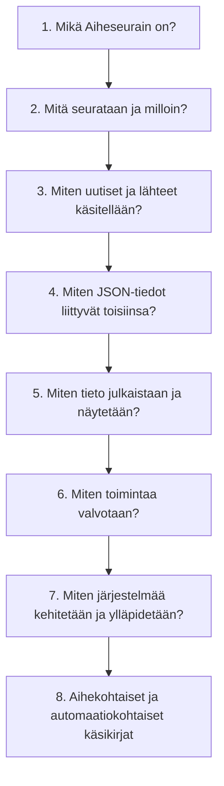

# Aiheseuraimen dokumentaation aloitus ja lukujärjestys

Tämä opas on tarkoitettu ihmiselle, joka haluaa ymmärtää Aiheseuraimen kokonaisuuden alusta lähtien. Lukujärjestys etenee yleiskuvasta yksityiskohtiin: ensin selviää, mitä palvelu tekee, sitten miten seuranta toimii, mistä tieto tulee, miten sitä käsitellään ja julkaistaan sekä lopuksi miten teknistä kokonaisuutta ylläpidetään.

Sinun ei tarvitse lukea kaikkia tiedostoja kerralla. Jokaisessa vaiheessa on **ydinlukemisto** ja tarvittaessa **syventävä lukemisto**. Ydinlukemiston avulla saat kokonaiskuvan; syventävät osat ovat hyödyllisiä, kun haluat ymmärtää toteutuksen tai tietyn automaation tarkasti.

## Lukupolku yhdellä silmäyksellä

## 1. Aloita kokonaiskuvasta

**Tavoite:** ymmärrä palvelun tarkoitus ja sen tärkeimmät osat ennen yksityiskohtia.

Lue tässä järjestyksessä:

1. [README – Aiheseuraimen yleiskuva](../README.md). Tutustu erityisesti ensimmäisiin kappaleisiin, hakemistorakenteeseen ja RSS-syötteiden luetteloon.
2. [Järjestelmäarkkitehtuuri](jarjestelmaarkkitehtuuri.md). Lue ensin järjestelmäriippumaton toimintamalli ja sen jälkeen nykyisen ChatGPT/GitHub-toteutuksen komponentit, tietovirrat ja vaihdettavuuden rajat.
3. [Aiheseuraimen etusivu](https://mikknikk.github.io/aiheseurain/). Näet palvelun julkisen sisääntulon.
4. [Valvomo](https://mikknikk.github.io/aiheseurain/valvomo/), [RSS-lukija](https://mikknikk.github.io/aiheseurain/lukija/) ja [Kehitysjono](https://mikknikk.github.io/aiheseurain/kehitysjono/). Katso, millaisia näkymiä järjestelmä tarjoaa.

Kun olet valmis, osaat vastata kysymyksiin: mitä Aiheseurain seuraa, mitä se julkaisee ja mitä sen verkkosivuston eri osat tekevät?

## 2. Ymmärrä seurannan työnjako ja aikataulu

**Tavoite:** hahmota, miksi kaikki seurannat eivät tapahdu samalla ajolla.

Lue:

1. [Tehtäväjono](tehtavajono.md) – yhdeksän aiheen kiertojärjestys ja seuraava vuoro.
2. [Uutisseurannan seurantaohje](seuranta.md) – seurantajaksojen muodostaminen, raportointisäännöt ja seurantahistorian ylläpito.
3. README:n kohta *Pääautomaation lukujärjestys ja tehtäväkierto* – pääautomaation, erillisen näytösvahdin ja viikoittaisen laatutarkistuksen työnjako.

Tärkeä ero: yhdeksän uutistehtävää käsitellään vuorotellen, mutta intialaisten elokuvien näytösseuranta toimii erillisenä päivittäisenä automaationa. Viikoittainen laatutarkistus on puolestaan auditointi, ei uutishaku.

## 3. Tutustu uutisten etsimiseen ja lähteiden arviointiin

**Tavoite:** ymmärrä, mistä tieto hankitaan ja miten julkaistavan tiedon luotettavuutta arvioidaan.

Lue:

1. [Lähteet ja hakustrategia](lahteet.md) – yleiset lähdeperiaatteet sekä aihekohtaiset hakujen lähtöpisteet.
2. [Uutislähteiden ja uutisväitteiden luotettavuusluokitus](luotettavuusluokitus.md) – lähteen A–D-luokka ja yksittäisen väitteen varmennustaso.
3. [Saavutettavuusperiaatteet](saavutettavuus.md) – millä periaatteilla raportit ja dokumentaatio kirjoitetaan.
4. Halutessasi [Uutisseurannan seurantaohjeen](seuranta.md) yleiset raportointisäännöt uudelleen – erityisesti seurantajakson ja uutisen julkaisu- ja tapahtumapäivän ero.

Muista, että lähdeluettelo ei ole suljettu sallittujen lähteiden luettelo. Lähteiden alkuperäinen sisältö ja uutisväitteet tarkistetaan; pelkkä hakutuloskatkelma ei riitä.

## 4. Opettele JSON-tietomallien perusidea

**Tavoite:** ymmärrä, miksi koneelliset tiedot on jaettu useaan tiedostoon ja miten ne viittaavat toisiinsa.

Lue tämä opas kokonaan:

- [Tietomallit ja prosessikaaviot](tietomallit-ja-prosessit.md), erityisesti kohta 2.1 hakukriteerien, löydösrekisterin ja kriteerikohtaisten jatkotoimien erottelusta.

Se kannattaa lukea vasta edellisten vaiheiden jälkeen, koska silloin esimerkiksi tehtävä, lähde ja ajokohtainen tarkistus ovat jo käsitteinä tuttuja.

Jos haluat seurata esimerkkiä tiedostoista käsin, avaa tämän jälkeen:

1. [Yhteinen lähdekatalogi](../data/source-catalog.json) – lähteen yhteiset perustiedot.
2. [Tolkienin lähdekäyttörekisteri](../data/sources/tolkien.json) – miten yksi aihe viittaa lähteeseen.
3. [Ajokohtainen lähdetarkistusloki](../data/lahdetarkistukset.json) – mitä yksittäisellä ajolla tarkistettiin.
4. [Seurantatila](../data/seurantatila.json) – järjestelmän viimeisin tunnettu tila.
5. [Syötekatalogi](../data/feed-catalog.json) – RSS-lukijan tuntemat syötteet.

JSON-tiedostot ovat koneellista tilaa ja määrittelyjä, eivät itsenäisiä käyttöohjeita. Niitä on helpompi lukea teknisen oppaan jälkeen.

## 5. Ymmärrä julkaisu ja verkkosivuston näkymät

**Tavoite:** hahmota, miten seurannan tuloksista tulee lukijoille näkyvää sisältöä.

Lue:

1. README:n kohdat *Syötteet* ja *RSS-itemien sisältö ja lähteet*.
2. [Valvomon tietomalli](valvomon-tietomalli.md) – mistä Valvomo lukee tietonsa ja miten tilatietoja tulkitaan.
3. Tutustu [RSS-lukijaan](https://mikknikk.github.io/aiheseurain/lukija/) ja avaa tarvittaessa repositorion `feeds/`-hakemiston RSS-tiedostoja.
4. Jos haluat ymmärtää RSS-lukijan toteutusta, tarkastele README:n tiedostovastuita: `lukija/index.html` ja `assets/js/reader.js`.

Tässä vaiheessa kannattaa erottaa toisistaan lähteistä kerätty tieto, automaation sisäinen seurantatila ja lukijoille julkaistu RSS-sisältö. Ne ovat eri asioita.

## 6. Opettele valvonta ja laadunvarmistus

**Tavoite:** ymmärrä, miten järjestelmän onnistumista ja virheitä seurataan.

Lue:

1. [Valvomo](https://mikknikk.github.io/aiheseurain/valvomo/) – tarkastele automaatioiden viimeisimpiä varmennettuja tiloja.
2. [Tietomallit ja prosessikaaviot](tietomallit-ja-prosessit.md), erityisesti ajolokin ja seurantatilan osuudet.
3. [Viikoittaisen laatutarkistuksen käsikirja](laatutarkistuksen-ohje.md) – mitä auditointi tarkistaa ja mitä se ei saa muuttaa.
4. README:n kohta *Automaattiset laatutestit* – mitä GitHub Actions tarkistaa automaattisesti ja mitkä asiat vaativat ihmisen tekemää arviointia.

Automaattinen rakennetesti ei todista uutisväitteitä oikeiksi eikä saavutettavuustavoitteita saavutetuiksi. Eri tarkistuksilla on eri tarkoitus.

## 7. Tutustu kehittämiseen ja ylläpitoon

**Tavoite:** ymmärrä, miten muutoksia suunnitellaan, toteutetaan ja varmistetaan.

Lue:

1. [Järjestelmäarkkitehtuuri](jarjestelmaarkkitehtuuri.md) – järjestelmän kerrokset, nykyinen toteutus, tietovirrat ja teknologioiden vaihdettavuus.
2. [Kehityssuunnitelma](kehityssuunnitelma.md) – sivuston tavoitetila ja kehityksen toimintamalli.
3. [Kehityskohteet](kehityskohteet.md) – toteutetut parannukset ja avoin kehitystyö.
4. [Kehitysjonon julkaistu aineisto](kehitysjonon-aineisto.md) – miten GitHub Issues ja natiivit riippuvuudet muodostetaan Pagesissa käytettäväksi JSON-aineistoksi.
5. [Kehityskäytännöt](kehityskaytannot.md) – dokumentoinnin, koodin, testauksen ja ylläpidon säännöt. Kehitysjonon Kanban näyttää myös GitHubiin kirjatut tikettien riippuvuudet; suhteen tarkka suunta ja tietolähde on kuvattu [kehityssuunnitelmassa](kehityssuunnitelma.md).
6. [GitHub-tikettien riippuvuuksien hallinta](github-riippuvuuksien-hallinta.md) – miten ChatGPT pyytää natiivien riippuvuuksien lisäämistä tai poistamista ja miten GitHub Actions välittää pyynnön turvallisesti.
7. [Automaatioiden hallintaperiaatteet](automaation-hallintaperiaatteet.md) – kuka saa muuttaa ajastuksia, asetuksia ja kohdekeskusteluja.
8. [Julkaisulaadun portti](julkaisuportti.md) – miten yksittäinen RSS-raportti tarkistetaan ennen julkaisemista.
9. [Saavutettavuuskatselmoinnin raportti](saavutettavuuskatselmointi-2026-11-17.md) – esimerkki siitä, miten tarkastelun havainnot ja testaamatta jääneet asiat kirjataan.

Kun tunnet nämä dokumentit, pystyt seuraamaan kehitystehtäviä ja ymmärtämään, miksi muutokset tehdään versionhallinnan, katselmoinnin ja testien kautta.

## 8. Lue automaatioiden ja aiheiden käsikirjat tarpeen mukaan

Näitä dokumentteja ei tarvitse lukea kaikkia yleiskuvan saamiseksi. Ne ovat yksityiskohtaisia toimintaohjeita tiettyä automaatiota tai aihetta varten.

### Pääautomaatio

- [Pääautomaation toimintakäsikirja](paaautomaation-ohje.md) – pääaihekierron tarkka suoritusjärjestys, keskeytysehdot ja julkaisuprosessi.
- `prompts/paauutisseuranta.txt` – automaation asetuksiin kopioitava käynnistyskehote; ei korvaa käsikirjaa.

### Intialaisten elokuvien näytösvahti

- [Näytösseurannan käsikirja](intialaisten-elokuvien-naytosseuranta.md) – erillisen päivittäisen näytösseurannan toimintatapa.
- [Näytöshistorian tietomalli](naytoshistorian-rakenne.md) – näytösten nykytilan ja tapahtumahistorian rakenne.
- `prompts/naytosvahti.txt` – näytösvahdin käynnistyskehote.

### Aihekohtainen intialaisen elokuvan uutisseuranta

- [Uutisseurannan aiheohje](intialaisen-elokuvan-ohje.md).
- [Uutisraportin sisältöohje](intialaisen-elokuvan-uutiset.md).
- [Aihekohtaiset lähteet](intialaisen-elokuvan-lahteet.md).
- [Aihekohtainen seuranta ja historia](intialaisen-elokuvan-seuranta.md).

Muiden kahdeksan aihekierroksen tehtävien lähdekohtaiset tiedot löytyvät [yleisestä lähdeohjeesta](lahteet.md) ja koneellisista `data/sources/`-rekistereistä. Aihekohtaiset lisäohjeet luetaan tarpeen mukaan.

### Laatutarkistus

- [Laatutarkistuksen käsikirja](laatutarkistuksen-ohje.md).
- `prompts/laatutarkistus.txt` – laatutarkistuksen käynnistyskehote.

## 9. Mistä jatkaa, kun etsit tiettyä tietoa?

| Haluan ymmärtää… | Aloita tästä |
|---|---|
| Mitä Aiheseurain tekee? | [README](../README.md) ja vaihe 1 |
| Mikä aihe käsitellään seuraavaksi? | [Tehtäväjono](tehtavajono.md) |
| Miten lähteet valitaan ja tarkistetaan? | [Lähteet ja hakustrategia](lahteet.md) |
| Miksi lähdetiedot ovat useassa JSONissa? | [Tietomallit ja prosessikaaviot](tietomallit-ja-prosessit.md) |
| Mitä viimeisimmällä ajolla tapahtui? | [Valvomo](https://mikknikk.github.io/aiheseurain/valvomo/) ja [seurantatila](../data/seurantatila.json) |
| Miten RSS-syötteet on koottu? | README:n [syöteluettelo](../README.md#syotteet) ja [syötekatalogi](../data/feed-catalog.json) |
| Miten näytösvahti toimii? | [Näytösseurannan käsikirja](intialaisten-elokuvien-naytosseuranta.md) |
| Miten muutoksia testataan? | [Kehityskäytännöt](kehityskaytannot.md) ja README:n laatutestien osio |\n| Miten tikettien riippuvuuksia hallitaan? | [GitHub-tikettien riippuvuuksien hallinta](github-riippuvuuksien-hallinta.md) ja [Kehitysjonon julkaistu aineisto](kehitysjonon-aineisto.md) |
| Miten uutisraportti hyväksytään ennen julkaisua? | [Julkaisulaadun portti](julkaisuportti.md) |
| Kuka saa muuttaa automaatioiden ajastuksia tai kohdekeskusteluja? | [Automaatioiden hallintaperiaatteet](automaation-hallintaperiaatteet.md) |

## Lukemisen jälkeen

Jos haluat vain ymmärtää palvelun käyttäjänä, vaiheet 1–3 ja 5 riittävät. Jos haluat ymmärtää myös teknisen toteutuksen, lue vaiheet 4, 6 ja 7. Jos haluat ylläpitää tai muuttaa tiettyä automaatiota, jatka vaiheen 8 kyseiseen käsikirjaan.

Tämä opas kertoo lukujärjestyksen; yksityiskohtaiset säännöt pysyvät omissa ensisijaisissa dokumenteissaan. Jos dokumenttien sisältö muuttuu, päivitä myös tämä lukupolku ja sen linkit.

## Valvomon ajohistoria

Kun haluat ymmärtää ChatGPT-automaation käynnissäolon ja vaiheiden tallennuksen, lue [ajohistorian tietomalli](ajohistoria.md) ja sen jälkeen [Valvomon tietomalli](valvomon-tietomalli.md).
