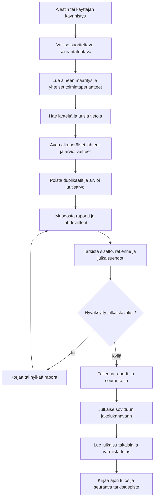
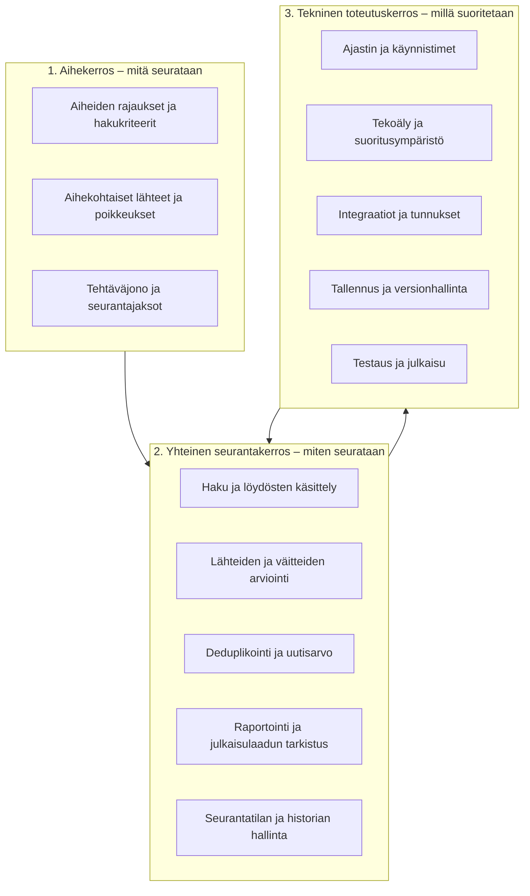
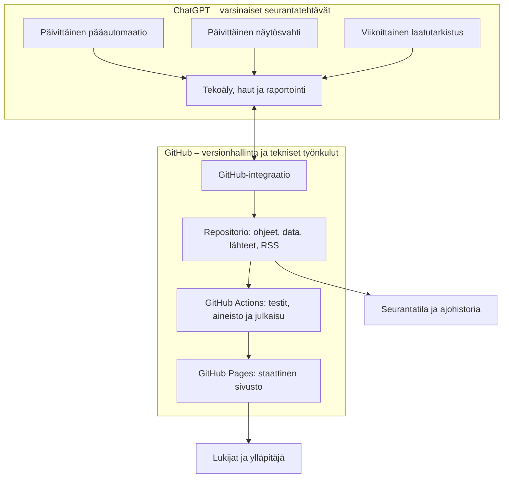

# Aiheseuraimen järjestelmäarkkitehtuuri

**Tarkoitus:** kuvata ensin Aiheseuraimen toimintamalli ilman sidosta yksittäiseen palveluun ja sen jälkeen nykyinen ChatGPT- ja GitHub-toteutus.  
**Nykytilan tarkistus:** 17.11.2026  
**Liittyvä kehitystehtävä:** [#75 – Dokumentoi Aiheseuraimen järjestelmäarkkitehtuuri ja teknologioiden vaihdettavuus](https://github.com/mikknikk/aiheseurain/issues/75)

## 1. Järjestelmän tarkoitus ja rajat

Aiheseurain on aiheohjattu tiedonkeruu-, arviointi-, raportointi- ja julkaisujärjestelmä. Se seuraa useita toisistaan erotettuja aiheita, etsii niihin liittyviä uusia tapahtumia, arvioi lähteitä ja väitteitä, muodostaa suomenkielisiä raportteja sekä säilyttää seurannan tilaa ja julkaistua historiaa.

Järjestelmän suunnitteluperiaate on erottaa toisistaan:

1. **Mitä seurataan:** aiheet, rajaukset, hakukriteerit, lähteet ja aihekohtaiset erityissäännöt.
2. **Miten seuranta tehdään:** yhteinen haku-, arviointi-, varmennus-, raportointi- ja jatkotoimintamalli.
3. **Millä tekniikalla se tehdään:** ajastin, tekoälypalvelu, suoritusympäristö, integraatiot, tallennus, testaus ja julkaisu.

Erottelu mahdollistaa aiheiden kehittämisen ilman, että jokainen muutos vaatii teknisen järjestelmän uudelleenohjelmointia. Se myös rajaa aihekohtaisen poikkeuslogiikan vaikutukset kyseiseen aiheeseen.

## 2. Järjestelmäriippumaton toimintamalli

Seuraava prosessi kuvaa toiminnalliset vaiheet riippumatta siitä, mikä ajastin, tekoälypalvelu tai ohjelmisto ne suorittaa.

### 2.1 Vaiheiden vastuut

- **Käynnistys ja tehtävän valinta:** ajastin tai käyttäjä käynnistää oikean tehtävän. Tehtävän valinta perustuu määriteltyyn jonoon tai erillisen prosessin omaan aikatauluun.
- **Määritysten lukeminen:** suorittaja lukee tehtävän rajauksen, aiheen lähteet, yhteiset toimintaperiaatteet ja edellisen onnistuneen tarkistuspisteen.
- **Tiedonhaku:** lähteitä haetaan useilla aiheeseen sopivilla kielillä ja alueilla. Rekisteröity lähdelista on hakujen lähtökohta, ei suljettu luettelo.
- **Arviointi ja varmennus:** alkuperäiset julkaisut avataan, väitteet erotetaan lähteiden tulkinnoista ja epävarmuudet kirjataan. Lähteen yleinen luotettavuus ja yksittäisen väitteen varmennus ovat eri asioita.
- **Raportointi:** vain olennaiset uudet tai muuttuneet tapahtumat raportoidaan. Raporttiin liitetään lähteet ja tarkasteltu ajanjakso.
- **Laadunvarmistus:** tarkistetaan toimitukselliset ehdot sekä koneellisesti tarkistettavat rakenteet. Automaattinen skeema- tai XML-testi ei todista väitteen totuutta.
- **Tallennus ja julkaisu:** raportti, ajokohtainen tila ja julkaisu tallennetaan sovittuihin tietolähteisiin. Julkaisun jälkeen sisältö luetaan takaisin.
- **Jäljitettävyys:** onnistunut tarkistus kirjataan vasta, kun vaaditut haut, kirjoitukset ja takaisinlukutarkistukset on tehty.

Prosessi ei edellytä RSS:ää jakelumuotona. RSS on nykyinen julkaisutapa; toinen järjestelmä voisi tuottaa saman sisällön esimerkiksi verkkosivulle tai rajapintaan, kunhan lähteet, ajanjakso ja raporttihistoria säilyvät.

## 3. Kolme arkkitehtuurikerrosta

### 3.1 Aihekerros

Aihekerros määrittelee seurannan kohteen, ei sitä, millä ohjelmistolla seuranta tehdään. Aihekohtaisia määrityksiä ovat esimerkiksi:

- aiheen sisältörajaukset, nimivariantit ja hakusanat;
- kieli- ja aluepainotukset;
- aihekohtaiset lähdevalinnat ja lähteiden käyttörajoitteet;
- uutisarvon ja mukaan ottamisen erityissäännöt;
- erillistä prosessia edellyttävät tehtävät.

Nykyisessä repositoriossa aihekohtaiset ohjeet ovat `docs/`-hakemiston dokumenteissa. Yhteiset lähdetiedot ovat `data/source-catalog.json`-tiedostossa ja tehtäväkohtaiset lähdekäyttövalinnat `data/sources/{task_id}.json`-tiedostoissa. Yhdeksän aihekierroksen järjestys on `docs/tehtavajono.md`-tiedostossa ja sen koneellisesti ylläpidetty rinnakkaistieto on `data/seurantatila.json`-tiedostossa.

Tavoitetilassa aiheiden rajaukset, hakusanat, kieli- ja aluevalinnat sekä lähdeviittaukset voidaan pitää rakenteisina määrityksinä. Kaikkea ei kuitenkaan pidä pakottaa yhteen skeemaan: esimerkiksi intialaisten elokuvien näytösvahti on erillinen prosessi, koska sillä on oma päivittäinen näytöslogiikka, tapahtumahistoria ja jakelusyöte.

### 3.2 Yhteinen seurantakerros

Yhteinen seurantakerros vastaa siitä, että eri aiheet käsitellään yhdenmukaisilla laadun ja jäljitettävyyden periaatteilla. Se ei saa sisältää yksittäiseen aiheeseen sidottuja oletuksia.

Yhteisiä sääntöjä ovat muun muassa:

- seurantajakson määrittely edellisen kyseisen aiheen onnistumisen perusteella;
- alkuperäisten lähteiden avaaminen ja lähteiden riippumattomuuden arviointi;
- lähteen luotettavuusluokan erottaminen väitekohtaisesta varmennuksesta;
- duplikaattien poistaminen ja uutisarvon arviointi;
- suomenkielisen raportin ja kuvaavien lähdeviitteiden muodostaminen;
- julkaisua edeltävä tarkistus ja julkaistun sisällön takaisinluku;
- onnistuneen tarkistuspisteen sekä virheiden ja epävarmuuksien kirjaaminen.

Nykyiset ensisijaiset ohjeet ovat `docs/seuranta.md`, `docs/luotettavuusluokitus.md`, `docs/julkaisuportti.md` ja saavutettavuuden osalta `docs/saavutettavuus.md`. Näitä ei pidä kopioida aihekohtaisiin ohjeisiin kokonaisuudessaan, vaan aiheohjeiden tulee viitata yhteisiin sääntöihin.

### 3.3 Tekninen toteutuskerros

Tekninen kerros käynnistää ja suorittaa prosessin, välittää haut ja kirjoitukset, säilyttää tiedot, validoi rakenteet ja julkaisee tulokset. Se ei määrittele, mitä uutisia yksittäisestä aiheesta etsitään.

Nykyisessä toteutuksessa tekninen kerros jakautuu useaan palveluun ja komponenttiin:

- ChatGPT:n ajastetut tehtävät käynnistävät varsinaiset seurantavuorot.
- ChatGPT:n tekoäly ja käytettävissä olevat työkalut suorittavat tiedonhaun, lähteiden arvioinnin ja raportoinnin.
- GitHub-integraatio välittää repositorion luku- ja kirjoitustoiminnot.
- GitHub-repositorio säilyttää ohjeet, lähderekisterit, seurantatilan, raportit ja RSS-syötteet.
- GitHub Actions suorittaa repositorion testit, erilliset tekniset työnkulut ja Pages-julkaisun.
- GitHub Pages julkaisee staattisen verkkosivuston, RSS-syötteet ja julkiset JSON-tietolähteet.

## 4. Nykyinen tekninen toteutus

### 4.1 Varsinaiset seurantatehtävät

Nykyisessä toteutuksessa on kolme erillistä ChatGPT:n ajastettua tehtävää:

1. **Pääautomaatio:** käsittelee päivittäisellä ajollaan yhden yhdeksästä aihekierron tehtävästä.
2. **Intialaisten elokuvien näytösvahti:** erillinen päivittäinen prosessi, joka etsii Suomessa järjestettäviä näytöksiä ja ylläpitää näytöshistoriaa sekä omaa RSS-syötettä.
3. **Viikoittainen järjestelmän laatutarkistus:** auditointiprosessi, joka tarkistaa dokumentaation, tietomallit, RSS-syötteet, testit ja automaatioiden hallinnan. Se ei ole uutishaku eikä korjaava ylläpitoprosessi.

Jokaisella on oma GitHubissa ylläpidetty käsikirjansa ja kanoninen käynnistyskehotteensa:

| Tehtävä | Ensisijainen käsikirja | Käynnistyskehote |
|---|---|---|
| Pääautomaatio | `docs/paaautomaation-ohje.md` | `prompts/paauutisseuranta.txt` |
| Näytösvahti | `docs/intialaisten-elokuvien-naytosseuranta.md` | `prompts/naytosvahti.txt` |
| Laatutarkistus | `docs/laatutarkistuksen-ohje.md` | `prompts/laatutarkistus.txt` |

Käynnistyskehote on lyhyt aloitusohje, ei automaation täydellinen toimintamäärittely. Ohjeiden versionumerot ja käynnistyskehotteiden tunnisteet tarkistetaan `data/seurantatila.json`-tiedoston avulla. GitHubiin tallennettu käynnistyskehote ei kuitenkaan päivity automaation asetuksiin itsestään; tekstin kopiointi ja asetusten täsmäytys ovat erillisiä toimenpiteitä.

### 4.2 Ajastus ja käynnistysvastuut

Varsinaiset kolme seurantatehtävää käynnistää ChatGPT:n ajoitettujen tehtävien palvelu. Niiden tehtäväasetukset – aktiivisuus, tarkka aikataulu, aikavyöhyke, käynnistysohje ja kohdekeskustelu – sijaitsevat ChatGPT:n automaatioasetuksissa, eivät GitHub-repositorion tiedostoissa.

GitHubissa olevat käsikirjat kuvaavat odotettua rytmiä seuraavasti: pääautomaatio päivittäin noin klo 12.00 Europe/Helsinki, näytösvahti päivittäin noin klo 05.00 Europe/Helsinki ja laatutarkistus kerran viikossa. Nämä ovat käsikirjoihin kirjattuja odotuksia. **Tässä dokumentointikatselmuksessa ei luettu ChatGPT:n tallennettuja tehtäväasetuksia, joten tarkkoja asetettuja kellonaikoja, aikavyöhykkeitä, aktiivisuutta tai kohdekeskusteluja ei väitetä erikseen varmennetuiksi.**

GitHub-tiedostoista ei voi päätellä ChatGPT:n ajastuksen todellista asetusta. Jos ajastus halutaan myöhemmin tarkistaa tai muuttaa, se tehdään erikseen ChatGPT:n tehtäväasetuksissa ja vain käyttäjän nimenomaisella valtuutuksella. GitHubiin tehty dokumentaatiomuutos ei muuta tehtävän asetuksia.

### 4.3 GitHub-integraatio

ChatGPT:n GitHub-integraatio tarjoaa suorittajalle repositorion luku- ja kirjoitustoiminnot. Nykyisessä työnkulussa sitä käytetään muun muassa tiedostojen lukemiseen, dokumenttien ja seurantatietojen päivittämiseen, issueiden käsittelyyn sekä muutosten viemiseen haaroihin ja pull requesteihin.

Integraation tarkka käyttöoikeusjoukko ja käyttäjän valitsemat käytettävissä olevat repositoriot ovat GitHub-sovelluksen ja ChatGPT-yhteyden asetuksia. Ne eivät ole tämän repositorion tiedostoista kokonaan todennettavissa. Siksi tässä ei väitetä, että integraatiolla olisi kaikki GitHub-sovelluksen teknisesti mahdolliset oikeudet. Käyttöoikeudet tulee rajata vain tarvittaviin repositorioihin ja toimintoihin.

GitHub-integraatio ja GitHub Actionsin `GITHUB_TOKEN` ovat eri tunnistusmekanismeja. Integraation kautta tehtävä käyttäjän puolesta tehtävä repositoriotyö ei ole sama asia kuin Actions-työnkulun oma rajattu token.

### 4.4 GitHub-repositorio ja tallennus

Repositorio `mikknikk/aiheseurain` on nykyisen toteutuksen versionhallittu tietovarasto ja julkaisun lähde. Sen keskeiset vastuut ovat:

| Sijainti | Sisältö ja vastuu |
|---|---|
| `docs/` | Ihmiselle ja automaatioille tarkoitetut ensisijaiset ohjeet, seurannan historia ja tietomallien kuvaukset |
| `prompts/` | ChatGPT:n tehtäväasetuksiin kopioitavat kanoniset käynnistyskehotteet |
| `data/source-catalog.json` | Lähteiden yhteiset perustiedot |
| `data/sources/*.json` | Aihe- tai tehtäväkohtaiset lähdekäyttörekisterit |
| `data/seurantatila.json` | Aihekierron, viimeisimpien onnistumisten ja ohjeversioiden koneellisesti luettava tila |
| `data/lahdetarkistukset.json` | Ajokohtaiset lähteiden tarkistustulokset ja kattavuushuomiot |
| `data/naytosten-muutoshistoria.json` | Näytösseurannan nykytila ja tapahtumahistoria |
| `run-history/*/history.json` | Kolmen ChatGPT-automaation erillisiin haaroihin tallentama vaihekohtainen ajohistoria |
| `feeds/*.xml` | Aihekohtaiset uutis-RSS-syötteet ja erillinen näytös-RSS |
| `schemas/` | JSON-tietomallien ja julkaisuraporttien rakennesopimukset |
| `scripts/` ja `.github/` | Validointi, aineiston muodostus ja GitHub Actions -työnkulut |

GitHub Issues on kehitystehtävien kanoninen tietolähde. Kehitysjono ei ylläpidä tiketeistä erillistä käsin päivitettävää tietokantaa, vaan GitHub Actions muodostaa GitHub Issues -tiedoista ja natiiveista riippuvuuksista täydellisen JSON-tilannekuvan.

### 4.5 GitHub Actions: testaus, aineiston muodostus ja julkaisu

GitHub Actions ei suorita varsinaisia uutis- tai näytöshakuja. Se hoitaa repositorion teknisiä tehtäviä:

| Työnkulku | Käynnistin | Vastuu |
|---|---|---|
| `RSS- ja dokumentaatiotestit` (`validate-feeds.yml`) | Push `main`-haaraan, pull request `main`-haaraan tai manuaalinen käynnistys | RSS/XML- ja HTML-rakenteet, dokumentaatio, seurantatila, JavaScript ja yksikkötestit |
| `Kehitysjonon aineisto ja Pages-julkaisu` (`publish-pages.yml`) | Push, pull request, issue-tapahtumat, issue-kommentit, päivittäinen ajastus tai manuaalinen käynnistys | GitHub Issues -aineiston muodostus ja validointi sekä Jekyll/Pages-julkaisu |
| `Synkronoi tikettien riippuvuudet` (`sync-issue-dependencies.yml`) | Issue muokattu | Käsittelee yksiselitteisen natiivin riippuvuuspyynnön ja käynnistää tarvittaessa Pages-aineiston päivityksen |
| `Lähde- ja RSS-linkkien viikoittainen tarkistus` (`check-links.yml`) | Viikoittainen ajastus tai manuaalinen käynnistys | Tarkistaa lähde- ja RSS-linkkien saavutettavuuden ja tallentaa raportin artefaktiksi |

`publish-pages.yml` sisältää päivittäisen varmistusajastuksen `17 3 * * *` UTC, eli Suomen talviaikana klo 05.17 ja kesäaikana klo 06.17. Tämä on GitHub Actionsin Pages-aineiston päivitys- ja julkaisuaika, ei pääautomaation uutishaku. GitHub Actionsin ajastus voi viivästyä ruuhkatilanteessa.

`check-links.yml` sisältää viikoittaisen maanantain ajastuksen `17 6 * * 1` UTC. Sekään ei käynnistä uutisseurantaa. `validate-feeds.yml` käynnistyy koodimuutoksista tai manuaalisesti, eikä sillä ole omaa ajastusta.

### 4.6 Käyttöoikeudet ja salaisuudet

Työnkulut määrittelevät oikeutensa erikseen vähimmän tarpeen periaatteella:

- Pages-julkaisu: `contents: read`, `issues: read`, `pages: write` ja `id-token: write`.
- RSS-/dokumentaatiotestit ja linkkitarkistus: `contents: read`.
- Natiivien issue-riippuvuuksien synkronointi: `contents: read`, `issues: write` ja `actions: write`, koska työnkulku muuttaa riippuvuuksia ja käynnistää Pages-työnkulun.

Actions käyttää työnkululle rajattua `GITHUB_TOKEN`-tunnusta. Tokenia ei kirjoiteta lähdekoodiin eikä julkaista selaimelle. GitHub Actionsin työnkulkuoikeudet eivät määrittele ChatGPT:n GitHub-integraation oikeuksia.

### 4.7 GitHub Pages ja verkkosivusto

GitHub Pages julkaisee staattisen Jekyll-sivuston osoitteessa https://mikknikk.github.io/aiheseurain/. Sivuston osia ovat etusivu, Valvomo, RSS-lukija ja Kehitysjono. Selaimen käyttöliittymät lukevat julkisia RSS- ja JSON-tiedostoja; niillä ei ole GitHub-kirjoitusoikeuksia.

Pages-julkaisu muodostaa Kehitysjonon JSON-aineiston Actions-ajossa ennen Jekyll-rakennusta. Aineisto validoidaan, ja vasta onnistunut build voidaan julkaista. Epäonnistunut build ei julkaise osittaista Kehitysjono-aineistoa.

## 5. Tietovirrat nykyisessä toteutuksessa

Kaavio on käsitteellinen: integraation kautta tapahtuva luku- tai kirjoitustoiminto voi olla yksittäinen vaihe ajon aikana. Se ei tarkoita, että kaikki seurantatyön vaiheet suoritettaisiin GitHub Actionsissa.

## 6. Virhetilanteet ja palautuminen

- **Lähtötiedot puuttuvat tai ovat ristiriidassa:** automaatio keskeyttää ennen hakuja tai julkaisuja. Vanhentunutta ohjetta tai arvattua seurantatilaa ei käytetä.
- **Lähde ei ole käytettävissä:** merkitään lähde tarkistamatta jääneeksi syineen. Hakutuloskatkelmaa ei tulkita alkuperäisen sisällön tarkistamiseksi.
- **Raportti ei täytä julkaisuehtoja:** raporttia korjataan tai se hylätään. RSS-muutosta ei julkaista ilman julkaisulaadun portin hyväksyntää ja vaadittuja testejä.
- **GitHub-kirjoitus epäonnistuu:** julkaisua ei väitetä onnistuneeksi. Kirjoitettu sisältö luetaan takaisin ennen onnistumisen kirjaamista.
- **GitHub Actions -aineiston muodostus epäonnistuu:** Pages-build pysähtyy ennen julkaisua. Viimeisin onnistunut sivustojulkaisu jää käyttöön.
- **Osittainen riippuvuusaineisto:** sitä ei julkaista täydellisenä. Kehitysjono näyttää välimuistin tai virheen rajauksen mukaisesti.
- **Ajastukseen tai automaatioasetukseen liittyvä ongelma:** ongelma raportoidaan; tehtävän ajastusta tai kohdekeskustelua ei muuteta ilman käyttäjän nimenomaista lupaa.

Virheiden käsittelyn yksityiskohtaiset menettelyt ovat kunkin automaation omassa käsikirjassa ja teknisten työnkulkujen dokumentaatiossa.

## 7. Teknologioiden vaihdettavuus ja siirrettävyys

Teknologian vaihtaminen on mahdollista, mutta se ei ole pelkkä palvelun nimen tai asetuksen muuttaminen. Siirto edellyttää, että uusi toteutus pystyy täyttämään nykyiset tietosopimukset, käsittelemään tehtäväkohtaisen tilan oikein ja suorittamaan samat laadunvarmistukset.

| Osa | Siirrettävä sisältö | Vaihdon edellyttämä työ |
|---|---|---|
| Ajastin | Tehtävien rytmi, jonon säännöt ja erillisten prosessien periaatteet | Uusi ajastin, aikavyöhykkeet, päällekkäisten ajojen esto, uusintayritykset ja tehtävien omistajuus |
| Tekoälypalvelu | Aiheohjeet, lähderekisterit, yhteiset toimitukselliset säännöt ja raporttien rakenteet | Promptien ja työkalukutsujen sovitus, haku- ja selainominaisuudet, kontekstin hallinta sekä tulosten laadun vertailu |
| Suoritusympäristö | Prosessin vaiheet ja hyväksymiskriteerit | Käyttöympäristö, riippuvuudet, salaisuuksien hallinta, ajonaikainen valvonta ja virheistä palautuminen |
| GitHub-integraatio | Tietomallit, tiedostopolut ja versionhallinnan työnkulkuperiaatteet | Uusi API-/connector-adapteri, tunnistautuminen, oikeuksien rajaus, konfliktien ja uudelleenyritysten käsittely |
| Tallennus | JSON-skeemat, RSS-rakenne, tunnisteet ja tapahtumahistorian periaatteet | Tallennusadapteri, migraatiot, varmistukset, palautus ja tietojen eheyden tarkistus |
| Julkaisu | Raporttisisältö, lähdeviitteet ja julkaisun hyväksymisehdot | Uusi jakelukanava tai julkaisupalvelu, URL-osoitteet, välimuisti ja lukijoiden siirtymä |
| Testaus ja valvonta | Hyväksymiskriteerit, testitapaukset ja raportointiperiaatteet | Uudet integraatio- ja päästä päähän -testit sekä hälytykset ja käyttötilan seuranta |

### 7.1 Mitä voidaan siirtää sellaisenaan?

Todennäköisimmin siirrettäviä ovat aiheiden kuvaukset, hakukriteerit, lähderekisterit, yhteiset toimitukselliset säännöt, JSON-skeemat, RSS-sisältöjen rakenne, seurantahistorian tietomallit ja dokumentoidut hyväksymiskriteerit. Ne eivät lähtökohtaisesti riipu ChatGPT:n tai GitHub Actionsin käyttöliittymästä.

### 7.2 Mitä täytyy sovittaa uudelleen?

ChatGPT:n tehtäväasetukset, käynnistyskehotteet, mallikohtaiset työkalukutsut ja integraation toimintatavat ovat alustakohtaisia. Niitä ei voi olettaa siirrettäviksi sellaisenaan toiseen tekoälypalveluun. Samoin GitHub Actions -YAML, GitHub API -kutsut, käyttöoikeusmallit ja Pages-julkaisun toteutus ovat GitHubiin sidottuja.

Uuden toteutuksen tulee tarjota vastaavat adapterit ainakin seuraaville rajapinnoille:

- `Scheduler`: käynnistää oikean tehtävän ja estää saman tehtävän päällekkäiset ajot;
- `ResearchProvider`: hakee lähteitä ja avaa alkuperäisiä sisältöjä;
- `AIProcessor`: arvioi lähteitä, muodostaa löydökset ja raportit;
- `RepositoryAdapter`: lukee määritykset ja kirjoittaa hyväksytyt muutokset;
- `StateStore`: säilyttää tarkistuspisteet, historian ja yksilölliset tunnisteet;
- `Publisher`: julkaisee raportit ja varmistaa takaisinluvun;
- `QualityGate`: suorittaa sisällölliset ja rakenteelliset hyväksymistarkistukset.

Nämä ovat arkkitehtuurin rajapintasuosituksia, eivät nykyisessä repositoriossa jo toteutettuja ohjelmistoluokkia tai API-rajapintoja.

### 7.3 Siirron vähimmäisvaatimukset

Ennen tuotantokäyttöä vaihtoehtoisen toteutuksen tulee osoittaa vähintään:

1. Kaikki nykyiset aiheet ja niiden erilliset rajaukset säilyvät.
2. Tehtäväjono ja seurantajaksot jatkuvat oikeista tarkistuspisteistä.
3. Uudet ja aiemmin käsitellyt tapahtumat erotetaan ilman duplikaatteja.
4. Alkuperäiset lähteet, väitteiden varmennustasot ja lähderiippuvuudet säilyvät jäljitettävinä.
5. Kirjoitukset ovat idempotentteja tai niiden uudelleenyritykset eivät tuota päällekkäisiä julkaisuja.
6. Virhe ei siirrä onnistumisen tarkistuspistettä eikä julkaise osittaista aineistoa täydellisenä.
7. Tunnukset ja salaisuudet säilytetään uudessa ympäristössä turvallisesti ja vähimmillä oikeuksilla.
8. Tietomallit voidaan migroida ja palauttaa, ja vanha julkaistu historia säilyy.
9. Uuden toteutuksen integraatio-, regressio- ja päästä päähän -testit kattavat samat kriittiset tapaukset.
10. Vanha ja uusi toteutus voidaan ajaa rajatusti rinnakkain vertailua varten ennen kuin uusi toteutus ottaa tuotantovastuun.

## 8. Tosiasiat, päätelmät ja avoimet asiat

### 8.1 Repositoriosta ja työnkuluista varmennetut tosiasiat

- Repositorio sisältää kolme erillistä ChatGPT-automaatiota varten ylläpidettyä käsikirjaa ja käynnistyskehotetta.
- Pääautomaation tehtäväjono, lähdekatalogi, tehtäväkohtaiset lähderekisterit ja seurantatila ovat erillisiä tiedostoja.
- RSS-syötteet, näytöshistoria ja vaihekohtainen ajohistoria tallennetaan eri tiedostoihin tai haaroihin.
- GitHub Actionsissa on erilliset RSS-/dokumentaatiotestien, Pages-julkaisun, riippuvuuksien synkronoinnin ja linkkitarkistuksen työnkulut.
- Pages-julkaisu muodostaa ja validoi Kehitysjonon aineiston ennen Jekyll-julkaisua.
- ChatGPT:n ajastettujen tehtävien asetuksia ei tallenneta GitHub-repositorioon.

### 8.2 Arkkitehtuuripäätelmät ja suositukset

- Aihekohtaiset määritykset kannattaa pitää mahdollisimman rakenteisina ja erottaa yhteisistä toimituksellisista säännöistä.
- Ajastin, tekoälypalvelu, tallennus, GitHub-integraatio ja julkaisu kannattaa mallintaa vaihdettavina adaptereina.
- Teknologian vaihto tulee toteuttaa hallittuna migraationa, ei asetuksen vaihtona.
- Uusi toteutus tulee hyväksyä vasta, kun tietojen eheys, idempotenssi, virhetilanteet ja julkaisun takaisinluku on testattu.

Nämä ovat suunnittelupäätelmiä ja tulevan kehityksen suosituksia, eivät väitteitä jo toteutetuista adaptereista.

### 8.3 Avoimet ja erikseen varmennettavat asiat

- ChatGPT:n kolmen ajoitetun tehtävän tallennetut tarkat aikataulut, aikavyöhykkeet, aktiivisuus ja kohdekeskustelut tulee tarkistaa ChatGPT:n tehtäväasetuksista. Niitä ei voi vahvistaa GitHubin tiedostoista.
- GitHub-integraation käyttäjäkohtainen repositorioiden valinta ja todelliset tehokkaat käyttöoikeudet tulee tarkistaa GitHub-sovelluksen ja ChatGPT-yhteyden asetuksista.
- Vaihtoehtoisen tekoälypalvelun tai ajastimen valintaa ei ole tehty.
- Adapterirajapintoja, migraatiotyökaluja tai toista suoritusympäristöä ei ole tämän dokumentin yhteydessä toteutettu.
- Nykyisten aihekohtaisten ohjeiden täydellinen muuttaminen koneellisesti luettaviksi määrityksiksi vaatisi erillisen kartoituksen. Kaikki poikkeukset eivät välttämättä sovellu rakenteiseen yhteiseen malliin.

## 9. Automaatioiden hallinnan rajat

Tämä arkkitehtuurikuvaus ei anna lupaa muuttaa ChatGPT:n ajastettuja tehtäviä, niiden aktiivisuutta, suoritusvälejä, kellonaikoja, aikavyöhykkeitä, käynnistysohjeita tai kohdekeskusteluja. Se ei myöskään anna lupaa luoda korvaavia automaatioita, vaihtaa tekoälypalvelua, muuttaa GitHub-yhteyden oikeuksia tai ottaa käyttöön uutta suoritusympäristöä.

Kaikkia automaatioita koskeva käyttäjän valtuutukseen perustuva sääntö on määritelty ensisijaisesti dokumentissa [Automaatioiden hallinnan suojausperiaatteet](automaation-hallintaperiaatteet.md). Nykyisten automaatioiden yksityiskohtaiset toimintatavat ovat niiden omissa käsikirjoissa.

## 10. Aiheeseen liittyvät ensisijaiset dokumentit

- [Aloitus ja dokumentaation lukujärjestys](aloitus-ja-lukujarjestys.md)
- [Pääautomaation toimintakäsikirja](paaautomaation-ohje.md)
- [Intialaisten elokuvien näytösseurannan käsikirja](intialaisten-elokuvien-naytosseuranta.md)
- [Viikoittaisen laatutarkistuksen käsikirja](laatutarkistuksen-ohje.md)
- [Seurantaohje](seuranta.md)
- [Lähteet ja hakustrategia](lahteet.md)
- [Uutislähteiden ja uutisväitteiden luotettavuusluokitus](luotettavuusluokitus.md)
- [Tietomallit ja prosessikaaviot](tietomallit-ja-prosessit.md)
- [Kehitysjonon julkaistu aineisto](kehitysjonon-aineisto.md)
- [Automaatioiden hallinnan suojausperiaatteet](automaation-hallintaperiaatteet.md)

## 11. Muutoshistoria

- **1.0.0 – 2026-11-17:** kuvattiin järjestelmäriippumaton toimintamalli, kolmen arkkitehtuurikerroksen vastuut, nykyinen ChatGPT/GitHub-toteutus, tietovirrat sekä teknologioiden vaihdettavuuden edellytykset. Erotettiin repositoriosta varmennetut tosiasiat, päätelmät ja erikseen tarkistettavat asetukset.
