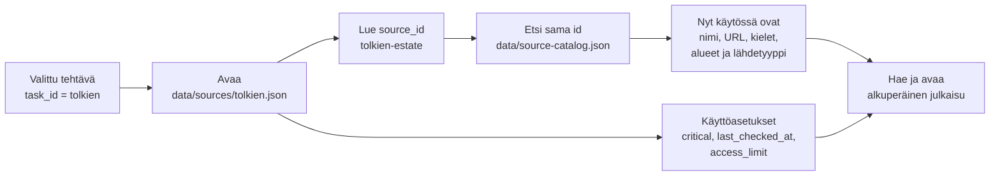
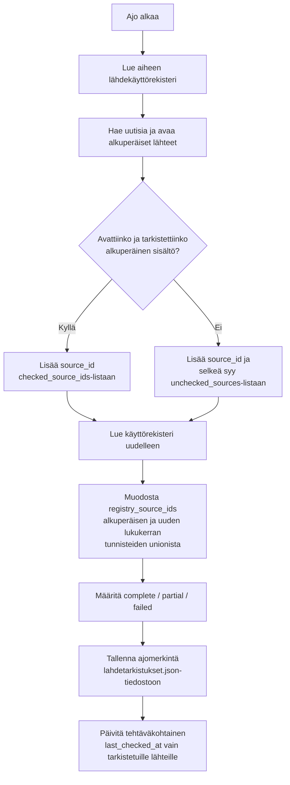
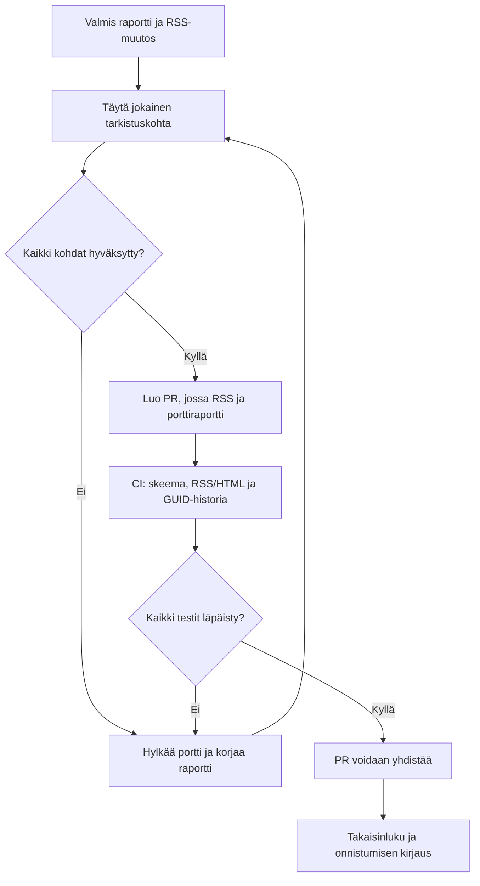
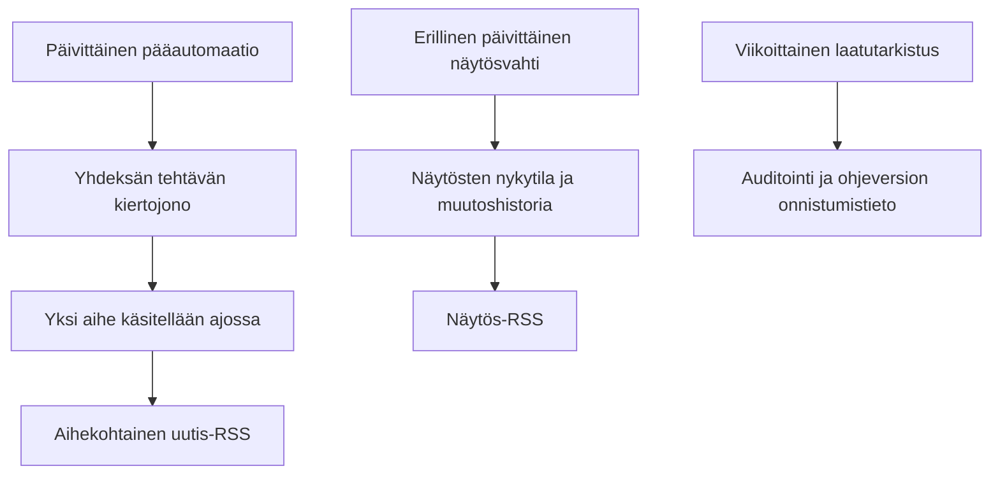
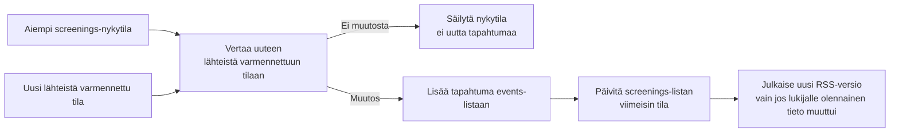

# Aiheseuraimen tietomallit ja prosessikaaviot

Tämä opas näyttää, miten Aiheseuraimen JSON-tiedostot liittyvät toisiinsa, mistä automaatio lukee tiedot, mihin se kirjoittaa tulokset ja mitä kukin tiedosto tarkoittaa. Opas on tarkoitettu myös lukijalle, joka ei tunne JSONia tai ohjelmointia.

**Tärkein periaate:** JSON-tiedostot eivät ole yksi suuri tietokanta. Jokaisella tiedostolla on oma rajattu tehtävänsä. Lähteen perustiedot tallennetaan kerran, aihekohtainen käyttö määritellään erikseen ja yksittäisen ajon toteutunut lähdekattavuus kirjataan omaan lokiinsa.

## 1. Kokonaiskuva yhdellä silmäyksellä

Aiheseuraimen koneelliset tiedot jakautuvat viiteen ryhmään:

1. **Mitä seurataan?** Lähdekatalogi, aihekohtaiset lähdekäyttörekisterit ja RSS-syötekatalogi.
2. **Mitä yhdellä ajolla tapahtui?** Lähdetarkistusten ajoloki.
3. **Mikä on järjestelmän viimeisin tunnettu tila?** Seurantatila.
4. **Miten RSS-raportin laatu hyväksytään ennen julkaisua?** Raporttikohtainen julkaisulaadun tarkistusraportti.
5. **Miten näytösvahti säilyttää muutokset?** Näytösten nykytila ja tapahtumahistoria.

Alla oleva kaavio näyttää tiedostojen väliset suhteet. Nuoli tarkoittaa, että toinen tiedosto käyttää toisen tietoja tai viittaa niihin. Se ei tarkoita, että tiedostot olisivat kopioita toisistaan.

```mermaid
flowchart TB
    subgraph LAHTEET["Lähteiden määrittely"]
      C["data/source-catalog.json<br/>Lähteen yhteiset perustiedot"]
      R["data/sources/{task_id}.json<br/>Aihekohtainen käyttörekisteri"]
      C -->|"source_id viittaa id-arvoon"| R
    end

    subgraph AJO["Yksittäisen seuranta-ajon tiedot"]
      L["data/lahdetarkistukset.json<br/>Tarkistetut ja tarkistamatta jääneet lähteet"]
      S["data/seurantatila.json<br/>Viimeisin onnistunut tila ja tehtäväkierto"]
      R -->|"ajon lähtölista"| L
      L -->|"viimeisimmän ajon tiedot"| S
    end

    subgraph JULKAISU["Julkaiseminen"]
      F["data/feed-catalog.json<br/>Syötteiden luettelo"]
      XML["feeds/*.xml<br/>Julkaistut RSS-artikkelit"]
      F --> XML
    end

    subgraph PORTTI["Raporttikohtainen julkaisun hyväksyntä"]
      G["reports/julkaisuportit/{run_id}.json<br/>Toimitukselliset tarkistukset ja päätös"]
      GS["schemas/julkaisuportti.schema.json<br/>Porttiraportin rakenne"]
      G -->|"hyväksyntä PR:ssä"| XML
      GS -. "validoi raportin" .-> G
    end

    subgraph NAYTOS["Erillinen näytösvahti"]
      N["data/naytosten-muutoshistoria.json<br/>Näytösten nykytila ja tapahtumat"]
    end
\n    subgraph PALAUTUMINEN["Näytösvahtiajon julkaisun palautuminen"]
      J["data/screening-publication-journal.json<br/>Ajokohtainen julkaisuvaihe ja kuittaukset"]
      J -->|"RSS-tiiviste ja GUIDit"| XML
      J -->|"onnistumispisteen suojaus"| S
    end

    SC["schemas/*.schema.json<br/>Rakenteen tarkistussäännöt"]
    SC -. "validoi rakenteen" .-> C
    SC -. "validoi rakenteen" .-> R
    SC -. "validoi rakenteen" .-> L
    SC -. "validoi rakenteen" .-> S
    SC -. "validoi rakenteen" .-> N
```

Skeemat ovat siis sääntökirjoja. Ne eivät sisällä varsinaista seurantadataa.

## 2. Kolme eri asiaa, joita ei pidä sekoittaa

Lähteisiin liittyvät kolme JSON-tiedostotasoa vastaavat eri kysymyksiin:

| Tiedosto | Kysymys, johon se vastaa |
|---|---|
| `data/source-catalog.json` | Mikä tämä lähde on? |
| `data/sources/{task_id}.json` | Miksi ja miten tämä aihe käyttää lähdettä? |
| `data/lahdetarkistukset.json` | Tarkistettiinko lähde tällä nimenomaisella ajolla? |

Esimerkki: Tolkien-seurannassa käytetään Tolkien Estaten sivustoa.

- Lähdekatalogissa on Tolkien Estaten nimi, verkkosivu, kielet, alueet ja lähdetyyppi.
- Tolkienin käyttörekisterissä on viittaus tunnisteeseen `tolkien-estate`, tieto siitä että lähde on tälle tehtävälle kriittinen, sekä tehtäväkohtainen viimeisin tarkistusaika.
- Ajolokiin kirjataan, tarkistettiinko `tolkien-estate` juuri kyseisellä ajolla vai jäikö se tarkistamatta.

Yksi lähde voi olla monen aiheen käytössä. Siksi sen perustietoja ei kopioida jokaiseen aihekohtaiseen tiedostoon.

## 2.1 Hakukriteerit, löydökset ja kriteerikohtaiset jatkotoimet

Hakuprosessin kolme osaa pidetään erillään, koska ne vastaavat eri kysymyksiin:

1. **Hakukriteerit määrittävät, mitä etsitään.** Jokaisella kriteerillä on pysyvä tunniste, kuvaus, rajaukset ja tarvittaessa omat hakutapansa.
2. **Havaintorekisteri kertoo, mitä löydettiin.** Se tallentaa löydetyn kohteen pysyvän tunnisteen, tunnistamiseen tarvittavat tiedot sekä kaikki hakukriteerit, joiden perusteella kohde löytyi.
3. **Jatkotoimien määritykset kertovat, mitä löydökselle tehdään.** Toiminnot liitetään hakukriteereihin, eivät suoraan yleiseen hakutulokseen. Yhdelle kriteerille voidaan määrittää yksi tai useampi toiminto, eikä kaikkien kriteerien tarvitse käynnistää samoja toimintoja.

Näiden osien välinen suhde on monesta moneen: yksi löydös voi osua useaan hakukriteeriin, ja yksi hakukriteeri voi löytää useita kohteita. Siksi löydöksen yhteydessä säilytetään tieto kaikista siihen osuneista kriteereistä. Kriteerien tunnisteiden tulee olla pysyviä, jotta jatkotoimien määritykset eivät riipu kriteerin muuttuvasta nimestä tai kuvauksesta.

### Esimerkki: elokuva löytyy kahdella hakukriteerillä

Oletetaan, että sama elokuva löytyy sekä näyttelijään perustuvalla kriteerillä että erillisellä elokuvasarjakriteerillä.

- Havaintorekisteriin tallennetaan elokuva kerran ja molemmat osuneet kriteerit.
- Näyttelijäkriteerille on määritelty Discord-ilmoitus ensimmäisestä näytöshavainnosta.
- Elokuvasarjakriteerille ei ole määritelty Discord-ilmoitusta, vaan esimerkiksi myöhemmin lisättävä erillinen käsittely.
- Discord-ilmoitus käynnistyy näyttelijäkriteerin perusteella, mutta ei elokuvasarjakriteerin perusteella.

Näin elokuvan osuminen useaan kriteeriin ei automaattisesti tarkoita, että kaikki kriteereihin liittyvät toiminnot suoritetaan samalla tavalla tai että sama ilmoitus lähetetään useita kertoja.

### Toimintojen suorittamisen periaatteet

- Kunkin toiminnon käynnistymisen syy on jäljitettävissä siihen hakukriteeriin, joka sen aiheutti.
- Sama kohde ja sama toiminto käsitellään idempotentisti: uudelleenajo tai usean kriteerin osuma ei saa aiheuttaa tahattomia kaksoissuorituksia.
- Eri kriteerien eri toiminnot voivat silti kaikki toteutua samalle löydökselle.
- Epävarmoja kohteiden identiteettiosumia ei yhdistetä automaattisesti tavalla, joka voisi käynnistää väärän toiminnon.
- Hakukriteerien, havaintorekisterin ja jatkotoimien määritysten rakenteet validoidaan erikseen omilla skeemoillaan, kun ne otetaan käyttöön.

Tämä on Aiheseuraimen yleinen tavoitearkkitehtuurin periaate. Se ei tarkoita, että kaikki nämä tietomallit tai toiminnot olisivat jo toteutettu. Esimerkiksi näytösvahdin kehitystehtävät [#66](https://github.com/mikknikk/aiheseurain/issues/66) ja [#67](https://github.com/mikknikk/aiheseurain/issues/67) soveltavat periaatetta elokuvien havaintoihin, hakukriteereihin ja Discord-ilmoituksiin.

## 3. Yhteinen lähdekatalogi: mikä lähde on?

Tiedosto: [`data/source-catalog.json`](../data/source-catalog.json`  
Skeema: [`schemas/lahdekatalogi.schema.json`](../schemas/lahdekatalogi.schema.json`

Katalogi sisältää lähteen yhteiset perustiedot. Yksinkertaistettu esimerkki nykyisestä rakenteesta:

```json
{
  "id": "tolkien-estate",
  "name": "Tolkien Estate",
  "url": "https://www.tolkienestate.com/",
  "language_regions": ["en"],
  "source_type": "primary",
  "regions": ["UK", "GLOBAL", "US"],
  "reliability_class": "A"
}
```

Kenttien merkitys:

- `id`: pysyvä tekninen tunniste. Muiden tiedostojen viittaukset käyttävät tätä arvoa.
- `name`: ihmiselle näytettävä lähteen nimi.
- `url`: lähteen yleinen verkkosivu, ei välttämättä yksittäisen uutisen osoite.
- `language_regions`: kielet, joilla lähde julkaisee sisältöä.
- `source_type`: lähteen perustyyppi: `primary`, `editorial` tai `other`.
- `regions`: alueet, joita lähde kattaa.
- `reliability_class`: lähteen yleinen A–D-luokka.
- `reliability_note`: valinnainen huomio lähteen käyttörajoitteesta tai erityisestä todistusroolista.

`source_type` ja `reliability_class` kuvaavat eri asioita. A–D-luokka ei ole yksittäisen uutisväitteen varmennus. Luokkien kriteerit ja kuusi väitekohtaista varmennustasoa on määritelty dokumentissa [Uutislähteiden ja uutisväitteiden luotettavuusluokitus](luotettavuusluokitus.md).

## 4. Aihekohtainen lähdekäyttörekisteri: miten aihe käyttää lähdettä?

Esimerkkejä:
- [Tolkienin rekisteri](../data/sources/tolkien.json)
- [Intialaisen elokuvan uutisten rekisteri](../data/sources/intialaiset_elokuvat_uutiset.json)
- [Näytösvahdin rekisteri](../data/sources/intialaiset_elokuvat_naytokset.json)

Skeema: [`schemas/lahderekisteri.schema.json`](../schemas/lahderekisteri.schema.json`

Käyttörekisteri ei toista lähteen nimeä tai URL-osoitetta. Se viittaa katalogiin `source_id`-kentällä:

```json
{
  "source_id": "tolkien-estate",
  "critical": true,
  "last_checked_at": "2026-11-16T17:56:58+02:00",
  "access_limit": null
}
```

- `source_id`: viittaus yhteisen katalogin `id`-arvoon.
- `critical`: onko lähde tämän aiheen kattavuuden kannalta kriittinen. Tämä ei ole luotettavuusarvosana.
- `last_checked_at`: milloin lähde viimeksi tarkistettiin tämän tehtävän yhteydessä. `null` tarkoittaa, ettei tarkistusaikaa ole kirjattu.
- `access_limit`: käyttöä rajaava huomio, esimerkiksi sivuston esto tai se, että lähde toimii vain uutisvihjeenä.

Tehtäväkohtaisuus on tärkeää: jos sama sivusto tarkistetaan Tolkien- ja Muumi-seurannassa, Tolkien-rekisterin tarkistusaika ei automaattisesti päivitä Muumien rekisteriä.

### Miten automaatio löytää lähteen tiedot?



Käyttörekisteri on hakujen lähtölista, ei suljettu sallittujen lähteiden luettelo. Automaatio voi löytää uusia olennaisia lähteitä. Uusi lähde lisätään ensin yhteiseen katalogiin ja sen jälkeen oikean aiheen käyttörekisteriin.

## 5. Ajokohtainen lähdetarkistusloki: mitä oikeasti tarkistettiin?

Tiedosto: [`data/lahdetarkistukset.json`](../data/lahdetarkistukset.json`  
Skeema: [`schemas/lahdetarkistukset.schema.json`](../schemas/lahdetarkistukset.schema.json`

Tämä tiedosto vastaa eri kysymykseen kuin käyttörekisterin `last_checked_at`: se kuvaa yksittäisen ajon lähdekattavuutta.

Yksinkertaistettu ote Tolkien-ajosta:

```json
{
  "run_id": "tolkien-20261116T175100-0200",
  "task_id": "tolkien",
  "status": "complete",
  "checked_source_ids": [
    "tolkien-estate",
    "harpercollins-tolkien"
  ],
  "unchecked_sources": [
    {
      "source_id": "tolkien-society",
      "reason": "Suora avaus palautti 403 Forbidden."
    }
  ],
  "coverage_notes": [
    "Hakutulosotteita ei merkitty tarkistetuiksi lähteiksi."
  ]
}
```

Tässä esimerkissä:

- `run_id` yksilöi yhden ajon.
- `task_id` kertoo, mitä aihetta ajo käsitteli.
- `status` kertoo ajon lähdekattavuuden: `complete`, `partial` tai `failed`. `complete` tarkoittaa, että kaikki ajon lähdejoukon kriittiset lähteet on käsitelty; se ei tarkoita, että jokainen rekisterin lähde tai kaikki mahdolliset maailman lähteet olisi avattu.
- `checked_source_ids` sisältää lähteet, joiden alkuperäinen sisältö avattiin ja tarkistettiin.
- `unchecked_sources` sisältää lähteet, joita ei saatu tarkistettua, sekä syyn.
- `coverage_notes` selittää kattavuuteen vaikuttavia asioita, kuten kieli- tai aluepuutteita.

Uusissa lokimerkinnöissä `registry_source_ids` tallentaa kyseisen ajon lähderekisterin lähdejoukon. Se on ajon aikainen tilannekuva: jos rekisteriä myöhemmin muutetaan, vanhan ajon lähdejoukkoa ei päätellä uudelleen nykyisestä rekisteristä.

### Yhden ajon lähteiden käsittely



Tarkistamattomuuden syy on olennainen tieto. Esimerkiksi 403-esto ei tarkoita, että lähde olisi tarkistettu. Myöskään hakutuloskatkelma ei yksin riitä tarkistetuksi lähteeksi.

**Älä tulkitse lokin tilaa koko automaation julkaisutilaksi.** `complete`, `partial` ja `failed` kuvaavat lähdetarkistuksen kattavuutta. `complete` voi sisältää myös tarkistamatta jääneitä ei-kriittisiä lähteitä, kunhan kriittiset lähteet on käsitelty ja puutteet kirjattu. Tila ei yksin kerro, julkaistiinko RSS-artikkeli tai onnistuiko koko automaatio.

## 6. Raporttikohtainen julkaisulaadun portti

Jokainen RSS-syötteen muutos saa oman ajokohtaisen JSON-tarkistusraportin. Se ei ole sama asia kuin järjestelmän viimeisin tila eikä viikoittainen laatuauditointi.

- Raportit: `reports/julkaisuportit/{run_id}.json`. `task_id` on syötekatalogin `id`-arvo, ei lähderekisterin tehtävätunniste.
- Rakenne: `schemas/julkaisuportti.schema.json`.
- Toimituksellinen arviointi: lähteiden avaaminen, väitteiden vastaavuus, lähteiden riippumattomuus, epävarmuudet, ajankohdat, seurantajakso, duplikaatit, sisällön täydellisyys ja saavutettavuus.
- Automaattinen arviointi: RSS/XML- ja HTML-rakenne, GUIDien yksilöllisyys ja aiempien GUIDien säilyminen.
- PR:n CI hylkää puuttuvan tai hylätyn porttiraportin. Hylätty raportti jää PR:n muutoksiin ja CI-artefaktiin tarkasteltavaksi; se ei muuta `data/seurantatila.json`-tiedoston viimeisintä onnistunutta tarkistuspistettä.

Prosessi:



Skeema tarkistaa tietueen rakenteen, ei sitä, ovatko toimitukselliset arviot tosia. CI ei avaa uutislähteitä eikä pysty päättelemään väitteiden totuutta tai lähteiden riippumattomuutta. Tarkistuslista ja rajaukset on kuvattu [julkaisulaadun portin ohjeessa](julkaisuportti.md).

## 7. Seurantatila: mikä on viimeisin tunnettu järjestelmätila?

Tiedosto: [`data/seurantatila.json`](../data/seurantatila.json`  
Skeema: [`schemas/seurantatila.schema.json`](../schemas/seurantatila.schema.json`

Seurantatila on tiivis tilannekuva, ei kaikkien ajojen tapahtumaloki. Se sisältää esimerkiksi:

- `rotation.next_task`: seuraava aihekierroksen tehtävä.
- `rotation.tasks`: kunkin aiheen viimeisin tunnettu onnistuminen, seurantajakso, tulos, julkaistujen itemien määrä, tarkistettujen lähteiden määrä ja virheet.
- `separate_screening_watch`: erillisen päivittäisen näytösvahdin viimeisin tunnettu tila.
- `automation_instructions`: pääautomaation ohjeversion tiedot.
- `quality_check_instructions`: viikoittaisen laatutarkistuksen ohjeversion tiedot.
- `updated_at`: koko seurantatiedoston viimeisin päivitysaika.

Esimerkki yhdestä tehtävästä:

```json
{
  "name": "J. R. R. Tolkien",
  "feed": "feeds/tolkien.xml",
  "last_successful_check": "2026-11-16T18:00:19+02:00",
  "last_period_start": null,
  "last_period_end": null,
  "last_result": "published",
  "published_items": 3,
  "sources_checked": 13,
  "errors": []
}
```

Tässä `last_successful_check` on onnistuneen tarkistuksen ajankohta. `last_period_start` ja `last_period_end` kuvaavat tarkasteltua uutisjaksoa; jos niiden arvo on `null`, tarkkaa ajanjaksoa ei ole tallennettu. Älä täydennä puuttuvaa ajanjaksoa päättelemällä.

Seurantatila ei tällä hetkellä tallenna kaikkien löydettyjen uutisehdokkaiden määriä eikä jokaisen ajon julkaisemien GUIDien luetteloa. Näiden jäljitettävyys on tunnistettu jatkokehitykseksi (#55).

### Pääaihekierto ja näytösvahti ovat eri prosesseja



Näytösvahti ei kuluta aihekierroksen vuoroa. Intialaisen elokuvan uutisseuranta ja näytösseuranta käyttävät myös erillisiä lähdekäyttörekistereitä.

### 7.1 Yhteinen tila ja moduulikohtaiset checkpointit

`data/seurantatila.json` omistaa edelleen tehtäväkierron, tekniset automaatiotiedot ja ohjeversiot. Jokaisella moduulilla on lisäksi oma `data/module-state/{module_id}.json`-tiedosto, joka sisältää viimeisimmän varmennetun onnistumisen checkpointin, checkpoint-historian sekä viitteet vanhoihin lähdetarkistusajoihin, RSS-GUIDeihin ja tapahtumahistoriaan. Osittainen tai epäonnistunut ajo ei saa päivittää moduulin onnistumisen checkpointia.

Moduulikohtaisen tilan skeema ja päivityssäännöt on kuvattu [erillisessä dokumentissa](moduulikohtainen-tila.md). Tämänhetkinen migraatio säilyttää vanhan seurantatilan yhteensopivuuslähteenä; automaatioiden kirjoituspolku vaihdetaan vasta yhteisen orkestroinnin käyttöönotossa.

### 7.2 Palveluntarjoajien tekninen reititys

`data/provider-routing.json` on erillinen tekninen konfiguraatio. Moduulit määrittelevät vaaditut kyvykkyydet, mutta reititys valitsee AIProcessor- ja ResearchProvider-adapterit. Konfiguraatio sisältää vain ympäristömuuttujien nimiä, aikakatkaisut, rajatut uusinnat ja kustannusrajat; salaisuuksien arvoja ei tallenneta. Tuotannon reititys on toistaiseksi tyhjä. Sopimukset ja testiadapterit on kuvattu [palveluadapterien dokumentissa](palveluadapterit.md).

## 8. Näytöshistorian JSON: nykytila ja tapahtumat

Tiedosto: [`data/naytosten-muutoshistoria.json`](../data/naytosten-muutoshistoria.json`  
Skeema: [`schemas/naytosten-muutoshistoria.schema.json`](../schemas/naytosten-muutoshistoria.schema.json`  
Yksityiskohtainen ohje: [`docs/naytoshistorian-rakenne.md`](naytoshistorian-rakenne.md`

Näytöshistorian rakenne eroaa uutisseurannan tilatiedostoista:

- `screenings` sisältää kunkin tunnetun näytöksen viimeisimmän tilan.
- `events` sisältää tapahtumat, jotka selittävät, miten nykytilaan päädyttiin.
- Tapahtumaloki on append-only: vanhoja tapahtumia ei poisteta eikä muokata. Virhe korjataan lisäämällä uusi `correction`-tapahtuma.
- Näytöksen `screening_id` säilyy, vaikka näytösaika tai sali muuttuu.



Tapahtumaloki kertoo, mitä havaittiin ja milloin. RSS taas on lukijoille julkaistava sisältö. Ne eivät ole sama asia.

## 8.1 Näytösvahdin julkaisupäiväkirja: miten keskeneräinen ajo palautetaan?

Näytösvahdin RSS-julkaisun ja sitä seuraavan tilasynkronoinnin välinen katkos kirjataan tiedostoon [`data/screening-publication-journal.json`](../data/screening-publication-journal.json). Sen virallinen rakenne on [`schemas/screening-publication-journal.schema.json`](../schemas/screening-publication-journal.schema.json), ja projektikohtaiset eheystarkistukset tekee [`scripts/screening_publication_journal.py`](../scripts/screening_publication_journal.py).

Päiväkirja vastaa kysymykseen: **jäikö RSS-julkaisu ja sen seurantatilan päivitys kesken, ja mitä pitää tehdä seuraavaksi?**

- `prepared`: ajon RSS-ehdokas ja sen tiiviste/GUIDit on kirjattu ennen julkaisua. Onnistumisen tarkistuspiste pysyy seurantajakson alussa. Seuraava ajo palauttaa tämän saman ajon eikä aloita uutta hakua.
- `completed`: Pagesin julkinen RSS-sisältö on varmennettu ja vastaavat seurantatiedot on synkronoitu. Tietue sisältää julkaisun commitin, Pages-deploymentin ja synkronoinnin commitin tunnisteet.

Päiväkirjassa voi olla enintään yksi keskeneräinen ajo. Saman `run_id`:n ja sisällön uusinta ei lisää uutta merkintää; saman tunnisteen eri RSS-tiiviste hylätään konfliktina. Päiväkirja ei korvaa `data/seurantatila.json`-tiedoston onnistumispistettä eikä RSS:n Pages-palautusmanifestia. Se sitoo nämä erilliset tiedot samaan seurantavahtiajoon.

GitHub Actionsin `validate_feeds.py` validoi päiväkirjan skeeman lisäksi sen suhteet syötekatalogiin ja seurantatilaan. Keskeneräinen ajo ei saa olla merkitty onnistuneeksi, ja valmiin viimeisimmän ajon jakson lopun pitää vastata näytösvahdin onnistumispistettä.

## 9. JSON Schema: mitä se tarkistaa ja mitä ei?

Jokaisella koneellisella tietomallilla on oma skeemansa:

| JSON-tiedosto | Skeema |
|---|---|
| `data/source-catalog.json` | `schemas/lahdekatalogi.schema.json` |
| `data/sources/*.json` | `schemas/lahderekisteri.schema.json` |
| `data/lahdetarkistukset.json` | `schemas/lahdetarkistukset.schema.json` |
| `data/seurantatila.json` | `schemas/seurantatila.schema.json` |
| `data/naytosten-muutoshistoria.json` | `schemas/naytosten-muutoshistoria.schema.json` |
| `data/feed-catalog.json` | RSS-lukijan ja syötevalidoinnin katalogirakenteen tarkistukset |
| `reports/julkaisuportit/*.json` | `schemas/julkaisuportti.schema.json` |

JSON Schema voi tarkistaa esimerkiksi, että:
- pakollinen kenttä on olemassa;
- päivämääräkenttä on oikean tyyppinen;
- `critical` on totuusarvo;
- `source_type` on jokin sallituista arvoista;
- tapahtuman tyyppi kuuluu sallittuun joukkoon.

JSON Schema ei voi todistaa, että:
- uutisen väite on totta;
- lähde todella tukee artikkelin väitettä;
- kaksi uutismediaa ovat toisistaan riippumattomia;
- lähderekisteri kattaa kaikki maailman olennaiset lähteet;
- automaatio on tehnyt hyvän toimituksellisen ratkaisun.

Näitä asioita arvioidaan automaation työohjeiden ja raporttikohtaisen julkaisulaadun portin avulla. Portti dokumentoi toimituksellisen arvion, mutta ei todista sen oikeellisuutta automaattisesti.

## 10. Tunnisteet: miksi eri tiedostoissa on hieman eri nimet?

Tiedostojen tunnisteet ovat eri käyttötarkoituksiin. Älä päättele niitä pelkästään näyttönimestä:

- `data/seurantatila.json` käyttää kiertojonon yhdeksännen uutistehtävän avaimena historiallista nimeä `intialaiset_elokuvat`.
- Uutisten lähdekäyttörekisterin `task_id` on `intialaiset_elokuvat_uutiset`.
- Näytösvahdin lähdekäyttörekisterin `task_id` on `intialaiset_elokuvat_naytokset`.
- Ajolokin `task_id` käyttää lähderekistereissä määriteltyjä tehtävätunnisteita.

Tämä erottelu pitää uutisraportin ja näytösseurannan erillään, vaikka molemmat liittyvät intialaiseen elokuvaan. Kun lisäät tai muutat tehtäviä, tarkista aina kyseisen JSON-tiedoston oma skeema.

## 11. Mitä tiedostot eivät tällä hetkellä kerro?

On tärkeää tunnistaa myös rajat, jotta käyttöliittymä tai lukija ei päättele tietoa, jota ei ole tallennettu.

- **Lähteen yleinen A–D-luokka:** tallennetaan yhteisen lähdekatalogin `reliability_class`-kenttään; se ei ole yksittäisen uutisväitteen luotettavuusarvio.
- **Väitekohtainen varmennustaso:** uusien julkaisulaadun porttiraporttien `claim_assessments` tallentaa olennaisten väitteiden tilan ja lähteet. RSS-raportissa sama arvio esitetään lukijalle selkokielisesti.
- **Kaikki löydetyt uutisehdokkaat ja niiden hylkäyssyyt:** eivät sisälly nykyiseen ajolokiin; kehitystiketti #55.
- **Jokaisen ajon julkaisemat GUIDit:** niitä ei tällä hetkellä tallenneta ajokohtaisena listana; kehitystiketti #55.
- **Automaation kaikki työvaiheet ja niiden aikaleimat:** eivät sisälly nykyisiin JSON-tiedostoihin. Viimeisin onnistuminen ei tarkoita, että uusi ajo olisi käynnissä.
- **Lähdekattavuuden yleinen prosenttiluku:** sitä ei pidä laskea ilman tarkasti määriteltyä nimittäjää. Tarkistettujen lähteiden määrä ei yksin kuvaa kieli-, alue- tai aihekatetta.

## 12. Suositeltu lukujärjestys

Jos haluat ymmärtää yhden aiheen lähteiden toimintaa, avaa nämä tässä järjestyksessä:

1. [Yhteinen lähdekatalogi](../data/source-catalog.json) – etsi lähteen `id`.
2. [Tolkienin lähdekäyttörekisteri](../data/sources/tolkien.json) – etsi sama `source_id`.
3. [Ajokohtainen lähdetarkistusloki](../data/lahdetarkistukset.json) – etsi kyseisen tehtävän viimeisin `run_id` ja tarkista, löytyykö lähde tarkistetuista vai tarkistamatta jääneistä.
4. [Lähdekatalogin skeema](../schemas/lahdekatalogi.schema.json) ja [käyttörekisterin skeema](../schemas/lahderekisteri.schema.json) – katso, mitä kenttiä tiedostoissa saa olla.

Jos haluat ymmärtää automaation tilan, avaa [seurantatila](../data/seurantatila.json) ja [sen skeema](../schemas/seurantatila.schema.json).

Aihekohtaiset toimitukselliset hakuperiaatteet ovat edelleen [lähdeohjeessa](lahteet.md). Tämä tekninen opas täydentää sitä; se ei korvaa aihekohtaisia lähdeohjeita eikä automaatioiden toimintakäsikirjoja.
