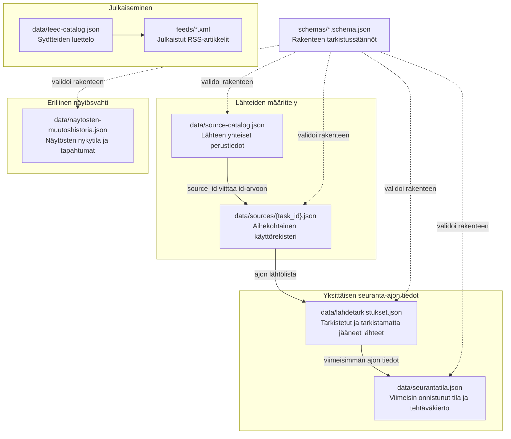
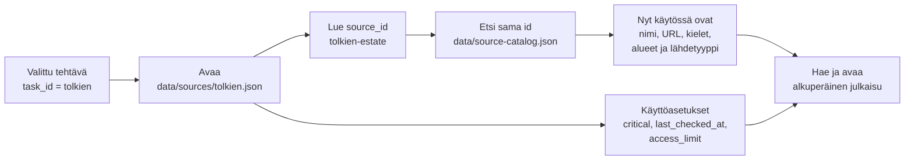
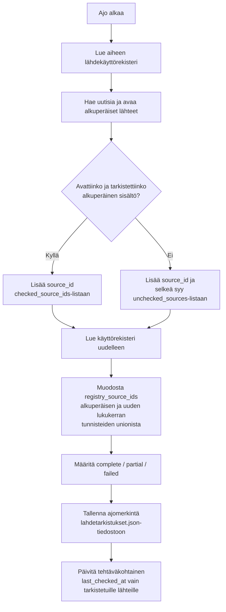
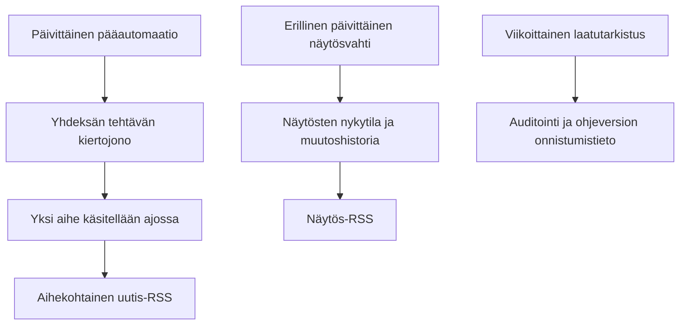
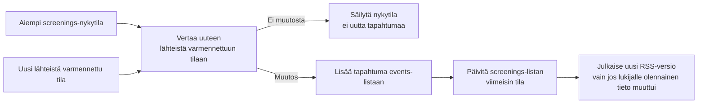

# Aiheseuraimen tietomallit ja prosessikaaviot

Tämä opas näyttää, miten Aiheseuraimen JSON-tiedostot liittyvät toisiinsa, mistä automaatio lukee tiedot, mihin se kirjoittaa tulokset ja mitä kukin tiedosto tarkoittaa. Opas on tarkoitettu myös lukijalle, joka ei tunne JSONia tai ohjelmointia.

**Tärkein periaate:** JSON-tiedostot eivät ole yksi suuri tietokanta. Jokaisella tiedostolla on oma rajattu tehtävänsä. Lähteen perustiedot tallennetaan kerran, aihekohtainen käyttö määritellään erikseen ja yksittäisen ajon toteutunut lähdekattavuus kirjataan omaan lokiinsa.

## 1. Kokonaiskuva yhdellä silmäyksellä

Aiheseuraimen koneelliset tiedot jakautuvat neljään ryhmään:

1. **Mitä seurataan?** Lähdekatalogi, aihekohtaiset lähdekäyttörekisterit ja RSS-syötekatalogi.
2. **Mitä yhdellä ajolla tapahtui?** Lähdetarkistusten ajoloki.
3. **Mikä on järjestelmän viimeisin tunnettu tila?** Seurantatila.
4. **Miten näytösvahti säilyttää muutokset?** Näytösten nykytila ja tapahtumahistoria.

Alla oleva kaavio näyttää tiedostojen väliset suhteet. Nuoli tarkoittaa, että toinen tiedosto käyttää toisen tietoja tai viittaa niihin. Se ei tarkoita, että tiedostot olisivat kopioita toisistaan.



Skeemat ovat siis sääntökirjoja. Ne eivät sisällä varsinaista seurantadataa.

## 2. Kolme eri asiaa, joita ei pidä sekoittaa

Lähteisiin liittyvät kolme JSON-tiedostotasoa vastaavat eri kysymyksiin:

| Tiedosto | Kysymys, johon se vastaa |
|---|---|
| `data/source-catalog.json` | Mikä tämä lähde on? |
| `data/sources/{task_id}.json` | Miksi ja miten tämä aihe käyttää lähdettä? |
| `data/lahdetarkistukset.json` | Tarkistettiinko lähde tällä nimenomaisella ajolla? |

Esimerkki: Tolkien-seurannassa käytetään Tolkien Estaten sivustoa.

- Lähdekatalogissa on Tolkien Estaten nimi, verkkosivu, kielet, alueet ja lähdetyyppi.
- Tolkienin käyttörekisterissä on viittaus tunnisteeseen `tolkien-estate`, tieto siitä että lähde on tälle tehtävälle kriittinen, sekä tehtäväkohtainen viimeisin tarkistusaika.
- Ajolokiin kirjataan, tarkistettiinko `tolkien-estate` juuri kyseisellä ajolla vai jäikö se tarkistamatta.

Yksi lähde voi olla monen aiheen käytössä. Siksi sen perustietoja ei kopioida jokaiseen aihekohtaiseen tiedostoon.

## 3. Yhteinen lähdekatalogi: mikä lähde on?

Tiedosto: [`data/source-catalog.json`](../data/source-catalog.json)  
Skeema: [`schemas/lahdekatalogi.schema.json`](../schemas/lahdekatalogi.schema.json)

Katalogi sisältää lähteen yhteiset perustiedot. Yksinkertaistettu esimerkki nykyisestä rakenteesta:

```json
{
  "id": "tolkien-estate",
  "name": "The Tolkien Estate",
  "url": "https://www.tolkienestate.com/",
  "language_regions": ["en"],
  "source_type": "primary",
  "regions": ["GLOBAL"]
}
```

Kenttien merkitys:

- `id`: pysyvä tekninen tunniste. Muiden tiedostojen viittaukset käyttävät tätä arvoa.
- `name`: ihmiselle näytettävä lähteen nimi.
- `url`: lähteen yleinen verkkosivu, ei välttämättä yksittäisen uutisen osoite.
- `language_regions`: kielet, joilla lähde julkaisee sisältöä.
- `source_type`: lähteen perustyyppi: `primary`, `editorial` tai `other`.
- `regions`: alueet, joita lähde kattaa.

**Tärkeä rajaus:** `source_type` ei ole A–D-luotettavuusluokitus. Se kertoo lähteen tyypin, ei sitä, kuinka vahvasti yksittäinen uutisväite on vahvistettu. Ehdotettu A–D-luokitus ja väitekohtaiset varmennustasot eivät ole vielä käytössä; niiden suunnittelu on erillisessä kehitystehtävässä #27.

## 4. Aihekohtainen lähdekäyttörekisteri: miten aihe käyttää lähdettä?

Esimerkkejä:
- [Tolkienin rekisteri](../data/sources/tolkien.json)
- [Intialaisen elokuvan uutisten rekisteri](../data/sources/intialaiset_elokuvat_uutiset.json)
- [Näytösvahdin rekisteri](../data/sources/intialaiset_elokuvat_naytokset.json)

Skeema: [`schemas/lahderekisteri.schema.json`](../schemas/lahderekisteri.schema.json)

Käyttörekisteri ei toista lähteen nimeä tai URL-osoitetta. Se viittaa katalogiin `source_id`-kentällä:

```json
{
  "source_id": "tolkien-estate",
  "critical": true,
  "last_checked_at": "2026-11-16T17:56:58+02:00",
  "access_limit": null
}
```

- `source_id`: viittaus yhteisen katalogin `id)-arvoon.
- `critical`: onko lähde tämän aiheen kattavuuden kannalta kriittinen. Tämä ei ole luotettavuusarvosana.
- `last_checked_at`: milloin lähde viimeksi tarkistettiin tämän tehtävän yhteydessä. `null) tarkoittaa, ettei tarkistusaikaa ole kirjattu.
- `access_limit`: käyttöä rajaava huomio, esimerkiksi sivuston esto tai se, että lähde toimii vain uutisvihjeenä.

Tehtäväkohtaisuus on tärkeää: jos sama sivusto tarkistetaan Tolkien- ja Muumi-seurannassa, Tolkien-rekisterin tarkistusaika ei automaattisesti päivitä Muumien rekisteriä.

### Miten automaatio löytää lähteen tiedot?



Käyttörekisteri on hakujen lähtölista, ei suljettu sallittujen lähteiden luettelo. Automaatio voi löytää uusia olennaisia lähteitä. Uusi lähde lisätään ensin yhteiseen katalogiin ja sen jälkeen oikean aiheen käyttörekisteriin.

## 5. Ajokohtainen lähdetarkistusloki: mitä oikeasti tarkistettiin?

Tiedosto: [`data/lahdetarkistukset.json`](../data/lahdetarkistukset.json)  
Skeema: [`schemas/lahdetarkistukset.schema.json`](../schemas/lahdetarkistukset.schema.json)

Tämä tiedosto vastaa eri kysymykseen kuin käyttörekisterin `last_checked_at): se kuvaa yksittäisen ajon lähdekattavuutta.

Yksinkertaistettu ote Tolkien-ajosta:

```json
{
  "run_id": "tolkien-20261116T175100-0200",
  "task_id": "tolkien",
  "status": "complete",
  "checked_source_ids": [
    "tolkien-estate",
    "harpercollins-tolkien"
  ],
  "unchecked_sources": [
    {
      "source_id": "tolkien-society",
      "reason": "Suora avaus palautti 403 Forbidden."
    }
  ],
  "coverage_notes": [
    "Hakutulosotteita ei merkitty tarkistetuiksi lähteiksi."
  ]
}
```

Tässä esimerkissä:

- `run_id) yksilöi yhden ajon.
- `task_id) kertoo, mitä aihetta ajo käsitteli.
- `status) kertoo lähdetarkistuksen kattavuuden: `complete), `partial) tai `failed).
- `checked_source_ids) sisältää lähteet, joiden alkuperäinen sisältö avattiin ja tarkistettiin.
- `unchecked_sources) sisältää lähteet, joita ei saatu tarkistettua, sekä syyn.
- `coverage_notes) selittää kattavuuteen vaikuttavia asioita, kuten kieli- tai aluepuutteita.

Uusissa lokimerkinnöissä `registry_source_ids) tallentaa kyseisen ajon lähderekisterin lähdejoukon. Se on ajon aikainen tilannekuva: jos rekisteriä myöhemmin muutetaan, vanhan ajon lähdejoukkoa ei päätellä uudelleen nykyisestä rekisteristä.

### Yhden ajon lähteiden käsittely



Tarkistamattomuuden syy on olennainen tieto. Esimerkiksi 403-esto ei tarkoita, että lähde olisi tarkistettu. Myöskään hakutuloskatkelma ei yksin riitä tarkistetuksi lähteeksi.

**Älä tulkitse lokin tilaa koko automaation julkaisutilaksi.** `complete), `partial) ja `failed) kuvaavat lähdetarkistuksen kattavuutta. Ne eivät yksin kerro, julkaistiinko RSS-artikkeli tai onnistuiko koko automaatio.

## 6. Seurantatila: mikä on viimeisin tunnettu järjestelmätila?

Tiedosto: [`data/seurantatila.json`](../data/seurantatila.json)  
Skeema: [`schemas/seurantatila.schema.json`](../schemas/seurantatila.schema.json)

Seurantatila on tiivis tilannekuva, ei kaikkien ajojen tapahtumaloki. Se sisältää esimerkiksi:

- `rotation.next_task`: seuraava aihekierroksen tehtävä.
- `rotation.tasks`: kunkin aiheen viimeisin tunnettu onnistuminen, seurantajakso, tulos, julkaistujen itemien määrä, tarkistettujen lähteiden määrä ja virheet.
- `separate_screening_watch`: erillisen päivittäisen näytösvahdin viimeisin tunnettu tila.
- `automation_instructions): pääautomaation ohjeversion tiedot.
- `quality_check_instructions): viikoittaisen laatutarkistuksen ohjeversion tiedot.
- `updated_at): koko seurantatiedoston viimeisin päivitysaika.

Esimerkki yhdestä tehtävästä:

```json
{
  "name": "J. R. R. Tolkien",
  "feed": "feeds/tolkien.xml",
  "last_successful_check": "2026-11-16T18:00:19+02:00",
  "last_period_start": null,
  "last_period_end": null,
  "last_result": "published",
  "published_items": 3,
  "sources_checked": 13,
  "errors": []
}
```

Tässä `last_successful_check) on onnistuneen tarkistuksen ajankohta. `last_period_start) ja `last_period_end) kuvaavat tarkasteltua uutisjaksoa; jos niiden arvo on `null), tarkkaa ajanjaksoa ei ole tallennettu. Älä täydennä puuttuvaa ajanjaksoa päättelemällä.

Seurantatila ei tällä hetkellä tallenna kaikkien löydettyjen uutisehdokkaiden määriä eikä jokaisen ajon julkaisemien GUIDien luetteloa. Näiden jäljitettävyys on tunnistettu jatkokehitykseksi (#55).

### Pääaihekierto ja näytösvahti ovat eri prosesseja



Näytösvahti ei kuluta aihekierroksen vuoroa. Intialaisen elokuvan uutisseuranta ja näytösseuranta käyttävät myös erillisiä lähdekäyttörekistereitä.

## 7. Näytöshistorian JSON: nykytila ja tapahtumat

Tiedosto: [`data/naytosten-muutoshistoria.json`](../data/naytosten-muutoshistoria.json)  
Skeema: [`schemas/naytosten-muutoshistoria.schema.json`](../schemas/naytosten-muutoshistoria.schema.json)  
Yksityiskohtainen ohje: [`docs/naytoshistorian-rakenne.md`](naytoshistorian-rakenne.md)

Näytöshistorian rakenne eroaa uutisseurannan tilatiedostoista:

- `screenings) sisältää kunkin tunnetun näytöksen viimeisimmän tilan.
- `events) sisältää tapahtumat, jotka selittävät, miten nykytilaan päädyttiin.
- Tapahtumaloki on append-only: vanhoja tapahtumia ei poisteta eikä muokata. Virhe korjataan lisäämällä uusi `correction)-tapahtuma.
- Näytöksen `screening_id) säilyy, vaikka näytösaika tai sali muuttuu.



Tapahtumaloki kertoo, mitä havaittiin ja milloin. RSS taas on lukijoille julkaistava sisältö. Ne eivät ole sama asia.

## 8. JSON Schema: mitä se tarkistaa ja mitä ei?

Jokaisella koneellisella tietomallilla on oma skeemansa:

| JSON-tiedosto | Skeema |
|---|---|
| `data/source-catalog.json` | `schemas/lahdekatalogi.schema.json` |
| `data/sources/*.json` | `schemas/lahderekisteri.schema.json` |
| `data/lahdetarkistukset.json` | `schemas/lahdetarkistukset.schema.json` |
| `data/seurantatila.json` | `schemas/seurantatila.schema.json` |
| `data/naytosten-muutoshistoria.json` | `schemas/naytosten-muutoshistoria.schema.json` |
| `data/feed-catalog.json` | RSS-lukijan ja syötevalidoinnin katalogirakenteen tarkistukset |

JSON Schema voi tarkistaa esimerkiksi, että:
- pakollinen kenttä on olemassa;
- päivämääräkenttä on oikean tyyppinen;
- `critical) on totuusarvo;
- `source_type) on jokin sallituista arvoista;
- tapahtuman tyyppi kuuluu sallittuun joukkoon.

JSON Schema ei voi todistaa, että:
- uutisen väite on totta;
- lähde todella tukee artikkelin väitettä;
- kaksi uutismediaa ovat toisistaan riippumattomia;
- lähderekisteri kattaa kaikki maailman olennaiset lähteet;
- automaatio on tehnyt hyvän toimituksellisen ratkaisun.

Näitä asioita arvioidaan automaation työohjeiden ja myöhemmin toteutettavien raporttikohtaisten laadunvarmistusten avulla.

## 9. Tunnisteet: miksi eri tiedostoissa on hieman eri nimet?

Tiedostojen tunnisteet ovat eri käyttötarkoituksiin. Älä päättele niitä pelkästään näyttönimestä:

- `data/seurantatila.json` käyttää kiertojonon yhdeksännen uutistehtävän avaimena historiallista nimeä `intialaiset_elokuvat`.
- Uutisten lähdekäyttörekisterin `task_id) on `intialaiset_elokuvat_uutiset`.
- Näytösvahdin lähdekäyttörekisterin `task_id) on `intialaiset_elokuvat_naytokset`.
- Ajolokin `task_id) käyttää lähderekistereissä määriteltyjä tehtävätunnisteita.

Tämä erottelu pitää uutisraportin ja näytösseurannan erillään, vaikka molemmat liittyvät intialaiseen elokuvaan. Kun lisäät tai muutat tehtäviä, tarkista aina kyseisen JSON-tiedoston oma skeema.

## 10. Mitä tiedostot eivät tällä hetkellä kerro?

On tärkeää tunnistaa myös rajat, jotta käyttöliittymä tai lukija ei päättele tietoa, jota ei ole tallennettu.

- **Lähteen A–D-luotettavuusluokitus:** ei vielä toteutettu. Nykyinen `source_type) on vain lähdetyyppi.
- **Uutisväitteiden varmennustaso rakenteisena kenttänä:** ei vielä kattavasti mallinnettu.
- **Kaikki löydetyt uutisehdokkaat ja niiden hylkäyssyyt:** eivät sisälly nykyiseen ajolokiin; kehitystiketti #55.
- **Jokaisen ajon julkaisemat GUIDit:** niitä ei tällä hetkellä tallenneta ajokohtaisena listana; kehitystiketti #55.
- **Automaation kaikki työvaiheet ja niiden aikaleimat:** eivät sisälly nykyisiin JSON-tiedostoihin. Viimeisin onnistuminen ei tarkoita, että uusi ajo olisi käynnissä.
- **Lähdekattavuuden yleinen prosenttiluku:** sitä ei pidä laskea ilman tarkasti määriteltyä nimittäjää. Tarkistettujen lähteiden määrä ei yksin kuvaa kieli-, alue- tai aihekatetta.

## 11. Suositeltu lukujärjestys

Jos haluat ymmärtää yhden aiheen lähteiden toimintaa, avaa nämä tässä järjestyksessä:

1. [Yhteinen lähdekatalogi](../data/source-catalog.json) – etsi lähteen `id).
2. [Tolkienin lähdekäyttörekisteri](../data/sources/tolkien.json) – etsi sama `source_id).
3. [Ajokohtainen lähdetarkistusloki](../data/lahdetarkistukset.json) – etsi kyseisen tehtävän viimeisin `run_id) ja tarkista, löytyykö lähde tarkistetuista vai tarkistamatta jääneistä.
4. [Lähdekatalogin skeema](../schemas/lahdekatalogi.schema.json) ja [käyttörekisterin skeema](../schemas/lahderekisteri.schema.json) – katso, mitä kenttiä tiedostoissa saa olla.

Jos haluat ymmärtää automaation tilan, avaa [seurantatila](../data/seurantatila.json) ja [sen skeema](../schemas/seurantatila.schema.json).

Aihekohtaiset toimitukselliset hakuperiaatteet ovat edelleen [lähdeohjeessa](lahteet.md). Tämä tekninen opas täydentää sitä; se ei korvaa aihekohtaisia lähdeohjeita eikä automaatioiden toimintakäsikirjoja.
